# Cách dùng sổ tay này

Sổ tay này đi theo một chiều duy nhất: **khái niệm trong slide môn DPL302m → khái niệm đó hiện ra thế nào trong đề tài của Nhóm 7**. Mỗi mục mở đầu bằng câu "slide nói gì" (có số slide), rồi chỉ ra đúng chỗ của nó trong dự án: tên hàm, tham số, giá trị, công thức. Sổ tay nền `t07-foundation-G7-VI-v3.pdf` (61 trang, viết tắt **FH3**) đi theo chiều ngược lại, từ bài báo và pipeline. Hai sổ tay bổ sung cho nhau. Khi cần chi tiết sâu, sổ tay này trỏ sang mục FH3 thay vì chép lại.

## Phương pháp sư phạm được dùng

1. **Cụ thể → Hình → Trừu tượng (Concrete → Pictorial → Abstract).** Mỗi khái niệm bắt đầu bằng một trường hợp nhỏ có số, rồi một hình, rồi mới đến công thức tổng quát.
2. **Ví dụ giải sẵn (worked examples, Sweller).** Mọi phép tính mẫu được giải trọn trước khi nêu quy tắc chung. Mọi con số do script `lab_bridge.py` tính và lưu ở `lab_output.txt`; mỗi ví dụ ghi khóa mục, ví dụ **[lab C6]**.
3. **Mã hóa kép (dual coding, Mayer).** Mỗi cơ chế chính có một hình đặt cạnh lời giải thích.
4. **Văn bản bác bỏ (refutation text).** Hộp *Bẫy hay nhầm* nêu một hiểu lầm cụ thể và vì sao nó sai. Chương 9 gom các bẫy của cả nhóm.
5. **Luyện truy xuất và ôn giãn cách (retrieval practice, spaced review; Dunlosky và cộng sự, 2013).** Cuối mỗi chương có câu hỏi tự kiểm tra; đáp án ở Phụ lục A, không đặt ngay dưới câu hỏi. Lịch ôn đề nghị: ngày 1 đọc chương 4–5; ngày 3 làm lại câu hỏi chương 4–5 không xem đáp án; ngày 7 đọc chương 6–8 và làm câu hỏi; ngày 14 làm chương 10 như một buổi bảo vệ thử.

## Nhãn nguồn

| Nhãn | Nghĩa |
|---|---|
| `[1.2 s010]` | deck 1.2 của DPL302m, slide 10 (lấy từ bản trích xuất slide) |
| `[DIG §n]` | digest dự án `t07-dl-digest-2026-10-11.md` (nguồn sự thật về dự án) |
| `[PROP §n]` | proposal `t07-c3-proposal-v2-EN.md` |
| `[CRIT §n]` | file phản biện `t07-critique-q2-2026-10-11.md` |
| `[FH3 mục, tr.n]` | sổ tay nền v3 |
| `[code: tệp:Ln]` | mã Ultralytics bản **8.4.174** (tag này trùng các snapshot dự án đã so byte [DIG §0.1]); tôi đọc lại nguồn chính thức `raw.githubusercontent.com/ultralytics/ultralytics/v8.4.174/...` ngày 2026-10-12 |
| `[lab Xn]` | mục trong `lab_output.txt`; công thức được **cài lại** bằng numpy/torch theo code đã đọc, không chạy Ultralytics |
| [tác giả báo cáo], [dự án đề xuất], [suy luận], [ước lượng], [chưa xác minh], [design] | giữ nguyên nghĩa như digest [DIG §0.2] |
| **giả lập** | dữ liệu tổng hợp trong lab, **không phải** kết quả dự án |

> [!IMPORTANT] Ba ràng buộc đọc trước
> (1) Dự án **chưa chạy thí nghiệm nào**; không con số AP nào trong sổ tay là kết quả của nhóm. (2) Mọi ví dụ số đều đến từ `lab_output.txt`. (3) Sổ tay không bàn venue hay tier của đề tài.

## Bản đồ: khái niệm slide → chương → chỗ trong code/pipeline

| Khái niệm trong slide | Chương | Chỗ trong dự án |
|---|---|---|
| Loss và cost [1.2 s010] | 4.1 | `v8OBBLoss.loss`: tổng chia cho $S$ (tổng nhãn mềm) |
| Hồi quy logistic, BCE [1.2 s008–s010]; đa nhãn [3.2 s047] | 4.2 | nhánh lớp: 8 sigmoid độc lập, BCE nhãn mềm |
| IoU [4.3 s026] | 4.3 | ProbIoU khi train; IoU đa giác khi chấm |
| Hồi quy hộp [4.3 s004] | 4.4 | DFL (YOLO11) hoặc L1 (YOLO26) |
| Gradient checking [2.1 s068] | 4.3 | kiểm gradient của $1-\mathrm{ProbIoU}$, unit test P1–P5 |
| Lưới YOLO, anchor box [4.3 s021, s036] | 3.5, 5.1 | điểm neo, TAL, STAL, OA-STAL v2 |
| Kích thước đầu ra conv [4.1 s038] | 3.2 | 800 → 100/50/25 → 13.125 điểm neo |
| ResNet, 1×1, depthwise [4.2] | 3.3 | Bottleneck, C3k2, `DWConv` ở head |
| Self-attention [5.4 s013] | 3.6 | `C2PSA` ở mức P5 |
| Epoch, iteration, mini-batch [2.2 s007] | 6.2 | 788 iteration/epoch, tích lũy tới `nbs = 64` |
| Momentum, Adam, LR decay, EWA [2.2] | 6.3–6.4 | SGD/AdamW/MuSGD, lịch tuyến tính, warmup, `ModelEMA` |
| Train/dev/test [2.1 s007; 3.1 s021–s032] | 2.3 | cắt 10% trainval làm dev; test chấm một lần |
| Precision/recall, metric một con số [3.1 s014–s019] | 7.1–7.2 | AP 101 điểm, $AP_{vt}$, $AP_t$ |
| Orthogonalization [3.1 s009] | 8.1 | mỗi nhánh A0–A7 đổi đúng một núm |
| Error analysis [3.2 s007] | 7.6 | AP theo lớp, bin, bố cục hàng xóm |

## Ký hiệu dùng xuyên suốt

| Ký hiệu | Nghĩa | Shape / đơn vị |
|---|---|---|
| $N$ | số điểm neo trên một ảnh (13.125 ở ảnh 800) | số nguyên |
| $C$ | số lớp, $C=8$ | số nguyên |
| $M$ | số hộp thật (ground truth, GT) trong ảnh | số nguyên |
| $z_{j,c}$, $\sigma(z_{j,c})$ | logit và xác suất lớp $c$ tại điểm neo $j$ | $(B, N, C)$ |
| $\hat s_{j,c}$ | nhãn mềm (soft target) do bộ gán nhãn tạo | $(B, N, C)$ |
| $\mathcal{P}$ | tập mẫu dương (positive sample), `fg_mask` | $(B, N)$ bool |
| $S$ | $\max(\sum_{j,c}\hat s_{j,c},\,1)$ | số thực |
| $g=(x,y,w,h,\theta)$ | hộp xoay, $w\ge h$ (cạnh dài) | pixel, radian |
| $\tilde R$ | vùng ứng viên (candidate region) | pixel |
| $s$ | stride của một mức: 8, 16, 32 | pixel |
| $t_{ij}=s^{\alpha}u^{\beta}$ | điểm căn chỉnh TAL (ở chương 5, $s$ là xác suất lớp, không phải stride) | số thực |

# 1. Dự án trong 2 trang

## 1.1 Bài toán

Đề tài #7 hỏi một câu hẹp: *vật thể tí hon có hướng (tiny oriented object) mất mẫu dương (positive sample), tức mất tín hiệu học, ở đâu trong các detector YOLO-OBB thời gian thực?* Dữ liệu là AI-TOD-R; mô hình là YOLO11-OBB và YOLO26-OBB của Ultralytics [DIG §1].

- AI-TOD-R có 28.036 ảnh 800×800 và 752.460 hộp xoay (OBB), 8 lớp; kích thước vật thể trung bình 10,6 ± 4,9 px [DIG §2.1, tác giả báo cáo].
- Tên đề tài còn hai bản ("Lose Their Positives" trong proposal md, "Lose Their Training Signal" trong bản nộp trường); việc chốt tên đang mở [DIG §1; issue #1].

## 1.2 Vì sao vật 10 px khó, nói bằng ngôn ngữ của slide

Slide 4.3 dạy YOLO bằng một lưới 3×3: vật thể được giao cho **ô chứa tâm của vật** [4.3 s036]. Như thế mọi vật đều có đúng một ô chịu trách nhiệm. YOLO11/26 làm ngược chiều: một **điểm neo (anchor point)**, tức tâm một ô lưới ở stride 8, 16 hoặc 32, chỉ trở thành ứng viên cho một GT khi **điểm neo nằm trong hộp GT** [code: tal\.py:L392–425; DIG §8.3]. Một hộp nhỏ hơn bước lưới có thể không chứa điểm neo nào. Khi đó GT không có mẫu dương, loss hộp và loss góc của nó bằng 0, và mạng không học được gì từ nó (Hình 1.1).

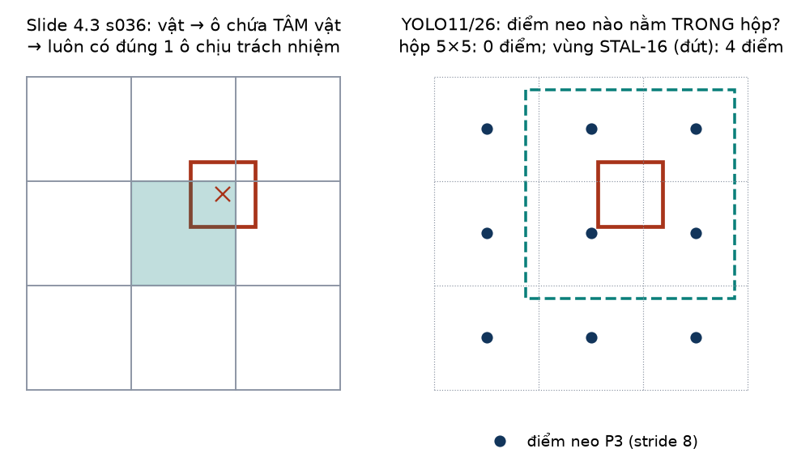

*Hình 1.1 — Trái: quy tắc của slide luôn cho một ô chịu trách nhiệm. Phải: quy tắc "điểm neo trong hộp" của YOLO11/26; hộp 5×5 không chứa điểm neo stride 8 nào; vùng phóng 16×16 kiểu STAL chứa 4 điểm.*

Ultralytics đã vá lỗi này bằng **STAL (Small-Target-Aware Label Assignment)**: phóng các cạnh nhỏ của GT lên 16 px, **chỉ ở bước chọn ứng viên** [DIG §5.2]. STAL mới được ablate trên COCO, hộp ngang, một lần chạy; quy tắc cho hộp xoay trong code đã đổi ba lần trong năm 2026 [DIG §1, §5.2].

## 1.3 Bốn câu hỏi nghiên cứu

| RQ | Nội dung rút gọn | Chương liên quan |
|---|---|---|
| RQ1 benchmark | YOLO11/26-OBB trên AI-TOD-R, chấm bằng evaluator chính thức `AITODReval`, theo bin kích thước và theo lớp, kèm baseline MMRotate tái lập | 6, 7 |
| RQ2 chẩn đoán | quy tắc vùng ứng viên (không sàn, STAL-8, STAL-16) thay đổi tỉ lệ GT rỗng, số ứng viên/mẫu dương mỗi GT, xung đột, vị trí mẫu dương thế nào; các đại lượng này có dự báo recall từng GT không | 5 |
| RQ3 can thiệp | OA-STAL v2 (vùng giữ hình dạng, cùng diện tích) có tăng $AP_t$/$AP_{vt}$ so với STAL-16 theo mẫu hình dự đoán trước không | 5, 7, 8 |
| RQ4 tổng quát | kết quả có chuyển sang dataset thứ hai, tỉ lệ với phần GT bị quy tắc tác động không | 2, 8 |

Nguồn: [PROP §5; DIG §1]. Giả thuyết trung tâm: **ngưỡng** (8 hay 16 px) quyết định *số* ứng viên; **hình dạng** vùng chỉ quyết định ứng viên *nằm ở đâu* và hàng xóm *tranh nhau* bao nhiêu [DIG §1].

## 1.4 Đang ở đâu (2026-10-12)

- **Chưa chạy thí nghiệm nào.** Proposal tự ghi "Not runnable as stated" cho tới khi qua Phase 0 (đăng ký xView, chạy được `AITODReval`, đo tốc độ trên Kaggle, kiểm converter) [DIG §1, §9.1].
- Repo có 21 issue và 10 milestone, tất cả đang mở [DIG §9.2]. `ROADMAP.md` trong repo vẫn ghi kế hoạch 14 tuần; quyết định nén vào 4 tuần (11/10 → 08/11/2026) chưa có trong repo [DIG §1; tôi kiểm lại `ROADMAP.md` ngày 2026-10-12].
- File phản biện ngày 11–12/10 đề xuất thêm nhánh **A8** (sàn phủ 11,3 px) và đặt `max_det` = 12.000 [CRIT §5.1, R9]. Đây là **đề xuất [design] của phản biện, nhóm chưa chốt**; sổ tay dùng A8 như một ví dụ áp dụng lý thuyết ở chương 5.

> [!NOTE] Một câu để nhớ
> Đề tài không đổi kiến trúc, không đổi loss, không đổi suy luận. Nó chỉ đổi **một bước** trong huấn luyện: điểm neo nào được tính là mẫu dương của GT nào. Muốn hiểu vì sao bước đó quyết định mọi thứ, phải hiểu loss (chương 4) trước rồi mới đến gán nhãn (chương 5).

> [!QUIZ]
> **Q1.** Theo slide 4.3, mỗi vật thể luôn có một ô lưới chịu trách nhiệm. Vì sao trong YOLO11/26 điều đó không còn đúng với vật 5×5 px?
>
> **Q2.** STAL thay đổi hộp GT ở những bước nào của huấn luyện, và giữ nguyên hộp GT ở những bước nào?

# 2. Dữ liệu và train/dev/test

## 2.1 Slide nói gì

- Dữ liệu chia thành **train** (để học), **dev/validation** (để chọn mô hình và chỉnh siêu tham số), **test** (để ước lượng không chệch hiệu năng cuối) [2.1 s006–s007; 3.1 s022]. Tỉ lệ cũ 60/20/20; thời dữ liệu lớn có thể 98/1/1 [2.1 s007; 3.1 s029].
- Dev và test phải **cùng phân phối** và phản ánh dữ liệu ta quan tâm [3.1 s023, s026]. Dev đủ lớn để "detect differences in algorithm/models you're trying out" [3.1 s031].
- Đặt **một chỉ số đánh giá một con số** trước khi bắt đầu dự án [3.1 s014]; khi có nhiều tiêu chí, chọn 1 chỉ số tối ưu (optimizing) và $N-1$ chỉ số thỏa mãn (satisficing) [3.1 s019].

## 2.2 AI-TOD-R bằng số

| Đại lượng | Giá trị | Nguồn |
|---|---|---|
| Ảnh | 28.036, mỗi ảnh 800×800 | [DIG §2.1], tác giả báo cáo |
| Hộp xoay | 752.460 | như trên |
| Mật độ trung bình | 752.460 / 28.036 = 26,84 vật/ảnh | [lab A1] |
| Kích thước | 10,6 ± 4,9 px | [DIG §2.1] |
| Nhãn | bán tự động: H2RBox-v2 sinh OBB từ HBB, rồi sửa tay | [DIG §2.1] |
| Số ảnh mỗi split | **không nêu** trong paper | [chưa xác minh] [DIG §2.3] |

Tổng số hộp theo 8 lớp cộng lại đúng 752.460 [lab A1]. Mất cân bằng rất mạnh: vehicle chiếm 88,10%, wind-mill 0,08%; vehicle nhiều gấp khoảng 1.049 lần wind-mill (Hình 2.1).

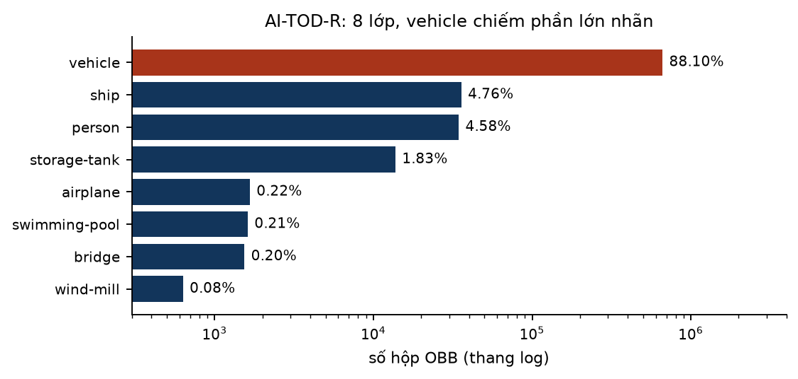

*Hình 2.1 — Phân bố lớp của AI-TOD-R (thang log). Số liệu: [DIG §2.1]; phần trăm tính ở [lab A1].*

> [!WARNING] "Mean 26,8 vật/ảnh" không mâu thuẫn với "có ảnh hơn 2.000 vật"
> Paper viết "most images featuring over 100 objects". Với trung bình 26,84 vật/ảnh, nhiều nhất khoảng 26,6% số ảnh có thể có ≥ 101 vật, nên câu "most images" không thể đúng [DIG §2.1, tính lại]. Nhưng câu "có ảnh hơn 2.000 vật" thì có thể đúng, và chính nó quyết định `max_det` ở chương 7.

> [!NOTE] Mất cân bằng lớp trong code
> Trọng số lớp `cls_pw` có trong code nhưng tắt mặc định (0,0) [code: default.yaml:L105]. Dự án không đổi loss, nên báo cáo AP theo lớp là cách duy nhất để thấy lớp hiếm [DIG §8.2].

## 2.3 Train/dev/test của dự án: vì sao phải tự cắt dev

Config chính thức của AI-TOD-R train trên `trainval`, còn **val và test cùng trỏ vào `labels_v1/test/`** [code: aitodr_cfg:L33–46; DIG §2.3]. Theo ngôn ngữ slide, nếu ta chọn checkpoint hay chỉnh tham số theo "val" này thì ta đang chỉnh trên test, và test mất vai trò ước lượng không chệch [2.1 s007; 3.1 s030].

Proposal sửa như sau [PROP §8.1; DIG §2.3]:

1. cắt **10% ảnh trainval** làm dev cố định (seed cố định), **tách theo cảnh nguồn** nếu tên file cho phép, nếu không thì theo hash ảnh;
2. mọi chỉnh tham số (kể cả bốn tham số của OA-STAL v2) chỉ trên dev;
3. test chấm **một lần cho mỗi nhánh cuối**;
4. thống kê nhãn của RQ2 tính trên trainval.

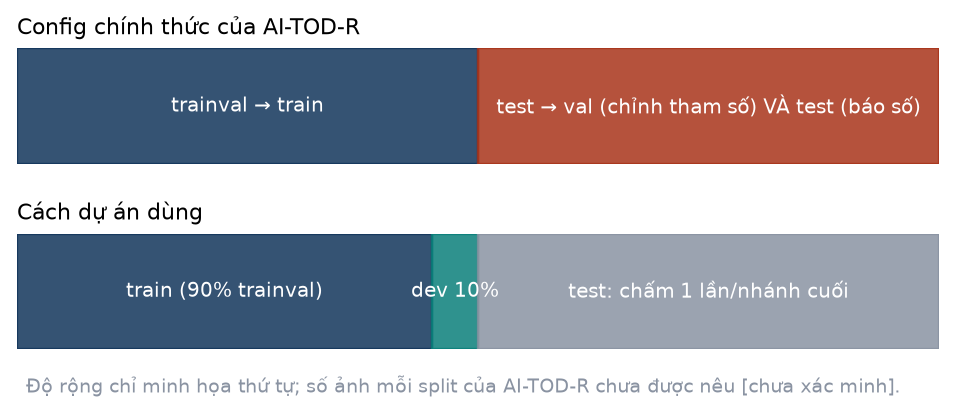

*Hình 2.2 — Trên: config chính thức dùng test cho cả hai vai. Dưới: cách dự án dùng. Độ rộng chỉ minh họa.*

> [!EXAMPLE] Vì sao "tách theo cảnh" chứ không "tách theo ảnh"? (giả lập)
> Ảnh AI-TOD được cắt từ các cảnh lớn; các ô cắt kề nhau gần như trùng nội dung. Lab tạo 30 cảnh × 4 ô = 120 ảnh giả. Cắt dev 10% **theo cảnh**: train 108, dev 12, **0** cảnh bị chia đôi. Cắt dev 10% **theo ảnh** (ngẫu nhiên): cũng 108/12 nhưng **10** cảnh có ô nằm cả ở train lẫn dev [lab A3]. Khi đó điểm dev bị thổi phồng vì mô hình đã "thấy" gần đúng ảnh đó lúc train. Đây là rò rỉ dữ liệu (data leakage), ngoài slide nhưng suy thẳng từ yêu cầu "dev phản ánh dữ liệu tương lai" [3.1 s026].

Năm điểm rò rỉ dự án đã liệt kê: dùng test làm val; ảnh gần trùng giữa train và dev; trọng số YOLO26-OBB phát hành được train trên DOTA mà AI-TOD dùng lại ảnh DOTA; đặt giả thuyết sau khi xem kết quả; dataset thứ hai trùng nguồn ảnh [DIG §8.2; QA Q12]. Vì điểm thứ ba, mọi hàng YOLO được báo cáo **khởi tạo từ trọng số COCO** [PROP §8.1].

## 2.4 Bin kích thước: một con số tóm tắt, nhưng tính theo diện tích

Evaluator chính thức xếp GT vào bin theo **diện tích** `int(w*h)` của hộp xoay [code: aitodr_eval\.py:L110, L741–745; DIG §2.2]:

| Bin | Diện tích (px²) | Cạnh tương đương $s_{eq}=\sqrt{wh}$ |
|---|---|---|
| very tiny ($AP_{vt}$) | [4, 64] | 2–8 px |
| tiny ($AP_t$) | [64, 256] | 8–16 px |
| small ($AP_s$) | [256, 1024] | 16–32 px |
| medium ($AP_m$) | [1024, 4096] | 32–64 px |

Không có bin "large"; GT lớn hơn $64^2$ chỉ được tính trong AP tổng [DIG §2.2]. Tỉ lệ bin của AI-TOD-R **chưa được đo**; tỉ lệ 73,4% ở bin tiny là của AI-TOD-v2 [DIG §2.2].

> [!WARNING] Bin tính theo diện tích, STAL kích hoạt theo từng cạnh
> Hộp 25×4 có diện tích 100, $s_{eq}=10$, nên thuộc bin **tiny**; nhưng cạnh 4 < 8 nên cả STAL-8 lẫn STAL-16 đều kích hoạt. Hộp 12×4 có diện tích 48, thuộc bin **very tiny**. Hộp 60×5 thuộc bin **small** nhưng STAL vẫn kích hoạt vì cạnh 5. Hộp 3×1,5 có diện tích 4 nên **vẫn được chấm** ở bin very tiny, trong khi loss bỏ mọi GT có cạnh < 2 px [lab A2; code: loss\.py:L1092–1093]. Nghĩa là có những GT bị loại khi train nhưng vẫn được tính khi chấm; số lượng trên AI-TOD-R [chưa xác minh] [DIG §4.3].

## 2.5 Metric một con số và metric thỏa mãn của dự án

- **Một con số tổng:** AP 0,50:0,95 của `AITODReval`. **So sánh chính** lại dùng hai con số $AP_t$ và $AP_{vt}$, cộng điều kiện mẫu hình dự đoán trước [DIG §8.2; PROP §8.6]. Đây là lựa chọn có chủ ý: bài toán là vật tí hon, nên chỉ số phải nhìn vào hai bin đó, đúng tinh thần "đổi metric khi metric cũ không xếp hạng đúng điều ta quan tâm" [3.1 s035, s038].
- **Satisficing:** chi phí suy luận không đổi, vì OA-STAL chỉ dùng khi train (thuộc tính P6) [PROP §7.1]. Tham số, FLOPs, latency được báo nhưng **không có ngưỡng FPS nào được khai báo** [DIG §8.2]. Nếu muốn đúng khuôn của slide 3.1 s019 (ví dụ "running time < 100 ms"), nhóm cần tự đặt ngưỡng đó.

## 2.6 Dataset thứ hai và lệch phân phối

Slide 3.2 bàn về train và test khác phân phối [3.2 s021–s030]. Trong dự án, có hai chỗ như vậy [DIG §2.6, §8.2]:

1. pretrain trên COCO (YOLO26: Objects365 rồi COCO) là ảnh thường; fine-tune trên ảnh hàng không;
2. RQ4 dùng SODA-A (chính) hoặc DOTA-v2.0 (dự phòng). Giao thức gốc của SODA-A phóng ô 800×800 lên 1200×1200, nên nhiều vật vượt ngưỡng 8/16 px; phải báo tỉ lệ GT bị quy tắc kích hoạt ở kích thước đầu vào thật [DIG §2.6].

> [!QUIZ]
> **Q3.** Config chính thức của AI-TOD-R dùng thư mục nào cho val? Nếu nhóm chọn checkpoint tốt nhất theo val đó rồi báo AP trên test, sai ở chỗ nào theo slide 2.1/3.1?
>
> **Q4.** Một hộp 60×5 px thuộc bin nào? STAL-8 có kích hoạt không? Hộp có bị loss loại không?
>
> **Q5.** Vì sao cắt dev theo cảnh lại quan trọng với AI-TOD? Trong ví dụ giả lập, cắt theo ảnh làm bao nhiêu cảnh bị chia đôi?
>
> **Q6.** Trong dự án, đâu là optimizing metric, đâu là satisficing metric? Satisficing metric hiện còn thiếu gì?

# 3. Mô hình như một CNN

## 3.1 Khung chung: backbone → neck → head

Slide 4.1 xây CNN từ ba loại tầng: conv, pooling, fully connected [4.1 s064]; slide 1.4 nói càng sâu thì đặc trưng càng trừu tượng [1.4 s014–s018]. YOLO11/26-OBB giữ đúng tinh thần đó nhưng bỏ tầng fully connected:

- **Xương sống (backbone)**: chuỗi conv trích đặc trưng; **cổ (neck)**: upsample, nối kênh (concat) và conv để trộn bản đồ đặc trưng nhiều mức; **đầu (head)**: biến đặc trưng tại từng vị trí lưới thành điểm lớp, tham số hộp và góc [DIG §3.1].
- Đầu ra ở ba mức P3/8, P4/16, P5/32, tức **stride 8, 16, 32** [code: yolo26-obb.yaml:L22–52].
- Khối `Conv` = `Conv2d(bias=False)` + `BatchNorm2d` + **SiLU** [code: conv\.py:L58–76]. Thân mạng không dùng ReLU, tanh hay sigmoid; sigmoid chỉ có ở đầu ra lớp [DIG §8.1].

## 3.2 Kích thước đầu ra: công thức của slide tính ra 13.125 điểm neo

Slide 4.1 cho công thức [4.1 s038, s060]:

$$
n_H^{[l]}=\left\lfloor\frac{n_H^{[l-1]}+2p^{[l]}-f^{[l]}}{s^{[l]}}\right\rfloor+1
$$

Backbone có năm `Conv` 3×3 bước 2, padding kiểu "same" ($p=1$ khi $f=3$) [code: conv\.py:L74; yolo26-obb.yaml:L22–30].

> [!EXAMPLE] Từ 800 đến 25
> Với $n=800$, $f=3$, $p=1$, $s=2$: $\lfloor(800+2-3)/2\rfloor+1=400$. Lặp năm lần: 400 → 200 → 100 → 50 → 25. Chạy năm `nn.Conv2d(·,·,3,2,1)` trên tensor $1\times3\times800\times800$ cho đúng các shape (400, 400), (200, 200), (100, 100), (50, 50), (25, 25) [lab B1].
>
> Head dùng P3, P4, P5: lưới 100×100, 50×50, 25×25, tức 10.000 + 2.500 + 625 = **13.125 điểm neo**. Ở ảnh 640 là 6.400 + 1.600 + 400 = 8.400 [lab B1].

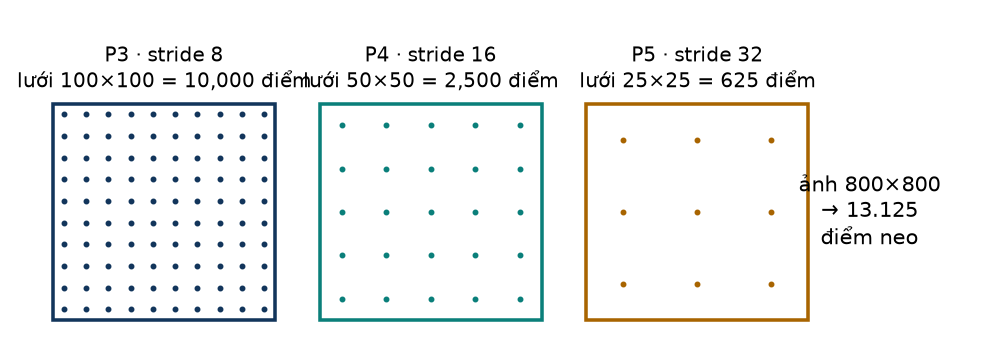

*Hình 3.1 — Ba mức dự đoán ở ảnh 800. Số chấm vẽ không theo đúng tỉ lệ số lượng.*

Mỗi điểm neo là tâm một ô lưới, $((j+0{,}5)s,\ (i+0{,}5)s)$, sinh bởi `make_anchors` theo đơn vị lưới rồi nhân stride [code: tal\.py:L428–454]. Một vật 10 px chỉ rộng hơn một ô P3 một chút và nhỏ hơn một ô P4.

## 3.3 Residual, CSP, 1×1 và depthwise: các khối của slide 4.2 trong YOLO

| Slide 4.2 | Trong YOLO11/26 | Nguồn |
|---|---|---|
| Residual block $a^{[l+2]}=g(z^{[l+2]}+a^{[l]})$ [4.2 s021] | `Bottleneck`: `x + cv2(cv1(x))` khi số kênh vào bằng ra; `PSABlock`: `x + attn(x)` rồi `x + ffn(x)` | [code: block\.py:L460–482, L1382–1383] |
| Tích chập 1×1 đổi số kênh [4.2 s030–s035] | `cv1`/`cv2` 1×1 trong C2f/C3k2/C2PSA/SPPF; lớp cuối mỗi nhánh head là `Conv2d` 1×1 | [code: block\.py; head\.py:L124–138] |
| Inception: nhiều nhánh rồi concat [4.2 s038] | không dùng; `SPPF` nối kết quả max-pool k=5 lặp ba lần, gần tinh thần "nhiều tầm rồi concat" | [code: block\.py:L211–240], [suy luận] |
| Depthwise separable [4.2 s048–s080] | nhánh lớp của head: `DWConv` 3×3 rồi `Conv` 1×1, hai lần | [code: head\.py:L127–138] |
| EfficientNet compound scaling [4.2 s093] | size n/s định bởi `[depth, width, max_channels]`: n = [0,50; 0,25; 1024], s = [0,50; 0,50; 1024] | [code: yolo26-obb.yaml:L11–17] |
| CSP (*ngoài slide*) | `C2f`/`C3k2` tách kênh làm hai, một nửa qua chuỗi Bottleneck, nối lại, trộn bằng 1×1 | [code: block\.py:L291–322] |

> [!EXAMPLE] Đếm tham số một khối Conv như slide 4.1 s059
> Slide: 10 bộ lọc 3×3×3 có $(27+1)\times10=280$ tham số [4.1 s059]. Với Conv 3×3 từ 64 lên 128 kênh, công thức slide (có bias) cho $(3\cdot3\cdot64+1)\cdot128=73.856$. Khối `Conv` của Ultralytics **bỏ bias** vì BatchNorm đã có $\beta$: trọng số conv 73.728, cộng $\gamma,\beta$ của BN là 256, tổng 73.984 tham số học được [lab B2]. Đây đúng là chỗ slide 2.3 nói BN có tham số $\gamma,\beta$ riêng [2.3 s020–s023].

> [!EXAMPLE] Depthwise rẻ hơn bao nhiêu (minh họa, số kênh giả định)
> Ở P3 (100×100), nếu một tầng đổi 64 → 64 kênh: conv 3×3 thường cần 368.640.000 phép nhân; depthwise cộng pointwise cần 46.720.000; tỉ lệ 0,127, khớp xấp xỉ $1/n_c'+1/f^2=1/64+1/9=0{,}127$ của slide [lab B2; 4.2 s080]. Số kênh 64 chỉ để minh họa, không phải số kênh thật của head.

## 3.4 Đầu ra tại mỗi điểm neo: vector $y$ của slide, phiên bản OBB

Slide 4.3 định nghĩa nhãn đích cho mỗi ô: $y=[p_c, b_x, b_y, b_h, b_w, c_1, c_2, c_3]^\top$ [4.3 s007]. Head của YOLO11/26-OBB xuất tại mỗi điểm neo:

| Thành phần | Slide 4.3 | YOLO11-OBB | YOLO26-OBB |
|---|---|---|---|
| Có vật không | $p_c$ | **không có kênh riêng**: cả 8 xác suất lớp thấp nghĩa là nền | như trái |
| Lớp | $c_1..c_3$ (softmax) | 8 logit, **sigmoid độc lập** | như trái |
| Hộp | $b_x,b_y,b_h,b_w$ | 4 khoảng cách $(l,t,r,b)$, mỗi cái là phân phối 16 bin (DFL) → 64 logit | 4 số thực (`reg_max = 1`) |
| Góc | không có | 1 logit, $\hat\theta=(\sigma(z)-0{,}25)\pi$ | 1 số thô $\hat\theta=z$ |
| Số kênh mỗi điểm neo | 8 | 64 + 8 + 1 = 73 | 4 + 8 + 1 = 13 (mỗi nhánh) |

Nguồn: [code: head\.py:L121–139, L217, L529, L558–568; DIG §3.3]. Góc của YOLO11 nằm trong $(-\pi/4,\ 3\pi/4)$. Một ảnh 800 cho 13.125 × 73 = 958.125 số với YOLO11 và 170.625 số cho mỗi nhánh của YOLO26, so với 3×3×16 = 144 số của ví dụ YOLO trên slide [lab B1; 4.3 s042].

Giải mã hộp xoay: tâm lệch $((r-l)/2,\ (b-t)/2)$ được quay theo $\hat\theta$ rồi cộng điểm neo; $w=l+r$, $h=t+b$; nhân stride để ra pixel [code: tal\.py:L497–515].

> [!NOTE] Quy ước góc: đã kiểm trong code
> Digest ghi "[chưa xác minh]" cách data loader đổi 4 đỉnh thành $(x,y,w,h,\theta)$ [DIG §2.5]. Tôi đã kiểm: bước `Format` gọi `xyxyxyxy2xywhr` [code: augment\.py:L2484]; hàm này dùng `cv2.minAreaRect` rồi **đổi chỗ để $w$ luôn là cạnh dài** và đưa góc về $[-\pi/4,\ 3\pi/4)$ [code: ops\.py:L383–413]. Mọi GT vào assigner theo quy ước cạnh dài, khớp miền góc của head YOLO11 và quy ước của paper YOLO26 [DIG §3.3]. Giả định "$w\ge h$" trong bản phác thảo OA-STAL v2 [PROP §7.3] được code bảo đảm.

> [!NOTE] Khởi tạo bias: "Random initialization" của slide, phiên bản detection
> Slide khuyên khởi tạo trọng số ngẫu nhiên nhỏ để phá đối xứng [1.3 s052–s054]. Ở head, bias lớp được đặt theo xác suất tiên nghiệm $b=\ln\big(5/C/(640/s)^2\big)$ [code: head\.py:L229–241]. Với $C=8$: $b=-9{,}234$ ở stride 8 ($\sigma(b)=0{,}000098$), $-7{,}848$ ở stride 16, $-6{,}461$ ở stride 32. BCE của một điểm nền lúc khởi tạo chỉ 0,000098 ở stride 8 [lab B4]. Mạng bắt đầu từ "mọi nơi là nền", nên hàng trăm nghìn điểm âm không làm loss bùng nổ ở bước đầu.

## 3.5 Anchor-based (slide) và anchor-free (dự án)

Slide 4.3 dùng **anchor box**: mỗi ô có vài hộp mẫu với hình dạng định sẵn (cao, rộng); vật được giao cho ô chứa tâm **và** hộp mẫu có IoU cao nhất [4.3 s034–s036]. YOLO11/26 là **anchor-free** theo nghĩa không có hộp mẫu, nhưng vẫn có lưới điểm neo và vẫn phải gán nhãn [DIG §3.1]. Ba điểm khác cần nhớ:

1. **Chiều gán đảo ngược.** Slide: từ vật đi tìm ô (luôn tìm được). Dự án: từ điểm neo hỏi "tôi có nằm trong vật không" (có thể không điểm nào trả lời có). Đây chính là bài toán của đề tài (Hình 1.1).
2. **Một vật có thể có nhiều mẫu dương.** TAL chọn tới `topk = 10` điểm neo mỗi GT ở nhánh one-to-many [code: loss\.py:L1044–1051].
3. **"Overlapping objects" của slide 4.3 s035** (người đứng trước xe, cùng một ô) tương ứng với **xung đột**: một điểm neo nằm trong vùng của nhiều GT. Code giao điểm đó cho GT có ProbIoU lớn nhất với dự đoán của nó [code: tal\.py:L365–371]. Baseline RetinaNet-O của MMRotate thì vẫn là anchor-based [DIG §8.3].

## 3.6 NMS (slide) và YOLO26 "end-to-end"

Slide: bỏ hộp $p_c\le0{,}6$, rồi lặp "giữ hộp điểm cao nhất, xóa hộp có IoU ≥ 0,5 với nó", chạy riêng cho từng lớp [4.3 s032, s043].

- **YOLO11-OBB:** đầu one-to-many cộng NMS ngoài, ngưỡng IoU mặc định 0,7, tối đa `max_det = 300` [code: default.yaml:L56–57].
- **YOLO26-OBB:** paper nói đường mặc định là đầu one-to-one **không cần NMS**; code 8.4.174 với `nms: None` vẫn dùng NMS ngoài, phải đặt `nms=False` mới chọn đầu NMS-free [DIG §3.4]. Mỗi run phải ghi chế độ suy luận.
- Đường NMS-free vẫn có bước chọn top-k theo điểm, $k=\min(\texttt{max\_det},N)$, nên `max_det` vẫn quyết định số phát hiện tối đa (chương 7) [code: head\.py:L249–288].
- Chữ "end-to-end" của YOLO26 **khác nghĩa** với "end-to-end deep learning" của slide 3.2 (bỏ pipeline thủ công) [3.2 s051; DIG §8.2].

## 3.7 Attention trong YOLO: slide 5.3–5.4 ở mức P5

Slide 5.4 định nghĩa $\mathrm{Attention}(Q,K,V)=\mathrm{softmax}\big(QK^\top/\sqrt{d_k}\big)V$, và multi-head attention là nhiều "đầu" chạy song song rồi nối lại [5.4 s013, s016]. Trong YOLO, các "từ" là **vị trí không gian** của bản đồ đặc trưng:

- `C2PSA` (cuối backbone, mức P5) và `C3k2(attn=True)` (neck P5 của YOLO26): q, k, v sinh bằng 1×1 conv; số đầu `max(c // 64, 1)`; kèm FFN và residual [code: block\.py:L1069–1106, L1442–1495].
- Thay cho positional encoding sin/cos của slide 5.4 s019, `Attention` của Ultralytics cộng một depthwise conv 3×3 trên v (`pe`) [code: block\.py:L1271–1335].

> [!EXAMPLE] Vì sao attention chỉ đặt ở P5
> Ma trận attention có kích thước (số vị trí)². Ở P5 (25×25 = 625 vị trí) là 390.625 phần tử, 1,5 MiB fp32 mỗi đầu mỗi ảnh. Ở P3 (100×100 = 10.000 vị trí) là 100.000.000 phần tử, 381,5 MiB mỗi đầu [lab B3]. Đây là chi phí bậc hai mà slide 5.3 s040 nhắc tới. Với YOLO26n-OBB, `C2PSA` có `self.c` = 128 nên có 2 đầu; YOLO26s-OBB có 256 nên 4 đầu [lab B3, tính lại từ code: block\.py:L1477–1481].

> [!TIP] Hệ quả cho vật tí hon
> Attention nhìn toàn ảnh nhưng ở độ phân giải 32 px/ô. Một vật 10 px chiếm chưa tới một phần mười diện tích một ô P5. Thông tin của vật tí hon chủ yếu nằm ở P3; attention P5 chỉ giúp gián tiếp qua ngữ cảnh mà neck đưa xuống [suy luận].

> [!QUIZ]
> **Q7.** Dùng công thức kích thước đầu ra của slide 4.1, tính số điểm neo của ảnh 640.
>
> **Q8.** Vector $y$ của slide 4.3 có $p_c$. Head YOLO11/26 không có kênh $p_c$. Vậy một điểm neo "nền" được biểu diễn thế nào?
>
> **Q9.** Vì sao `Conv` của Ultralytics đặt `bias=False`? Nối câu trả lời với công thức BN của slide 2.3.
>
> **Q10.** "Anchor-free" có nghĩa là không cần gán nhãn không? Giải thích bằng tình huống "overlapping objects" của slide 4.3 s035.

# 4. Loss function: từ slide đến dự án

Chương này đi từ hàm mất mát của hồi quy logistic trong slide 1.2 tới bốn thành phần của `v8OBBLoss`. Mọi công thức của dự án dưới đây đã được đọc trong code 8.4.174 [DIG §4; code: loss\.py:L1035–1207] và được cài lại trong lab để lấy số.

## 4.1 Loss và cost: slide nói gì, dự án làm gì

Slide 1.2 phân biệt rõ [1.2 s010]:

- **hàm mất mát (loss)** $\mathcal{L}(\hat y,y)$ đo sai số trên **một** mẫu;
- **hàm chi phí (cost)** là **trung bình** loss trên cả tập: $J(w,b)=\frac{1}{m}\sum_{i=1}^{m}\mathcal{L}(\hat y^{(i)},y^{(i)})$.

> [!EXAMPLE] Bốn mẫu của slide
> BCE với $y=1$: $\hat y=0{,}9$ cho 0,1054; $\hat y=0{,}5$ cho 0,6931; $\hat y=0{,}1$ cho 2,3026. Với $y=0$, $\hat y=0{,}2$ cho 0,2231. Cost của bốn mẫu là trung bình 0,8311 [lab C1].

Trong dự án, "một mẫu" không phải là một ảnh. Có ba mức:

| Mức | Slide | Dự án |
|---|---|---|
| phần tử nhỏ nhất | một ảnh, một nhãn $y$ | một cặp (điểm neo $j$, lớp $c$) cho BCE; một mẫu dương $j\in\mathcal{P}$ cho hộp và góc |
| chuẩn hóa | chia cho $m$ | chia cho $S=\max(\sum_{j,c}\hat s_{j,c},1)$, **không** chia cho số điểm neo |
| tổng | $J$ | $B\cdot(7{,}5\,\mathcal{L}_{box}+0{,}5\,\mathcal{L}_{cls}+1{,}5\,\mathcal{L}_{dist}+1{,}0\,\mathcal{L}_{ang})$ |

Nguồn: [code: loss\.py:L1121–1156; DIG §4.1, §4.3]. Phần còn lại của chương giải thích từng ô của bảng này.

## 4.2 Phân loại: từ BCE của logistic regression đến BCE nhãn mềm cho 8 lớp

### Mỗi kênh lớp là một bộ hồi quy logistic

Slide: $\hat y=\sigma(w^\top x+b)$ và $\mathcal{L}=-\big(y\log\hat y+(1-y)\log(1-\hat y)\big)$ [1.2 s008–s010]. Head YOLO tại điểm neo $j$ xuất logit $z_{j,c}$ cho từng lớp $c$; xác suất là $\sigma(z_{j,c})$. Ảnh 800 có 13.125 × 8 = **105.000 bộ phân loại nhị phân** chạy song song [lab B1].

Loss phân loại của dự án [code: loss\.py:L358, L1125–1128]:

$$
\begin{aligned}
\mathcal{L}_{cls}=\frac{1}{S}\sum_{j=1}^{N}\sum_{c=1}^{C}\Big[&-\hat s_{j,c}\log\sigma(z_{j,c})\\
&-(1-\hat s_{j,c})\log\big(1-\sigma(z_{j,c})\big)\Big]
\end{aligned}
$$

Ba khác biệt so với slide:

1. **Đích là nhãn mềm** $\hat s_{j,c}\in[0,1]$ chứ không phải 0/1. Nó khác 0 chỉ ở lớp của GT và chỉ tại điểm neo dương; giá trị tỉ lệ với chất lượng ghép (chương 5) [DIG §4.1].
2. **Tính trên mọi điểm neo**, cả dương lẫn âm. Điểm âm có đích 0 ở cả 8 lớp [DIG §4.6].
3. **Chia cho $S$**, tổng nhãn mềm của cả ảnh.

> [!EXAMPLE] Nhãn mềm làm cực tiểu dịch khỏi $p=1$
> Với đích $\hat s=0{,}62$: BCE bằng 0,8820 tại $p=0{,}30$; **0,6641 tại $p=0{,}62$**; 0,9403 tại $p=0{,}90$; 1,7562 tại $p=0{,}99$. Cực tiểu nằm ở $p=\hat s$ và bằng entropy $H(0{,}62)=0{,}6641$, không bao giờ về 0 [lab C2]. Mạng bị phạt nếu tự tin quá mức ở một điểm neo ghép kém.

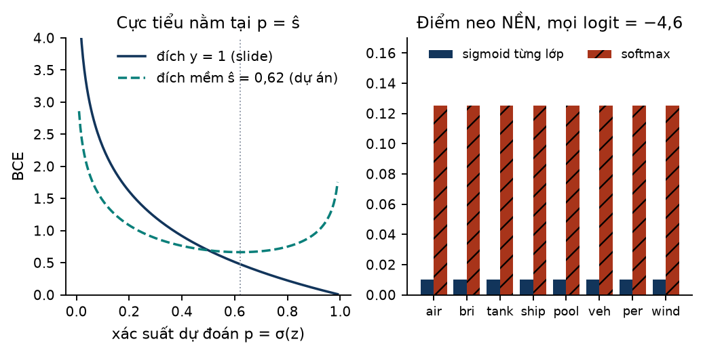

*Hình 4.1 — Trái: BCE với đích cứng (slide) và đích mềm (dự án). Phải: một điểm neo nền với 8 logit bằng −4,6; sigmoid cho mỗi lớp 0,0100, softmax buộc mỗi lớp 0,1250 [lab C3].*

### Vì sao sigmoid từng lớp, không softmax

Slide 2.3 dùng softmax cho phân loại nhiều lớp: các xác suất cộng lại bằng 1 [2.3 s031–s035]. Slide 3.2 lại cho một trường hợp khác: nhận diện nhiều nhãn không loại trừ nhau (người đi bộ, xe, biển STOP, đèn) dùng **tổng BCE của từng nhãn** [3.2 s047]. Head YOLO đi theo slide 3.2, vì hai lý do:

- **Không có lớp nền.** Phần lớn trong 13.125 điểm neo là nền. Với softmax, 8 xác suất buộc phải cộng lại bằng 1, nên một điểm nền với mọi logit bằng −4,6 vẫn có 0,1250 cho mỗi lớp; sigmoid cho 0,0100 mỗi lớp, tổng 0,0796 [lab C3]. Muốn dùng softmax phải thêm một lớp "nền" thứ chín, giống softmax(4) có lớp background của slide 4.3 s006.
- **Nhãn mềm là một số trong $[0,1]$ cho đúng một lớp**, không phải phân phối trên các lớp. BCE từng lớp nhận đích này trực tiếp.

> [!WARNING] "Loss phân loại chỉ tính trên vật thể"
> Sai. $\mathcal{L}_{cls}$ tính trên **mọi** điểm neo × mọi lớp. Chỉ ba thành phần còn lại (hộp, khoảng cách, góc) mới giới hạn trên mẫu dương [DIG §4.6]. Mục 4.8 kiểm chuyện này bằng gradient.

### Vì sao chia cho $S$ mà không chia cho $N\cdot C$

> [!EXAMPLE] Một ảnh giả lập: ai chiếm $\mathcal{L}_{cls}$?
> Giả lập 40 mẫu dương với nhãn mềm ngẫu nhiên trong [0,1; 0,6], tổng $S=14{,}029$ [lab C4].
> - Nếu điểm nền dự đoán $p=0{,}005$: tổng BCE của điểm âm là 526,12, của điểm dương 27,56; $\mathcal{L}_{cls}=553{,}67/14{,}029=39{,}467$. Nếu chia cho $N\cdot C=105.000$ thì chỉ còn 0,00527.
> - Nếu điểm nền dự đoán $p=0{,}0001$: điểm âm còn 10,50, $\mathcal{L}_{cls}=2{,}713$.
> - Nếu chất lượng ghép kém đi, nhãn mềm giảm một nửa: $S=7{,}014$ và $\mathcal{L}_{cls}=78{,}086$ với cùng dự đoán.

Hai bài học. (1) Với hàng trăm nghìn phần tử âm, chia cho $N\cdot C$ sẽ làm loss gần bằng 0 bất kể mạng học tốt hay không; chia cho $S$ giữ thang đo theo "số vật thể hiệu dụng". (2) Vì $S$ là tổng nhãn mềm, **tập mẫu dương và chất lượng ghép thay đổi thang của cả bốn thành phần loss**, kể cả phần BCE của điểm âm [DIG §4.6, suy luận từ code]. Đó là lý do một thay đổi chỉ ở bộ gán nhãn (đề tài) vẫn đổi giá trị loss.

## 4.3 Hộp: IoU của slide → IoU xoay → ProbIoU

### IoU của slide và độ nhạy với vật tí hon

Slide: $\mathrm{IoU}=\text{Area of Overlap}/\text{Area of Union}$, đúng nếu $\mathrm{IoU}\ge0{,}5$ [4.3 s026].

> [!EXAMPLE] Lệch 1 pixel
> Hộp 4×4 lệch 1 px: IoU = 0,6000; lệch 2 px: 0,3333. Hộp 10×10 lệch 1 px: 0,8182. Hộp 40×40 lệch 1 px: 0,9512 [lab C5]. Cùng một sai số tuyệt đối, vật tí hon mất gần nửa IoU.

Khi chấm, `AITODReval` dùng **IoU đa giác của hộp xoay** (`mmcv.ops.box_iou_rotated`) [code: aitodr_eval\.py:L236; DIG §7.1]. Lab cài lại IoU đa giác bằng thuật toán cắt Sutherland–Hodgman.

### ProbIoU: biến hộp thành Gaussian

IoU đa giác có đạo hàm không trơn ở các cạnh và khó tính theo lô. Khi train, Ultralytics dùng **ProbIoU** [code: metrics\.py:L218–285]. Mỗi hộp $(x,y,w,h,\theta)$ thành một Gaussian 2 chiều có tâm $(x,y)$ và hiệp phương sai

$$
\Sigma=R(\theta)\begin{pmatrix} w^2/12+\epsilon_f & 0\\ 0 & h^2/12+\epsilon_f\end{pmatrix}R(\theta)^{\top}
$$

($w^2/12$ là phương sai của phân phối đều trên đoạn dài $w$). Khoảng cách Bhattacharyya giữa hai Gaussian, với $\bar\Sigma=(\Sigma_1+\Sigma_2)/2$ và $\Delta=\mu_1-\mu_2$, là

$$
B_D=\frac{1}{8}\Delta^\top\bar\Sigma^{-1}\Delta+\frac{1}{2}\ln\frac{\det\bar\Sigma}{\sqrt{\det\Sigma_1\det\Sigma_2}}
$$

Code tính đúng biểu thức này dưới dạng ba số hạng `t1 + t2 + t3`, chặn $B_D$ trong $[10^{-7},100]$, rồi [code: metrics\.py:L265–276]

$$
\mathrm{ProbIoU}=1-\sqrt{1-e^{-B_D}},\qquad \mathcal{L}_{box}=\frac{1}{S}\sum_{j\in\mathcal{P}}w_j\Big(1-\mathrm{ProbIoU}\big(\hat b_j,g_{a(j)}\big)\Big)
$$

với $w_j=\sum_c\hat s_{j,c}$ là trọng số của mẫu dương $j$ [code: loss\.py:L222–246].

> [!EXAMPLE] ProbIoU và IoU đa giác trên cùng các cặp hộp
> - Hai hộp giống hệt nhau 10×10: IoU đa giác 1,0000, ProbIoU 0,99955. ProbIoU không bao giờ đúng bằng 1 vì $B_D$ bị chặn dưới bởi $10^{-7}$ [lab C6].
> - Hộp 12×4 xoay lệch 10°: IoU 0,7658, ProbIoU 0,8395; lệch 45°: 0,3084 và 0,4781.
> - Hộp **vuông** 10×10 xoay lệch 45°: IoU 0,7071 nhưng **ProbIoU 0,9996**; lệch 20°: IoU 0,7802, ProbIoU vẫn 0,9996.
> - Hộp A = (20; 20; 12; 4; 30°) và B = (21; 19,5; 11; 4,5; 40°): IoU đa giác 0,5873, ProbIoU 0,6856, nên $1-\mathrm{ProbIoU}=0{,}3144$ [lab C6].

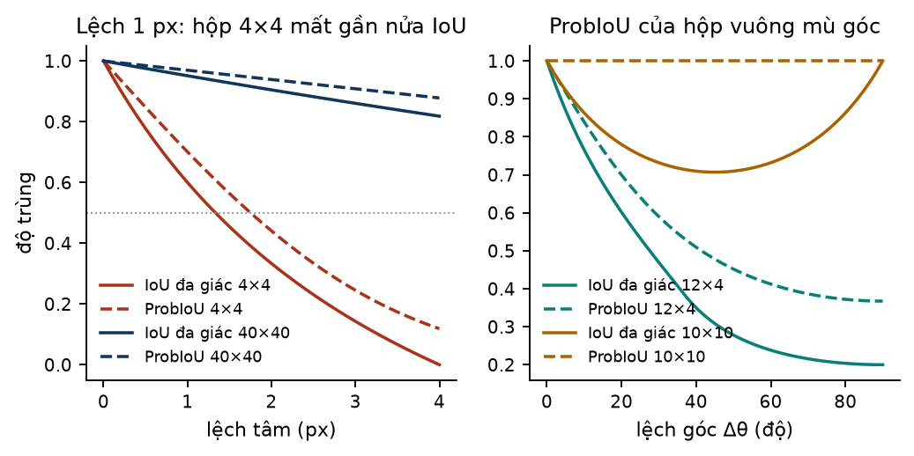

*Hình 4.2 — Trái: lệch tâm; đường liền là IoU đa giác, đường đứt là ProbIoU. Phải: lệch góc; với hộp vuông 10×10, ProbIoU gần như phẳng [lab C6].*

> [!IMPORTANT] Hai hệ quả của ProbIoU cho đề tài
> (1) Với hộp gần vuông, Gaussian gần đẳng hướng nên **ProbIoU mù góc**; tín hiệu học góc phải đến từ angle loss (mục 4.5) [DIG §4.2; Y26 tr.9]. (2) ProbIoU khi train **không phải** IoU khi chấm: cùng một dự đoán có thể được loss coi là tốt (ProbIoU 0,70 với hộp 4×4 lệch 1 px) nhưng chỉ đạt IoU 0,60 khi chấm [lab C6].

### Sàn $\epsilon_f$ và gradient checking của slide 2.1

Trong loss, hộp dự đoán và hộp đích tính theo **đơn vị lưới**: đích được chia cho stride của điểm neo [code: loss\.py:L1132]. Hộp 4×4 px ở stride 8 chỉ còn 0,5×0,5 đơn vị, phương sai $w^2/12=0{,}02083$. Code cộng $\epsilon_f=0{,}01$ vào phương sai "để chặn gradient cho hộp nhỏ hơn stride" [code: loss\.py:L225; metrics\.py:L224].

> [!EXAMPLE] Sàn làm gì với hộp 4×4 lệch 2 px (0,25 đơn vị lưới)
> Không sàn: ProbIoU 0,4408, độ lớn gradient theo tâm $x$ là 1,8437. Có sàn 0,01: ProbIoU 0,5269, gradient 1,6628 [lab C7]. Sàn tăng phương sai gần một nửa (0,01 so với 0,02083) với hộp cỡ này, nên nó làm mềm loss đúng ở vùng của đề tài.

Slide 2.1 dạy **gradient checking**: so gradient giải tích với gradient số $\big(f(\theta+\epsilon)-f(\theta-\epsilon)\big)/2\epsilon$ và tính độ chênh tương đối [2.1 s064–s070]. Lab làm đúng thủ tục đó cho $1-\mathrm{ProbIoU}$ cài lại: `torch.autograd.gradcheck` trả `True`; gradient giải tích và gradient số (với $\epsilon=10^{-7}$) trùng tới 4 chữ số, độ chênh tương đối $3{,}38\times10^{-10}$, dưới ngưỡng $10^{-7}$ của slide [lab C7; 2.1 s069].

> [!TIP] Gradient checking trong dự án là "kiểm trước khi tin"
> Ultralytics dùng autograd nên dự án không cần gradient checking cho mạng [DIG §8.2]. Tinh thần của nó xuất hiện ở chỗ khác: unit test P1–P5 cho hàm `surrogate` phải viết **trước** mọi lần train [issue #6; PROP §7.3]. Nếu nhóm tự viết hàm loss hay metric mới, gradcheck như trên là cách rẻ nhất để bắt lỗi.

## 4.4 Hồi quy khoảng cách: từ squared error của slide đến DFL và L1

Slide 4.3 nói định vị dùng hồi quy với squared error loss [4.3 s004, s064]. YOLO11/26 hồi quy **4 khoảng cách** $(l,t,r,b)$ từ điểm neo tới bốn cạnh hộp, đo trong hệ trục đã quay theo góc của GT [code: tal\.py:L518–554].

### YOLO11-OBB: Distribution Focal Loss (DFL)

Mỗi khoảng cách là một **phân phối** trên 16 bin $\{0,1,\dots,15\}$ (đơn vị lưới); giá trị giải mã là kỳ vọng $\sum_k k\,p(k)$ [code: loss\.py:L1171–1173]. Đích $d$ (bị chặn trong $[0;\ 14{,}99]$) được chia cho hai bin kề nhau [code: loss\.py:L89–108, L249–254]:

$$
\begin{aligned}
\mathcal{L}_{dfl}=\frac{1}{S}\sum_{j\in\mathcal{P}}\frac{w_j}{4}\sum_{k\in\{l,t,r,b\}}\Big[&-\big(\lfloor d_k\rfloor+1-d_k\big)\log p_{j,k}\big(\lfloor d_k\rfloor\big)\\
&-\big(d_k-\lfloor d_k\rfloor\big)\log p_{j,k}\big(\lfloor d_k\rfloor+1\big)\Big]
\end{aligned}
$$

> [!EXAMPLE] DFL với $d=3{,}7$
> Hai bin 3 và 4 nhận trọng số 0,30 và 0,70 [lab C8].
> - Phân phối lý tưởng $p(3)=0{,}3$, $p(4)=0{,}7$: DFL = 0,6109 và giải mã $\sum_k k\,p(k)=3{,}7000$.
> - Phân phối đỉnh $p(4)=0{,}9$ (phần còn lại chia đều): DFL = 1,5769, giải mã 4,3733.
> - Phân phối đều: DFL = $\ln16$ = 2,7726, giải mã 7,5.
>
> Như BCE nhãn mềm, DFL có cực tiểu khác 0 (0,6109 ở đây): nó là cross-entropy với một đích "hai nóng".

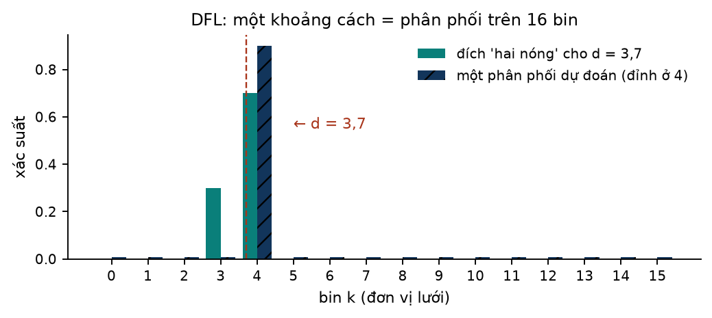

*Hình 4.3 — DFL biểu diễn một khoảng cách bằng phân phối trên 16 bin. Cột xanh lục: đích cho $d=3{,}7$; cột xanh đậm: một dự đoán có đỉnh lệch sang bin 4 [lab C8].*

Hai giới hạn của phép chặn $[0;\ 14{,}99]$ [lab C8]:

- **cận trên**: khoảng cách lớn nhất biểu diễn được là 119,9 px ở stride 8, 239,8 px ở stride 16, 479,7 px ở stride 32; không ảnh hưởng vật tí hon;
- **cận dưới 0**: đích âm $-0{,}8$ bị chặn về 0. Đích âm xuất hiện khi điểm neo dương nằm **ngoài** hộp thật, điều mà STAL và OA-STAL tạo ra thường xuyên (chương 5).

Với vật tí hon, khoảng cách rất nhỏ: điểm neo ở tâm một hộp 4×4 px, stride 8, có $d=2/8=0{,}25$ đơn vị lưới ở cả bốn phía, nên toàn bộ khối lượng xác suất dồn vào bin 0 và 1 [lab C8].

### YOLO26-OBB: L1 trên khoảng cách đã chuẩn hóa

YOLO26 bỏ DFL (`reg_max = 1`): mỗi khoảng cách là một số thực. Loss là L1 sau khi nhân stride và chia cho kích thước ảnh [code: loss\.py:L255–266]:

$$
\mathcal{L}_{l1}=\frac{1}{S}\sum_{j\in\mathcal{P}}\frac{w_j}{4}\sum_{k\in\{l,t,r,b\}}\left|\frac{s_j\,(\hat d_{j,k}-d_{j,k})}{I_k}\right|
$$

với $s_j$ là stride của điểm neo, $I_k$ là chiều rộng ảnh (cho $l,r$) hoặc chiều cao (cho $t,b$). Trường `dfl` trong config vẫn giữ tên cũ nhưng "now scales the L1 regression loss gain" [Y26 tr.22; DIG §4.2].

> [!EXAMPLE] Cùng sai số, khác stride
> Sai 0,5 đơn vị lưới ở stride 8, ảnh 800: $|0{,}5\cdot8/800|=0{,}0050$ mỗi cạnh. Cùng sai số đó ở stride 32 cho 0,0200, lớn gấp 4. Đích âm $-0{,}8$ được **giữ nguyên**: dự đoán 0,2 cho $|0{,}2-(-0{,}8)|\cdot8/800=0{,}0100$ [lab C9].

> [!WARNING] Cùng một quy tắc gán nhãn, hai model nhận đích khác nhau
> Nhánh L1 gọi `rbox2dist` không truyền `reg_max`, nên đích âm được giữ; nhánh DFL chặn về 0 [code: loss\.py:L250–256; tal\.py:L551–552]. Khi STAL-16 hay OA-STAL v2 chọn điểm neo ngoài hộp thật, YOLO26 học đích đúng, còn YOLO11 học một đích bị méo. Tác động của cùng một quy tắc vùng ứng viên vì vậy có thể khác nhau giữa hai model [DIG §4.7, suy luận].

## 4.5 Góc: $\sin^2(2\Delta\theta)$ có trọng số theo tỉ lệ cạnh

Slide không có góc. Code 8.4.174 thêm vào `v8OBBLoss` [code: loss\.py:L1176–1205; Y26 tr.9 Eq.14–15]:

$$
\begin{aligned}
\mathcal{L}_{ang}&=\frac{1}{S}\sum_{j\in\mathcal{P}}w_j\,\omega_j\,\sin^2\!\big(2\,\Delta\tilde\theta_j\big),\qquad
\omega_j=\exp\!\Big(-\frac{\ln^2(w_j/h_j)}{\lambda^2}\Big),\quad \lambda=3\\
\Delta\tilde\theta_j&=\Delta\theta_j-\mathrm{round}\big(\Delta\theta_j/\pi\big)\,\pi
\end{aligned}
$$

với $w_j,h_j$ là kích thước hộp đích.

> [!EXAMPLE] Hai nhân tử của angle loss
> $\sin^2(2\Delta)$: 0 tại 0°, 0,25 tại 15°, 0,75 tại 30°, **1 tại 45°**, 0,75 tại 60°, **0 tại 90°**; 135° được quấn về −45° nên cho 1; 180° quấn về 0 [lab C10].
> $\omega$ theo tỉ lệ cạnh $r=w/h$: $r=1$: 1,0000; $r=2$: 0,9480; $r=4$: 0,8077; $r=8$: 0,6185; $r=16$: 0,4256 [lab C10].

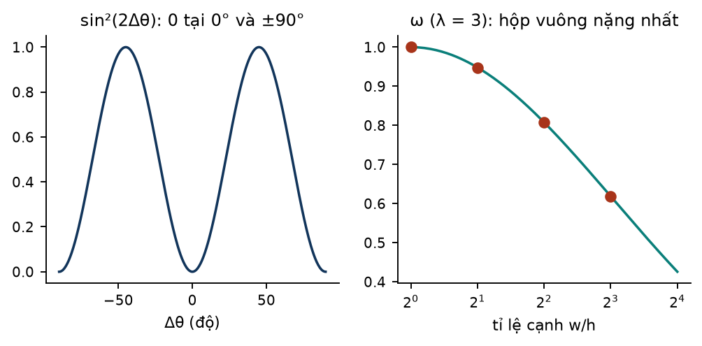

*Hình 4.4 — Trái: $\sin^2(2\Delta\theta)$ không phân biệt 0° với 90°. Phải: $\omega$ lớn nhất ở hộp vuông [lab C10].*

Đọc ngược hai hình: hộp **vuông** được trọng số góc lớn nhất, đúng ở chỗ ProbIoU mù góc (mục 4.3); hộp **dài** dựa nhiều hơn vào ProbIoU vốn đã nhạy góc [Y26 tr.9; DIG §4.2]. $\sin^2(2\Delta)$ bằng 0 ở 90° vì hộp xoay 90° chỉ là hoán đổi $w,h$; với hộp vuông thì hai hướng là một.

> [!WARNING] "Angle loss là của YOLO26"
> Paper trình bày Eq.15 như một phần của YOLO26. Nhưng trong 8.4.174, `calculate_angle_loss` nằm trong `v8OBBLoss`, nên **YOLO11-OBB train bằng bản này cũng có angle loss** (gain 1,0) [code: loss\.py:L1145–1154; DIG §4.2]. "YOLO11-OBB" của dự án là kiến trúc YOLO11 với mã huấn luyện 8.4.174, không phải YOLO11-OBB như bản phát hành gốc [DIG §4.5].

## 4.6 Tổng loss của một nhánh, tính bằng tay một lần

$$
\begin{aligned}
\mathcal{L}_{branch}=B\cdot\big(&7{,}5\,\mathcal{L}_{box}+0{,}5\,\mathcal{L}_{cls}\\
&+1{,}5\,\mathcal{L}_{dist}+1{,}0\,\mathcal{L}_{ang}\big)
\end{aligned}
$$

Trọng số `box=7.5`, `cls=0.5`, `dfl=1.5`, `angle=1.0` [code: default.yaml:L103–110]; $\mathcal{L}_{dist}$ là DFL (YOLO11) hoặc L1 (YOLO26); $B$ là số ảnh trong batch [code: loss\.py:L1156].

> [!EXAMPLE] Một ảnh đồ chơi, cài lại toàn bộ (dự đoán giả lập)
> Lab dựng ảnh 128×128 (336 điểm neo: 16² + 8² + 4²) với 5 GT: ship 12×4 xoay 30°, vehicle 5×5, storage-tank 10×10, và hai vehicle 5×3 đứng cạnh nhau cách 2 px. Logit lớp bằng bias khởi tạo thật cộng 3 cộng nhiễu chuẩn; khoảng cách và góc ngẫu nhiên. Assigner TAL xoay và `v8OBBLoss` (nhánh L1 của YOLO26) được cài lại theo code [lab D6].
>
> Với quy tắc STAL-16 (A2): 23 mẫu dương, $S=2{,}3627$, $\mathcal{L}_{box}=0{,}5015$, $\mathcal{L}_{cls}=13{,}3232$, $\mathcal{L}_{l1}=0{,}02582$, $\mathcal{L}_{ang}=0{,}6160$. Tổng với $B=1$:
>
> $7{,}5\times0{,}5015+0{,}5\times13{,}3232+1{,}5\times0{,}02582+1{,}0\times0{,}6160=11{,}0779$ [lab D6].
>
> Ở trạng thái gần khởi tạo này, phần phân loại chiếm hơn một nửa tổng (0,5 × 13,3232 = 6,66). Đó là điều mục 4.2 dự báo: hàng trăm điểm âm cộng lại, chia cho một $S$ nhỏ.

## 4.7 YOLO26: hai nhánh và Progressive Loss theo epoch

YOLO26 có hai đầu dùng chung backbone: **one-to-many (o2m)** với `tal_topk = 10` và **one-to-one (o2o)** với `tal_topk = 7` rồi `topk2 = 1`, tức tối đa 1 mẫu dương mỗi GT [code: loss\.py:L1327–1328]. Tổng loss [code: loss\.py:L1322–1354]:

$$
\begin{aligned}
\mathcal{L}_{total}&=\alpha(e)\,\mathcal{L}^{o2m}_{branch}+\big(1-\alpha(e)\big)\,\mathcal{L}^{o2o}_{branch}\\
\alpha(e)&=0{,}1+0{,}7\cdot\max\!\Big(1-\frac{e}{E-1},\ 0\Big)
\end{aligned}
$$

với $e$ là số epoch đã xong, $E$ là tổng số epoch; `criterion.update()` chạy một lần mỗi epoch [code: trainer\.py:L639].

> [!EXAMPLE] $\alpha(e)$ qua các epoch
> $E=100$: $\alpha$ = 0,800 (e = 0); 0,623 (25); 0,446 (50); 0,270 (75); 0,100 (99). $E=24$: 0,800; 0,617 (6); 0,435 (12); 0,252 (18); 0,100 (23). $E=12$: 0,800; 0,609 (3); 0,418 (6); 0,227 (9); 0,100 (11) [lab C11].
>
> Trên ảnh đồ chơi, nhánh o2o với cùng dự đoán chỉ giữ 5 mẫu dương (1 mỗi GT), cho tổng 11,2934. Ở $e=0$: $0{,}80\times11{,}0779+0{,}20\times11{,}2934=11{,}1210$; ở $e=99$: $0{,}10\times11{,}0779+0{,}90\times11{,}2934=11{,}2718$ [lab D6].

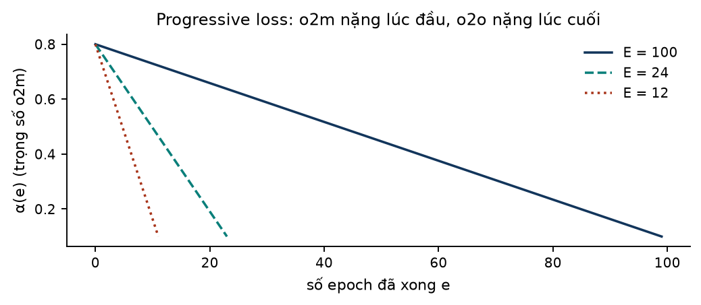

*Hình 4.5 — Lịch trọng số o2m. Với lịch ngắn, $\alpha$ đi hết từ 0,8 xuống 0,1 trong ít epoch hơn nhiều [lab C11].*

> [!WARNING] Hai bẫy khi đọc log YOLO26
> (1) Giá trị loss in ra khi train là của **nhánh o2o**, không phải tổng có trọng số [code: loss\.py:L1344]. (2) Đầu o2o nhận đặc trưng đã `detach`: "detach keeps one2one out of the backbone" [code: head\.py:L196]. Backbone/neck chỉ nhận gradient từ nhánh o2m. Theo ngôn ngữ đồ thị tính toán của slide 1.2 [1.2 s025–s031], đường lan truyền ngược từ $\mathcal{L}^{o2o}$ bị cắt tại đầu vào của head o2o.

## 4.8 Loss tính trên mẫu nào: kiểm bằng gradient

| Thành phần | Tính trên | Trọng số |
|---|---|---|
| $\mathcal{L}_{cls}$ | mọi điểm neo × mọi lớp | đích $\hat s$ (0 ở điểm âm) |
| $\mathcal{L}_{box}$, $\mathcal{L}_{dist}$, $\mathcal{L}_{ang}$ | chỉ $j\in\mathcal{P}$ | $w_j=\sum_c\hat s_{j,c}$ |

Nguồn: [code: loss\.py:L244–246, L1131–1147; DIG §4.6]. Lab kiểm trên ảnh đồ chơi (A2): số điểm neo có gradient khác 0 là **336/336** với $\mathcal{L}_{cls}$, nhưng chỉ **23/336** với $\mathcal{L}_{box}$, $\mathcal{L}_{l1}$ và $\mathcal{L}_{ang}$, đúng bằng số mẫu dương [lab D6].

Bộ gán nhãn chạy trong `@torch.no_grad()` trên dự đoán đã `detach` [code: tal\.py:L63; loss\.py:L1109–1119]. Không có gradient nào đi qua phép top-k; bộ gán nhãn chỉ **quyết định** gradient đi vào những điểm neo nào.

> [!IMPORTANT] Cầu nối sang chương 5
> Ba trong bốn thành phần loss chỉ "nhìn thấy" mẫu dương. Một GT không có mẫu dương thì đóng góp 0 vào $\mathcal{L}_{box}$, $\mathcal{L}_{dist}$, $\mathcal{L}_{ang}$, và chỉ còn xuất hiện gián tiếp như vùng mà mọi điểm neo bị dạy là nền. OA-STAL v2 **không đổi công thức loss nào** ở trên; nó chỉ đổi tập $\mathcal{P}$ [DIG §4.7; PROP §7.1]. Vì vậy câu hỏi "chọn mẫu dương thế nào" chính là câu hỏi "loss nhìn vào đâu".

> [!QUIZ]
> **Q11.** Vì sao BCE với nhãn mềm $\hat s=0{,}62$ không bao giờ bằng 0? Giá trị nhỏ nhất bằng bao nhiêu?
>
> **Q12.** Nêu hai lý do head dùng sigmoid từng lớp thay vì softmax. Slide nào trong DPL302m đã dùng đúng dạng loss này?
>
> **Q13.** Hộp vuông 10×10 xoay lệch 45°: IoU đa giác và ProbIoU bằng bao nhiêu? Thành phần loss nào bù cho điểm yếu này?
>
> **Q14.** Với cùng một điểm neo dương nằm ngoài hộp thật, đích khoảng cách của YOLO11 và YOLO26 khác nhau thế nào?
>
> **Q15.** Trong YOLO26, loss in ra trong log là của nhánh nào? Backbone nhận gradient từ nhánh nào?

# 5. Gán nhãn mẫu dương: trái tim của đề tài

## 5.1 Vì sao loss cần biết "ai chịu trách nhiệm"

Để tính BCE của slide 1.2, ta cần biết nhãn $y$ của từng mẫu. Ở detection, mỗi điểm neo cần được nói: "bạn học GT số mấy, hay bạn là nền". Slide 4.3 trả lời bằng một quy tắc hình học cố định: vật được giao cho **ô chứa tâm** của nó và **anchor box có IoU cao nhất** với nó [4.3 s036]. Bộ gán nhãn của YOLO11/26 phức tạp hơn ở hai điểm: nó cho phép nhiều mẫu dương mỗi GT, và nó dùng **chính dự đoán hiện tại của mạng** để xếp hạng ứng viên. Chương 4 đã cho thấy hệ quả: tập $\mathcal{P}$ quyết định ba trong bốn thành phần loss và cả mẫu số $S$.

## 5.2 TAL trong năm bước

TAL (Task-Aligned Assigner) đến từ TOOD; bản Ultralytics cho hộp xoay là `RotatedTaskAlignedAssigner` [DIG §5.1; code: tal\.py:L158–204, L384–425]. Với mỗi GT $i$:

1. **Mặt nạ ứng viên (candidate mask).** Điểm neo $j$ là ứng viên nếu tâm của nó nằm trong vùng $\tilde R_i$ (bằng hộp thật ở TAL gốc). Phép kiểm dùng hai tích vô hướng với hai cạnh của hộp xoay, có tính biên [code: tal\.py:L411–425]. **Đây là chỗ duy nhất STAL và OA-STAL can thiệp.**
2. **Điểm căn chỉnh (alignment metric)** cho ứng viên, dùng **hộp thật**:

$$
t_{ij}=s_{j,c_i}^{\ \alpha}\cdot u_{ij}^{\ \beta},\qquad \alpha=0{,}5,\quad \beta=6
$$

   với $s_{j,c_i}$ là xác suất (đã `detach`) điểm $j$ gán cho **đúng lớp** của GT, $u_{ij}$ là ProbIoU giữa GT và hộp dự đoán của $j$, chặn dưới 0 [code: tal\.py:L206–234, L388–390]. Giá trị α, β do `v8OBBLoss` truyền vào; mặc định của constructor (`topk=13`, `alpha=1.0`) **không** được dùng [code: loss\.py:L1044–1051; tal\.py:L31–40].
3. **Top-k theo GT**: giữ `topk` điểm có $t$ lớn nhất (10 ở nhánh o2m); mẫu dương = top-k ∩ ứng viên [code: tal\.py:L200–202, L248–275].
4. **Giải xung đột**: điểm neo dương của ≥ 2 GT được giữ cho GT có ProbIoU lớn nhất với dự đoán của nó; nhánh o2o sau đó giữ `topk2 = 1` điểm mỗi GT [code: tal\.py:L350–382].
5. **Đích và nhãn mềm**: hộp và lớp lấy từ GT gốc; nhãn mềm chuẩn hóa theo từng GT [code: tal\.py:L169–176]:

$$
\hat s_{j,c_i}=\frac{t_{ij}\cdot\max_{k\in\mathcal{P}_i}u_{ik}}{\max_{k\in\mathcal{P}_i}t_{ik}+\varepsilon},\qquad j\in\mathcal{P}_i
$$

> [!EXAMPLE] $\beta=6$ nghĩa là định vị lấn át phân loại
> $s=0{,}9$, $u=0{,}5$ cho $t=0{,}01482$; $s=0{,}1$, $u=0{,}9$ cho $t=0{,}16806$, lớn hơn 11 lần dù điểm lớp thấp hơn 9 lần. $s=0{,}5$: $u=0{,}7$ cho 0,08319, còn $u=0{,}35$ cho 0,00130 [lab D1].
>
> Nhãn mềm: hai mẫu dương có $t=(0{,}02;\ 0{,}01)$, $u=(0{,}5;\ 0{,}4)$ cho $\hat s=(0{,}5;\ 0{,}25)$ [lab D1; FH3 B2 tr.22]. Mẫu tốt nhất nhận đúng $\max u=0{,}5$, mẫu kia nhận tỉ lệ theo $t$.

> [!TIP] Hệ quả cho vật tí hon: top-k gần như không lọc
> Vùng 16×16 có trung bình 5,25 ứng viên (mục 5.4), ít hơn `topk` = 10. Vậy ở nhánh o2m, gần như **mọi ứng viên có $t>0$ đều thành mẫu dương**; chất lượng chỉ đi vào qua nhãn mềm [DIG §5.1]. Với vật tí hon, **mặt nạ ứng viên ở bước 1 gần như quyết định trọn tập dương**. Đó là lý do đề tài tập trung vào bước 1.

## 5.3 STAL: phóng cạnh nhỏ, chỉ khi chọn ứng viên

**Paper YOLO26** [Y26 tr.7–8; DIG §5.2]: mỗi cạnh $d\in\{w,h\}$ của GT được thay độc lập, chỉ trong mặt nạ ứng viên:

$$
\tilde d=\begin{cases} s_{ref}, & d<s_{min}\\ d, & d\ge s_{min}\end{cases}\qquad s_{min}=8,\quad s_{ref}=16
$$

Hộp gốc vẫn dùng cho điểm căn chỉnh, đích hồi quy và nhãn [Y26 tr.8]. **Code 8.4.174** dùng cùng một số `stride_val = stride[1]` = 16 cho cả ngưỡng và kích thước thay thế, trên bản `clone`, giữ nguyên góc [code: tal\.py:L58–59, L403–409]. Lịch sử quy tắc OBB [DIG §5.2; RESCAN §B.2]:

| Bản Ultralytics | Quy tắc cho GT xoay | Tên trong dự án |
|---|---|---|
| ≤ 8.4.7 | không có sàn | TAL (A0) |
| 8.4.8 – 8.4.38 | cạnh < 8 → 16, sửa **tại chỗ** trên GT (lỗi) | — |
| 8.4.39 – 8.4.127 | cạnh < 8 → 16 trên bản clone (= paper) | STAL-8 (A1) |
| ≥ 8.4.128 (gồm 8.4.174) | cạnh **< 16** → 16 trên bản clone | STAL-16 (A2) |

> [!WARNING] Thêm đầu P2 là âm thầm đổi STAL
> Vì `stride_val = stride[1]`, thêm mức P2 (stride [4, 8, 16, 32]) làm sàn STAL thành 8 [code: tal\.py:L59; RESCAN §B.2]. Đây là lý do tham số của OA-STAL v2 được viết tường minh, không phụ thuộc stride [PROP §7.1].

## 5.4 Proposition 1: đếm điểm neo rơi vào một vùng

**Phát biểu** [PROP §6, derived]. Nếu vị trí vùng $\tilde R$ so với lưới điểm neo là ngẫu nhiên đều thì

$$
\mathbb{E}\left[N_{cand}\right]=|\tilde R|\sum_{s\in\{8,16,32\}}\frac{1}{s^2}=\frac{21}{1024}\,|\tilde R|\approx0{,}0205\,|\tilde R|
$$

*Trực giác.* Trên lưới bước $s$, mỗi điểm neo "sở hữu" một ô diện tích $s^2$. Một vùng diện tích $A$ đặt ngẫu nhiên chứa trung bình $A/s^2$ điểm. Quay không đổi diện tích. Assigner gộp điểm neo của cả ba mức, nên cộng ba số hạng: $1/64+1/256+1/1024=21/1024=0{,}020508$ [lab D2].

> [!EXAMPLE] Mô phỏng Monte Carlo phép kiểm điểm-trong-hộp-xoay
> Lab đặt tâm GT ngẫu nhiên đều trong một chu kỳ 32×32 px (chu kỳ chung của ba lưới), góc ngẫu nhiên đều trong $[0,\pi)$, 20.000 mẫu mỗi trường hợp, rồi đếm điểm neo stride 8/16/32 nằm trong vùng bằng đúng phép kiểm có biên của code [lab D3]:
>
> | GT (TAL) | $\mathbb{E}[N]$ mô phỏng | Dự báo | $P(N=0)$ mô phỏng | Cận dưới $1-0{,}0205A$ |
> |---|---|---|---|---|
> | 4×4 | 0,323 | 0,328 | 0,677 | 0,672 |
> | 10×10 | 2,049 | 2,051 | 0,006 | 0 |
> | 16×16 | 5,252 | 5,250 | 0,000 | 0 |
> | 12×4 | 0,983 | 0,984 | 0,233 | 0,016 |
> | 25×4 | 2,052 | 2,051 | 0,048 | 0 |
>
> Trung bình mô phỏng khớp dự báo tới hai chữ số thập phân. Đây đúng là kiểm tra H2a mà RQ2 sẽ làm trên nhãn thật [PROP §5].

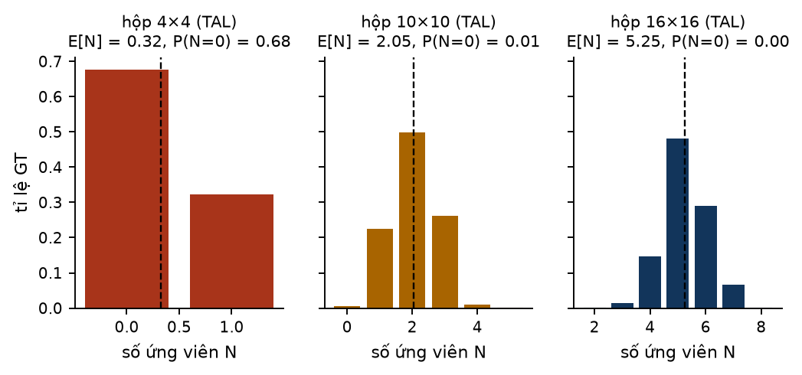

*Hình 5.1 — Phân phối số ứng viên dưới TAL. Đường đứt: dự báo của Proposition 1. Hộp 4×4 rỗng ở 67,7% vị trí [lab D3].*

**Ba hệ quả** [PROP §6]:

1. **Sàn xác suất rỗng.** $N$ là số nguyên không âm nên $P(N\ge1)\le\mathbb{E}[N]$, tức $P(N=0)\ge1-0{,}0205\,|\tilde R|$. Với hộp 4×4 dưới TAL, cận dưới là 0,672; mô phỏng cho 0,677. Mọi GT diện tích dưới khoảng 49 px² ($1/0{,}0205$) đều có thể không có ứng viên nào.
2. **Cùng diện tích ⇒ cùng số kỳ vọng.** STAL-16 và một vùng giữ hình dạng có diện tích $16^2$ cho cùng $\mathbb{E}[N]=5{,}25$. Tác dụng của việc giữ hình dạng, nếu có, chỉ có thể đến từ **vị trí** ứng viên và **xung đột**, không từ số lượng trung bình.
3. **Ngưỡng quan trọng hơn hình dạng.** Hộp 10×10: STAL-8 không đổi (2,05), STAL-16 phóng lên 16×16 (5,25), gấp khoảng 2,5 lần.

> [!WARNING] Cùng số kỳ vọng không có nghĩa cùng xác suất rỗng
> Hệ quả 2 chỉ nói về **trung bình**. Trên lưới stride 8, hộp 8×8 và 16×4 cùng $\mathbb{E}[N]=1$ nhưng xác suất rỗng lần lượt 0 và 0,5 [DIG §5.3; issue #21]. Câu "cannot add candidates" trong bản nộp trường phải hiểu theo nghĩa kỳ vọng [DIG §9.3].

## 5.5 Một ví dụ áp dụng: bán kính phủ của lưới [design, của phản biện]

File phản biện ngày 11–12/10 đề xuất một dẫn xuất ngắn [CRIT §5.1]. Lưới vuông bước $s$ có **bán kính phủ (covering radius)** $\rho=s/\sqrt2$: điểm xa nhất tới mọi điểm neo là đỉnh của một ô. Mọi hình tròn bán kính $\ge s/\sqrt2$, đặt ở đâu cũng chứa ít nhất một điểm neo. Một hình chữ nhật có cạnh ngắn $\ge\sqrt2\,s$ chứa một hình tròn nội tiếp như vậy ở mọi góc xoay, nên

$$
\min(\tilde w,\tilde h)\ \ge\ \sqrt2\,s_{min}=11{,}31\ \text{px}\quad\Longrightarrow\quad N_{cand}\ge1\ \text{với mọi vị trí và mọi góc}
$$

Đây là điều kiện **đủ**, không phải điều kiện cần [CRIT §5.1].

> [!EXAMPLE] Kiểm bằng mô phỏng (40.000 vị trí và góc ngẫu nhiên, TAL)
> Hình vuông cạnh 8: $P(N=0)=0{,}0607$; cạnh 10: 0,0059; cạnh 11: 0,0002; **cạnh 11,31: 0,0000**, và số điểm neo stride 8 nhỏ nhất qua mọi mẫu là 1; cạnh 12: 0,0000; cạnh 16: 0,0000 (tối thiểu 2 điểm stride 8) [lab D4]. Kết quả nhất quán với dẫn xuất, và cho thấy cận 11,31 rất sát: cạnh 11 vẫn còn rỗng ở 0,02% vị trí.
>
> Sàn phủ 11,31 cho vùng diện tích nhỏ nhất 128 px², tức $\mathbb{E}[N]=2{,}625$, bằng nửa STAL-16 (5,25) [lab D2, D4].

> [!NOTE] Trạng thái của "A8"
> Phản biện đề xuất thêm nhánh A8 (cạnh < 11,31 thì thành 11,31, trên bản clone, giữ góc) và một thiết kế giai thừa ngưỡng A0/A1/A2/A8 [CRIT §5.1]. Đây là **đề xuất [design] của phản biện, nhóm chưa chốt**; proposal hiện vẫn có tám nhánh A0–A7 [PROP §7.4]. Sổ tay dùng A8 ở đây và ở lab chỉ để minh họa cách một kết quả hình học biến thành một quy tắc có thể kiểm.

## 5.6 OA-STAL v2: giữ hình dạng, giữ diện tích [dự án đề xuất, design]

**Tham số** (tường minh, không phụ thuộc stride): kiểu kích hoạt $\tau\in\{\text{side},\text{area}\}$ với ngưỡng $t$; kích thước đích $s_{ref}$; sàn cạnh ngắn $s_{flo}$; hệ số nắp cạnh dài $c$ [PROP §7.1]. Với $g=(x,y,w,h,\theta)$, $w\ge h$, kích hoạt khi $h<t$ (side) hoặc $\sqrt{wh}<t$ (area). Nếu kích hoạt:

$$
\begin{aligned}
k&=\max\!\Big(1,\ \frac{s_{ref}}{\sqrt{wh}}\Big),\qquad \tilde h=\max\big(kh,\ s_{flo},\ h\big)\\
\tilde w&=\max\Big(\min\big(kw,\ \max(w,\ c\,s_{ref})\big),\ w\Big)
\end{aligned}
$$

và $\tilde R=(x,y,\tilde w,\tilde h,\theta)$, chỉ dùng cho mặt nạ ứng viên. Nhánh chính A4: area trigger, $t=s_{ref}=16$, $s_{flo}=8$, $c=2$ [PROP §7.1].

Sáu thuộc tính P1–P6 [PROP §7.1, derived]: P1 chứa ($g\subseteq\tilde R$, không bao giờ tệ hơn TAL về tỉ lệ rỗng); P2 đồng nhất (không kích hoạt thì $\tilde R=g$); P3 thu về hình vuông $s_{ref}\times s_{ref}$ khi $w=h<16$; P4 giữ đúng tỉ lệ cạnh khi $r\le4$; P5 diện tích $s_{ref}^2$ khi giữ hình dạng; P6 chi phí suy luận bằng 0.

> [!EXAMPLE] Bảng vùng ứng viên theo quy tắc ($\mathbb{E}[N]=0{,}0205\times$ diện tích)
> | GT | A0 TAL | A1 STAL-8 | A2 STAL-16 | A4 OA-STAL v2 | A8 sàn 11,31 [design] |
> |---|---|---|---|---|---|
> | 4×4 | 4×4 · 0,33 | 16×16 · 5,25 | 16×16 · 5,25 | 16×16 · 5,25 | 11,31×11,31 · 2,63 |
> | 12×4 | 12×4 · 0,98 | 12×16 · 3,94 | 16×16 · 5,25 | 27,71×9,24 · 5,25 | 12×11,31 · 2,78 |
> | 10×10 | 10×10 · 2,05 | 10×10 · 2,05 | 16×16 · 5,25 | 16×16 · 5,25 | 11,31×11,31 · 2,63 |
> | 25×4 | 25×4 · 2,05 | 25×16 · 8,20 | 25×16 · 8,20 | 32×8 · 5,25 | 25×11,31 · 5,80 |
> | 60×5 | 60×5 · 6,15 | 60×16 · 19,69 | 60×16 · 19,69 | 60×5 · 6,15 | 60×11,31 · 13,92 |
> | 20×5 | 20×5 · 2,05 | 20×16 · 6,56 | 20×16 · 6,56 | 32×8 · 5,25 | 20×11,31 · 4,64 |
>
> Tính bằng hàm `surrogate` cài lại theo [PROP §7.1, §7.3] [lab D2]. Ba cột đầu khớp bảng của FH3 [FH3 E5 tr.58]. Đọc một dòng: hộp 12×4 dưới OA-STAL v2 có $k=16/\sqrt{48}$, nên $\tilde h=\max(9{,}24;\ 8;\ 4)=9{,}24$ và $\tilde w=\max(\min(27{,}71;\ 32);\ 12)=27{,}71$. Hộp 60×5 có $\sqrt{300}\approx17{,}3\ge16$ nên không kích hoạt (P2). Hộp 25×4 vượt $r\le4$ nên sàn 8 và nắp 32 cùng tham gia (P4), và nó có **ít** ứng viên hơn STAL-16 (5,25 so với 8,20): chi phí đã biết của P5 [PROP §7.1].

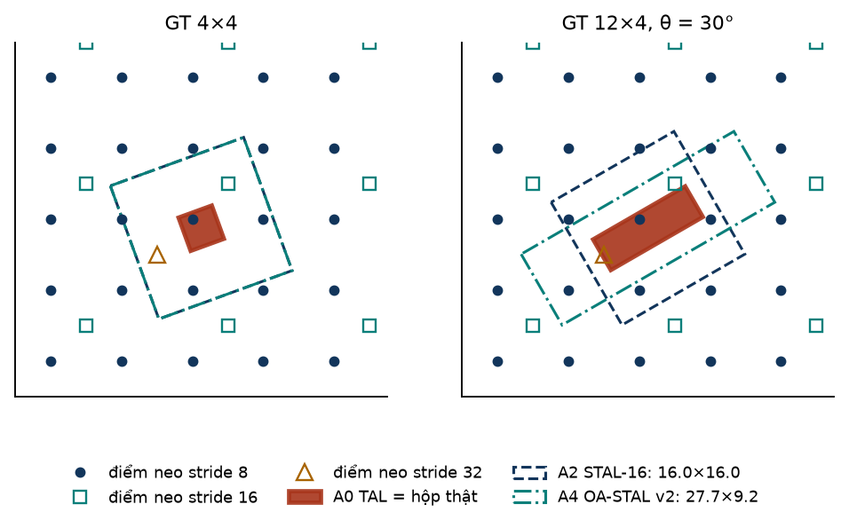

*Hình 5.2 — Cùng lưới điểm neo, ba vùng ứng viên. Trái: GT 4×4 không chứa điểm neo nào; STAL-16 và OA-STAL v2 trùng nhau (16×16). Phải: GT 12×4 xoay 30°; STAL-16 phóng theo cạnh ngắn, OA-STAL v2 kéo dài theo trục dài.*

## 5.7 Ứng viên nằm ở đâu và tranh nhau thế nào

### Phần ứng viên nằm ngoài hộp thật

Nếu một quy tắc cho vùng $\tilde R\supseteq g$, thì phần ứng viên nằm **ngoài** hộp thật có kỳ vọng xấp xỉ $1-|g|/|\tilde R|$ (cùng lập luận diện tích như Proposition 1) [suy luận, kiểm bằng mô phỏng]. Mô phỏng khớp công thức ở mọi dòng [lab D3]:

| GT | STAL-16 | OA-STAL v2 | A8 [design] |
|---|---|---|---|
| 4×4 | 0,938 | 0,938 | 0,877 |
| 10×10 | 0,610 | 0,610 | 0,219 |
| 12×4 | 0,813 | 0,813 | 0,646 |
| 25×4 | 0,750 | 0,610 | 0,646 |

Hai điều đáng chú ý. (1) Với hộp 12×4, STAL-16 và OA-STAL v2 có **cùng** phần ứng viên ngoài hộp (0,813), vì cùng diện tích; chúng chỉ khác **hướng** đẩy ứng viên ra (sang hai bên hay về hai đầu). (2) Mỗi ứng viên ngoài hộp là một mẫu dương cần **đích khoảng cách âm** (mục 4.4). Proposal đưa đại lượng này vào log chẩn đoán online [PROP §8.4]; độ lớn trên dữ liệu thật hiện [chưa xác minh] [DIG §4.7]. Con số trên là kỳ vọng hình học khi mọi ứng viên đều thành mẫu dương, đúng với vật tí hon vì số ứng viên nhỏ hơn `topk` (mục 5.2).

### Xung đột với hàng xóm

Dossier đã mô phỏng hai hộp 4×12 giống nhau cách 2 px [DIG §5.3]. Lab tái lập với cùng định nghĩa (phần ứng viên của hộp A cũng nằm trong vùng của hộp B) [lab D5]:

| Bố cục | STAL-16 | OA-STAL v2 | A8 [design] | Dossier (STAL-16 → OA-STAL v2) |
|---|---|---|---|---|
| đứng cạnh nhau | 0,625 | 0,351 | 0,469 | 0,63 → 0,34 |
| nối đuôi nhau | 0,126 | 0,495 | 0,000 | 0,12 → 0,49 |

Tái lập khớp dossier tới sai số làm tròn. Dấu của tác dụng hình dạng **phụ thuộc bố cục**: OA-STAL v2 giảm xung đột khi vật đứng cạnh nhau nhưng tăng mạnh khi vật nối đuôi nhau. Vì vậy dấu của H3 phải được chốt từ phân bố bố cục hàng xóm trên nhãn AI-TOD-R, đo **trước khi train** [PROP §6, §8.5].

## 5.8 Cùng công thức loss, khác tập dương: một ảnh đồ chơi

Lab chạy assigner và loss cài lại (nhánh o2m, L1) cho năm quy tắc trên **cùng một ảnh và cùng dự đoán giả lập** [lab D6]:

| Quy tắc | Ứng viên mỗi GT | Mẫu dương mỗi GT | Xung đột | Dương cần đích âm | $S$ | Tổng loss |
|---|---|---|---|---|---|---|
| A0 TAL | [1, 1, 2, 1, 1] | [1, 1, 2, 1, 1] | 0 | 0/6 | 1,9471 | 11,8540 |
| A1 STAL-8 | [5, 6, 2, 4, 6] | [5, 6, 2, 2, 5] | 3 | 14/20 | 2,3611 | 11,0792 |
| A2 STAL-16 | [5, 6, 5, 4, 6] | [5, 6, 5, 2, 5] | 3 | 17/23 | 2,3627 | 11,0779 |
| A4 OA-STAL v2 | [7, 6, 5, 5, 6] | [7, 6, 5, 3, 4] | 4 | 19/25 | 2,3528 | 11,0888 |
| A8 sàn 11,31 [design] | [2, 2, 2, 2, 4] | [2, 2, 2, 1, 3] | 2 | 4/10 | 2,1579 | 11,3547 |

Thứ tự GT: ship 12×4, vehicle 5×5, tank 10×10, vehicle 5×3 (a), vehicle 5×3 (b).

Đọc bảng:

- **Công thức loss giống hệt**; chỉ tập dương, $S$ và do đó giá trị loss thay đổi.
- Hai vehicle 5×3 đứng cạnh nhau: dưới STAL-16 chúng có 4 và 6 ứng viên nhưng chỉ còn 2 và 5 mẫu dương sau giải xung đột. Đây là "mẫu dương mất cho hàng xóm" mà RQ2 sẽ đo [PROP §8.4].
- Tank 10×10 có 2 ứng viên dưới TAL và STAL-8 (không kích hoạt), 5 dưới STAL-16: Hệ quả 3 hiện ra trên một ảnh cụ thể.
- Đây là **một ảnh giả lập**, không nói gì về AP. Nó chỉ cho thấy đường đi: quy tắc → tập dương → loss → gradient.

> [!IMPORTANT] Tóm tắt chương trong ba câu
> (1) Với vật tí hon, mặt nạ ứng viên gần như quyết định trọn tập dương vì số ứng viên nhỏ hơn `topk`. (2) Diện tích vùng quyết định **số** ứng viên kỳ vọng (Proposition 1); hình dạng vùng chỉ quyết định **vị trí** và **xung đột**. (3) OA-STAL v2 không đổi công thức loss nào; nó đổi tập $\mathcal{P}$, và qua đó đổi $S$, nhãn mềm, tập điểm âm và đích âm.

> [!QUIZ]
> **Q16.** Vì sao với vật tí hon, `topk = 10` gần như không phải là bộ lọc?
>
> **Q17.** Dùng Proposition 1, tính $\mathbb{E}[N]$ và cận dưới của $P(N=0)$ cho hộp 12×4 dưới TAL. So với mô phỏng.
>
> **Q18.** STAL-16 và OA-STAL v2 cho cùng $\mathbb{E}[N]$ với hộp 12×4. Vậy hai quy tắc khác nhau ở đâu? Nêu hai đại lượng đo được từ nhãn.
>
> **Q19.** Phát biểu điều kiện bán kính phủ. Vì sao nó là điều kiện đủ mà không phải điều kiện cần? Mô phỏng ở cạnh 11 px cho thấy gì?
>
> **Q20.** Tính vùng ứng viên OA-STAL v2 cho hộp 20×5. Vì sao nó có ít ứng viên kỳ vọng hơn STAL-16?

# 6. Một lần huấn luyện của dự án, từ ảnh đến con số

## 6.1 Slide nói gì

- Gradient descent sáu bước: khởi tạo, forward, tính loss, tính gradient, cập nhật tham số, lặp lại [1.2 s013].
- **Epoch** = mọi mẫu train đi qua mạng một lần; với mini-batch GD, một epoch = $n/b$ iteration. Ví dụ slide: 2.000 mẫu, batch 4, 10 epoch → 500 iteration mỗi epoch, 5.000 lần cập nhật [2.2 s007–s008].
- Mini-batch nên là lũy thừa của 2 và vừa bộ nhớ GPU [2.2 s017].

## 6.2 Một iteration trong dự án

| Bước của slide | Trong Ultralytics 8.4.174 |
|---|---|
| dữ liệu | dataloader: mosaic + `RandomPerspective` (R-native) hoặc chỉ lật ngang (R-short); 4 đỉnh → $(x,y,w,h,\theta)$ cạnh dài; ảnh chỉ chia 255, **không** trừ mean/chia std [code: augment\.py:L2484; detect/train\.py:L119] |
| forward | backbone → neck → head; ba mức, 13.125 điểm neo ở ảnh 800 |
| (bước mới) gán nhãn | assigner trong `no_grad` tạo $\mathcal{P}$, đích, nhãn mềm (chương 5) |
| loss | `v8OBBLoss` hoặc `E2ELoss` (chương 4) |
| backward | autograd; AMP fp16 với `GradScaler` [code: trainer\.py:L423–431] |
| cập nhật | **chỉ sau khi tích lũy đủ** `accumulate` batch; cắt chuẩn gradient `max_norm = 10`; rồi cập nhật EMA [code: trainer\.py:L598–600, L905–916] |

Chuẩn hóa đầu vào của slide 2.1 [2.1 s046–s049] ở đây chỉ là phép chia 255. Digest ghi bước này là [chưa xác minh] [DIG §8.2]; tôi đã kiểm: `OBBTrainer` kế thừa `DetectionTrainer`, có `batch["img"].float() / 255` [code: detect/train\.py:L119; obb/train\.py:L14].

> [!EXAMPLE] Iteration, bước optimizer và epoch [ước lượng]
> Số ảnh train của AI-TOD-R chưa biết; digest dùng $N_{train}\approx12.600$ (90% của con số giả định 14.000) [DIG §6.3]. Với batch 16: $\lceil12.600/16\rceil=788$ iteration mỗi epoch; `accumulate` = round(64/16) = 4, nên khoảng **197 bước optimizer** mỗi epoch. Batch 8 cho 1.575 iteration nhưng vẫn khoảng 197 bước. 100 epoch là 78.800 lần forward/backward [lab E1].

> [!WARNING] Iteration không phải bước cập nhật
> Slide coi mỗi mini-batch là một lần cập nhật [2.2 s010]. Ultralytics cộng dồn gradient tới batch danh nghĩa `nbs = 64` rồi mới cập nhật [code: trainer\.py:L321]. Đổi batch từ 16 xuống 8 (vì hết VRAM) không làm tăng số bước cập nhật; nó chỉ tăng số lần forward.

## 6.3 Optimizer: slide 2.2 trong `build_optimizer`

| Slide 2.2 | Trong code |
|---|---|
| Momentum [2.2 s035–s038] | SGD `momentum = 0.937`, `nesterov = True` [code: trainer\.py:L1200–1205] |
| Adam: $\beta_1=0{,}9$, $\beta_2=0{,}999$ [2.2 s046] | Adam/AdamW: `betas = (momentum, 0.999)` |
| L2 regularization [2.1 s023] | weight decay 0,0005 chỉ cho trọng số conv; trọng số BN và mọi bias không có weight decay [code: trainer\.py:L1186–1197] |
| (ngoài slide) | MuSGD = Muon (trực giao hóa cập nhật cho tham số 2D/4D) + SGD, dùng trong YOLO26 [DIG §6.3] |

Weight decay hiệu dụng là `weight_decay × batch × accumulate / nbs`: batch 16 → 0,000500; batch 12 (accumulate 5) → 0,000469; batch 8 → 0,000500 [lab E1].

> [!WARNING] `optimizer=auto` âm thầm đổi optimizer theo độ dài lịch
> Mặc định `optimizer: auto` [code: default.yaml:L27]. Code tính $\lceil N/\max(\text{batch},\text{nbs})\rceil\times E$; nếu > 10.000 thì chọn **MuSGD** (lr 0,01), ngược lại **AdamW** với lr $=\mathrm{round}(0{,}002\cdot5/(4+C),6)$, và **bỏ qua `lr0`** người dùng đặt [code: trainer\.py:L1173–1182]. Với $N=12.600$: $E=12$ → 2.364 → AdamW lr 0,000833; $E=24$ → 4.728 → AdamW; $E=50$ → 9.850 → AdamW; $E=51$ → 10.047 → **MuSGD**; $E=100$ → 19.700 → MuSGD [lab E1]. R-short và R-native vì vậy có thể khác cả optimizer. Phải đặt `optimizer` tường minh và ghi vào config của mỗi run [DIG §6.3; CRIT R13].

## 6.4 Learning rate, warmup và EMA

**Learning rate decay.** Slide dùng $\alpha=\alpha_0/(1+\text{decay\_rate}\cdot\text{epoch})$; với $\alpha_0=0{,}2$: 0,1000; 0,0667; 0,0500; 0,0400 ở epoch 1–4 [2.2 s050–s051; lab E2]. Ultralytics giảm **tuyến tính** [code: trainer\.py:L268–274]:

$$
\mathrm{lr}(e)=\mathrm{lr}_0\cdot\Big[\max\!\Big(1-\frac{e}{E},0\Big)(1-\mathrm{lrf})+\mathrm{lrf}\Big]
$$

Với $\mathrm{lr}_0=0{,}01$, $\mathrm{lrf}=0{,}01$, $E=100$: 0,010000 ở epoch 0; 0,005050 ở epoch 50; 0,000199 ở epoch 99 [lab E2].

**Warmup** (ngoài slide): trong $\min(3,E-1)$ epoch đầu, tính theo iteration, lr của trọng số tăng từ 0, lr của bias giảm từ 0,1, momentum tăng từ 0,8 lên 0,937, `accumulate` tăng dần từ 1 [code: trainer\.py:L276–279, L519–535]. Với 788 iteration/epoch, warmup dài 2.364 iteration; với lịch $E=12$, warmup chiếm 25% thời gian train [lab E2].

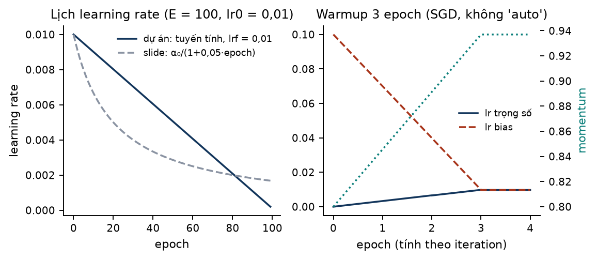

*Hình 6.1 — Trái: lịch tuyến tính của dự án so với lịch $1/(1+0{,}05\cdot\text{epoch})$ kiểu slide (cùng lr ban đầu, minh họa). Phải: ba epoch warmup [lab E2].*

**EMA của trọng số.** Slide 2.2 dạy trung bình trượt mũ $V_t=\beta V_{t-1}+(1-\beta)\theta_t$, xấp xỉ trung bình $1/(1-\beta)$ giá trị gần nhất [2.2 s019, s024]. Momentum là EWA của **gradient**; `ModelEMA` là EWA của **trọng số**, cập nhật sau mỗi bước optimizer với hệ số tăng dần $d(x)=0{,}9999\,(1-e^{-x/2000})$ [code: torch_utils\.py:L838–852; trainer\.py:L916].

> [!EXAMPLE] Cửa sổ EMA dài bao nhiêu
> Với 197 bước/epoch: sau 2.364 bước (12 epoch) $d=0{,}6933$, cửa sổ chỉ khoảng 3,3 bước; sau 4.728 bước (24 epoch) $d=0{,}9059$, khoảng 10,6 bước; sau 19.700 bước (100 epoch) $d=0{,}9998$, khoảng 6.547 bước, tức khoảng 33 epoch [lab E3]. Với lịch ngắn, EMA gần như không làm trơn; với lịch 100 epoch, mô hình được chấm là trung bình của hàng chục epoch cuối. Đây là một khác biệt giữa R-short và R-native mà bảng khác biệt của proposal đã liệt kê dưới mục "EMA" [PROP §8.3], và nó có số cụ thể [suy luận từ code].

## 6.5 Regularization và augmentation: hai recipe

| Slide | Trong dự án |
|---|---|
| L2 [2.1 s023] | weight decay (mục 6.3) |
| Dropout [2.1 s032] | **không dùng** cho detection; `dropout` chỉ cho classify [code: default.yaml:L49] |
| Data augmentation [2.1 s042; 4.2 s102] | R-native: mosaic 1,0 (tắt ở 10 epoch cuối), lật ngang 0,5, HSV 0,015/0,7/0,4, translate 0,1, **scale 0,5**; R-short: chỉ lật [code: default.yaml:L115–129; PROP §8.3] |
| Early stopping [2.1 s043] | dừng sau `patience = 100` epoch không cải thiện val, tức gần như tắt ở lịch 100 epoch [code: default.yaml:L14] |
| BatchNorm [2.3 s020–s029] | trong mọi `Conv`; trọng số BN không có weight decay |

> [!WARNING] Augmentation đổi kích thước vật, nên đổi luôn tập dương
> Với `scale = 0.5`, mỗi ảnh mosaic được phóng hệ số $s\sim U(0{,}5;\ 1{,}5)$ [code: augment\.py:L1159]. Vật có cạnh ngắn gốc 10 px rơi xuống dưới 8 px ở 30,0% số lần, tức đổi trạng thái kích hoạt STAL-8; vật 14 px có cạnh < 16 ở 64,3% số lần; vật 3 px có 16,7% khả năng thành ≤ 2 px và bị lọc [lab E5; code: augment\.py:L1451; loss\.py:L1093]. Hệ quả [suy luận]: thống kê RQ2 tính trên nhãn ở kích thước gốc chỉ khớp tập dương lúc train khi **không** có augmentation đổi tỉ lệ (R-short). Với R-native, tập dương thực tế chỉ đo được bằng log online [PROP §8.4].

> [!NOTE] "Flip-only" không phải một công tắc
> Muốn R-short đúng là chỉ lật ngang, phải tự đặt về 0 ít nhất `mosaic`, `scale`, `translate`, `hsv_h`, `hsv_s`, `hsv_v` (mặc định khác 0) [code: default.yaml:L115–126]. Bỏ sót một tham số là đổi recipe mà không biết.

## 6.6 Hết epoch, hết run: val, checkpoint, resume, test một lần

- **Hết mỗi epoch**: chấm validation (trên dev 10% của dự án, không phải test) và lưu `last.pt`; Progressive Loss của YOLO26 cập nhật $\alpha$ [code: trainer\.py:L639; DIG §6.1].
- **Resume trên Kaggle** (phiên tối đa 12 giờ): lưu `last.pt` vào `/kaggle/working`, phiên sau gắn output phiên trước làm input rồi `YOLO("path/to/last.pt").train(resume=True)` [PROP §9; FH3 P2 tr.35].
- **Kết thúc**: xuất dự đoán sang định dạng DOTA và chấm **một lần** bằng `AITODReval` [PROP §8.2].

Mô hình chi phí của proposal [PROP §9, ước lượng, chưa có tốc độ đo]:

$$
\text{GPU-h/run}=\frac{N_{img}\times E}{r\times3600}
$$

> [!EXAMPLE] GPU-giờ mỗi run [ước lượng]
> $N_{img}=14.000$, $E=100$: $r=100$ ảnh/s → 3,89 GPU-h; $r=50$ → 7,78; $r=25$ → 15,56, cần 2 phiên 12 giờ, mỗi epoch 9,3 phút. Nếu trừ 10% dev ($N=12.600$): 3,50 / 7,00 / 14,00 GPU-h. Lịch ngắn $E=24$, $r=25$: 3,36 GPU-h [lab E4]. Proposal dùng 14.000 cho số ảnh train; nếu đó là cả trainval thì sau khi cắt dev mọi con số giảm 10% [suy luận].

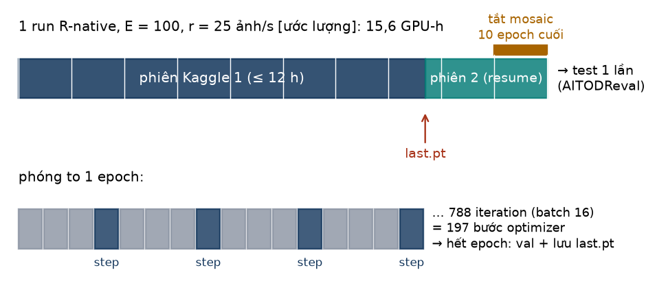

*Hình 6.2 — Dòng thời gian của một run R-native giả định (E = 100, r = 25 ảnh/s). Trên: hai phiên Kaggle nối bằng `last.pt`. Dưới: trong một epoch, cứ 4 iteration mới có một bước optimizer.*

> [!QUIZ]
> **Q21.** Batch 16, 12.600 ảnh train. Một epoch có bao nhiêu iteration và bao nhiêu bước optimizer? Nếu giảm batch xuống 8 thì số bước optimizer thay đổi thế nào?
>
> **Q22.** Vì sao R-short ($E=24$) và R-native ($E=100$) có thể dùng hai optimizer khác nhau dù không ai đổi tham số `optimizer`?
>
> **Q23.** Augmentation `scale = 0.5` ảnh hưởng thế nào tới việc so sánh thống kê nhãn offline (RQ2) với tập dương lúc train?

# 7. Đánh giá và thống kê

## 7.1 Từ precision/recall của slide đến AP

Slide 3.1 dùng ma trận nhầm lẫn 10 ảnh mèo: $P=3/4$, $R=3/5$ [3.1 s014]; F1 gộp hai số thành một: $F_1=0{,}667$; bộ phân loại A (95%, 90%) có $F_1=0{,}9243$, B (98%, 85%) có 0,9104, nên A tốt hơn [3.1 s015; lab F1].

Detector không có một ngưỡng duy nhất: mỗi phát hiện có điểm tin cậy. Xếp phát hiện theo điểm giảm dần, ở mỗi vị trí ta có một cặp (recall, precision); nối lại thành **đường precision–recall**. **AP** là diện tích dưới đường đó, tính theo quy ước COCO: lấy bao precision không tăng (max của precision ở mọi recall lớn hơn), đọc tại 101 mức recall $0, 0{,}01,\dots,1$ rồi lấy trung bình [DIG §7.1, suy luận từ tham số evaluator]:

$$
AP=\frac{1}{|T|\,|K|}\sum_{\tau\in T}\sum_{k\in K}\frac{1}{101}\sum_{r\in\{0,\,0.01,\,\dots,\,1\}}p^{interp}_{\tau,k}(r)
$$

với $T$ là 10 ngưỡng IoU 0,50:0,05:0,95 và $K$ là các lớp [code: aitodr_eval\.py:L728–745].

> [!EXAMPLE] Một đường PR giả lập
> 20 GT, 25 phát hiện, 14 đúng. Recall cuối 0,700, nên mọi mức recall từ 0,71 tới 1 nhận precision 0. AP 101 điểm = 0,6043 [lab F2].

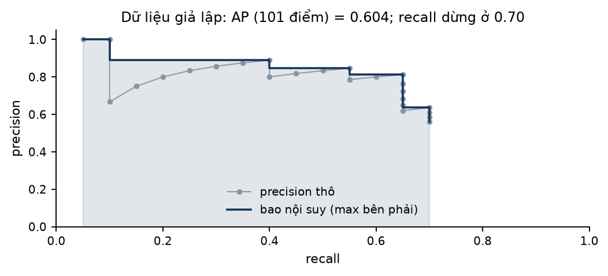

*Hình 7.1 — Precision thô (xám) và bao nội suy (xanh). Phần recall chưa đạt được đóng góp 0 vào AP [lab F2, giả lập].*

## 7.2 Ngưỡng IoU và vật tí hon

AP 0,50:0,95 trung bình trên 10 ngưỡng IoU. Một sai số 1 px có giá rất khác nhau theo kích thước:

> [!EXAMPLE] Một lỗi 1 px qua được bao nhiêu ngưỡng
> Hộp 4×4 lệch 1 px: IoU 0,6000, qua 3/10 ngưỡng. Hộp 10×10: 0,8182, qua 7/10. Hộp 40×40: 0,9512, qua 10/10. Hộp 12×4 lệch góc 10°: 0,7658, qua 6/10 [lab F3].

Hệ quả: $AP_{vt}$ và $AP_t$ thấp một phần vì **chính thước đo** khắt khe với vật nhỏ, không chỉ vì mô hình kém. Bảng II của AI-TOD-R cho thấy mọi phương pháp đều yếu nhất ở $AP_{vt}$ (ví dụ RetinaNet-O: $AP_{vt}$ 2,2 so với $AP_m$ 15,4) [DIG §7.6, tác giả báo cáo]. So sánh giữa các nhánh của dự án vẫn công bằng vì mọi nhánh cùng chịu thước đo này.

## 7.3 Evaluator chính thức và giới hạn số phát hiện

`AITODReval` [code: aitodr_eval\.py; DIG §7.1]: IoU đa giác xoay; 10 ngưỡng IoU; 101 điểm recall; bin theo diện tích (mục 2.4); đánh giá theo từng cặp (ảnh, lớp) với `maxDets = [1500]`.

Vì đánh giá theo cặp (ảnh, lớp), **1.500 là giới hạn cho mỗi ảnh và mỗi lớp**, không phải mỗi ảnh [DIG §7.1; FREV §4.2]. Phía YOLO, `max_det` giới hạn tổng số phát hiện **trên toàn ảnh, mọi lớp** (NMS hoặc top-k trên điểm neo × lớp) [code: head\.py:L249–288; DIG §3.4].

> [!EXAMPLE] Trần recall do `max_det`
> Ảnh có 1.200 GT cùng một lớp: `max_det` = 300 chặn recall ở 0,250; 1.500 cho 1,000. Ảnh có 2.000 GT: 300 → 0,150; 1.500 → 0,750; 12.000 → 1,000 [lab F4]. Muốn tương đương evaluator, phía YOLO cần `max_det` ≥ 1.500 × 8 = 12.000 [lab F4; CRIT R9].

> [!WARNING] Proposal đặt `max_det ≥ 1500` là chưa đủ
> Proposal và digest ghi đặt `max_det ≥ 1500` [PROP §8.2; DIG §7.2]. Nếu hiểu là 1.500 mỗi ảnh thì ảnh hơn 1.500 vật (AI-TOD-R có ảnh hơn 2.000 vật [DIG §2.1]) vẫn bị cắt recall, đúng ở cảnh đông mà H2b quan tâm. File phản biện đề xuất `max_det` = 12.000, hoặc ≥ số GT lớn nhất mỗi ảnh đo từ nhãn nhân hệ số an toàn, cùng `conf = 0.001` [CRIT R9]. Đây là một chỗ proposal cần sửa.

Lý do dự án **không** báo số từ validator của Ultralytics: `max_det = 300` mỗi ảnh; ghép đúng/sai bằng ProbIoU thay vì IoU đa giác; `conf` mặc định 0,01 khi val OBB [code: obb-val\.py:L95; default.yaml:L55–57; DIG §7.2]. Đúng tinh thần slide 3.1: khi metric và dev/test không phản ánh điều ta quan tâm thì đổi chúng [3.1 s038].

## 7.4 Seed, độ lệch chuẩn và bootstrap ghép cặp

Slide 3.1 nói dev phải "big enough to detect differences in algorithm/models you're trying out" [3.1 s031], nhưng không nói đo "đủ lớn" thế nào. Dự án trả lời bằng hai công cụ [PROP §8.6]:

1. **3 seed** mỗi nhánh; báo trung bình ± độ lệch chuẩn. Đây là độ dao động do khởi tạo, thứ tự batch, augmentation.
2. **Bootstrap ghép cặp theo ảnh**: lấy mẫu lại **cùng một tập ảnh** cho A4 và A2, 10.000 lần, lấy khoảng tin cậy 95% của $\Delta AP_t$ và $\Delta AP_{vt}$, gộp qua seed. "Cải thiện" chỉ khi khoảng tin cậy không chứa 0 **và** mẫu hình dự đoán trước (H3) đúng.

Proposal chưa mô tả cách cài bootstrap, và chi phí [chưa xác minh] vì AP không cộng được theo ảnh [DIG §7.3]. Lab thử một cách cài **chính xác và rẻ**: việc ghép phát hiện với GT xảy ra **trong từng ảnh**, nên lấy mẫu lại ảnh không đổi cờ đúng/sai của phát hiện nào. Lấy mẫu lại có hoàn lại tương đương gán cho mỗi ảnh một trọng số bằng số lần nó được chọn. Xếp phát hiện theo điểm **một lần**, rồi mỗi lần bootstrap chỉ cần tổng tích lũy có trọng số [lab F5].

> [!EXAMPLE] Bootstrap ghép cặp trên dữ liệu giả lập
> 300 ảnh giả, mỗi ảnh 1 + Poisson(8) GT; A2 phát hiện mỗi GT với xác suất 0,55, A4 với 0,57 (hiệu ứng do ta **đặt**); 3 seed với nhiễu riêng. AP (một ngưỡng, giả lập): A2 = 0,4847 ± 0,0063; A4 = 0,4993 ± 0,0062. $\Delta AP$ trung bình qua seed = 0,0146; KTC 95% bootstrap = [0,0133; 0,0229], không chứa 0. 10.000 lần × 3 seed × 2 nhánh chạy hết 9,1 giây trên CPU [lab F5].
>
> Hai lưu ý. Khoảng tin cậy phân vị ở đây lệch hẳn về một phía so với ước lượng điểm: AP là thống kê phi tuyến nên bootstrap có thể chệch; nên báo kèm phân phối (Hình 7.2). Và đây là **giả lập**; nó chỉ chứng minh cách cài chạy được, không nói gì về hiệu ứng thật.

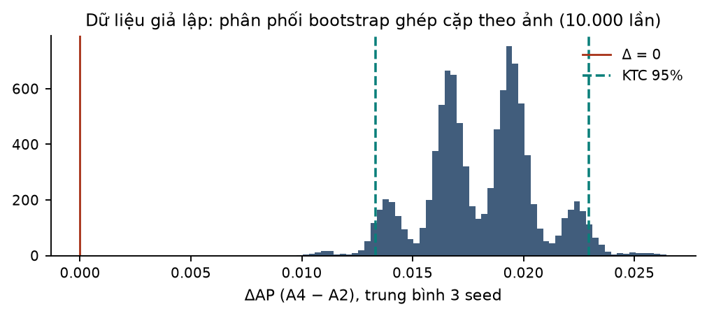

*Hình 7.2 — Phân phối bootstrap của $\Delta AP$ (giả lập). Đường đỏ: 0; đường xanh: KTC 95% [lab F5].*

> [!NOTE] Ảnh không độc lập
> Ảnh AI-TOD được cắt từ cảnh lớn; các ô cùng cảnh tương quan với nhau. Khi đó nên lấy mẫu lại theo **cảnh** (cluster bootstrap) thay vì theo ảnh; file phản biện cũng đề xuất "bootstrap theo cụm cảnh" [CRIT §5.1]. Cách cài bằng trọng số ở trên dùng được nguyên vẹn: chỉ cần gán trọng số theo cảnh. Độ dao động giữa seed và bootstrap theo ảnh là hai nguồn bất định khác nhau; không coi (seed × ảnh) là quan sát độc lập [DIG §7.3].

## 7.5 Phân tích lỗi theo kiểu slide 3.2

Slide 3.2 dạy lấy khoảng 100 mẫu dev bị sai, đếm theo nhóm nguyên nhân, rồi tính **trần lợi ích**: nếu dev error 10% và chỉ 8/100 lỗi là chó thì sửa hết lỗi chó chỉ còn 9,2%; nếu 50/100 thì còn 5,0% [3.2 s007–s008; lab F6].

Bản cho đề tài, các cột nên đếm trên GT bị bỏ sót và phát hiện sai ở dev [PROP §8.4; suy luận cho cột cụ thể]:

| Nhóm lỗi | Đo bằng gì |
|---|---|
| GT không có mẫu dương lúc train (rỗng ứng viên, mất cho hàng xóm, bị lọc < 2 px) | log chẩn đoán online + thống kê nhãn |
| Định vị kém (IoU 0,1–0,5 với GT) | ghép lại dự đoán của evaluator |
| Sai góc (tâm và kích thước đúng, góc lệch) | IoU khi đặt góc dự đoán bằng góc GT |
| Nhầm lớp | phát hiện trùng GT nhưng khác lớp |
| Cảnh đông, bị cắt bởi `max_det` | số GT mỗi ảnh so với `max_det` |
| Nhãn sai (H2RBox-v2 bán tự động) | xem tay một mẫu, như cột "Incorrectly labeled" [3.2 s014] |

Phân tích theo lớp, theo bin và theo bố cục hàng xóm (cạnh nhau hay nối đuôi) là phần đã có trong proposal; recall từng GT được nối với số mẫu dương bằng mô hình logistic phân tầng theo bin (H2c) [PROP §8.4].

> [!QUIZ]
> **Q24.** Vì sao AP có thể bằng 0 ở một đoạn recall? Trong ví dụ giả lập, đoạn nào?
>
> **Q25.** Một ảnh có 2.000 xe. Với `max_det` = 1.500, recall tối đa là bao nhiêu? Vì sao `AITODReval` vẫn giữ được 1.500 phát hiện cho lớp xe mà YOLO thì không?
>
> **Q26.** Vì sao có thể bootstrap AP theo ảnh mà không phải ghép lại phát hiện với GT ở mỗi lần lấy mẫu?

# 8. Thiết kế thí nghiệm như ML strategy

## 8.1 Orthogonalization: mỗi nhánh vặn đúng một núm

Slide 3.1 nói mỗi "núm vặn" nên có một tác dụng rõ, dễ diễn giải [3.1 s009–s011]; slide 2.1 chê early stopping vì nó **ghép** hai việc tối ưu và regularize vào một núm [2.1 s044]. Thiết kế tám nhánh của proposal áp đúng nguyên tắc này: mọi nhánh dùng cùng fork đã pin, cùng loss, head, evaluator, dữ liệu, lịch train; chỉ **bộ gán nhãn** thay đổi [PROP §7.4; DIG §8.2].

| Phép so sánh | Núm duy nhất khác nhau | Trả lời câu hỏi |
|---|---|---|
| A1 so với A2 | ngưỡng kích hoạt per-side 8 hay 16 | ngưỡng quan trọng thế nào (Hệ quả 3) |
| A5 so với A2 | cùng side trigger 16; phóng đồng dạng hay phóng từng cạnh | hình dạng vùng, khi giữ ngưỡng |
| A4 so với A5 | area trigger hay side trigger | kiểu kích hoạt |
| **A4 so với A2** | quy tắc đề xuất so với quy tắc hiện hành | **so sánh chính, khai báo trước** |
| A3 so với A0 | thêm fallback điểm neo gần nhất cho GT rỗng | đối chứng rẻ kiểu EARL/RDCNet |
| A6 so với A4; A7 so với A2 | luật xung đột C-inside thay mặc định | tác dụng của luật xung đột |

Nguồn: [PROP §7.4; DIG §5.5]. Những núm **không** được vặn nhưng dễ vặn nhầm: `optimizer` (mục 6.3), augmentation (mục 6.5), chế độ suy luận NMS hay NMS-free (mục 3.6), loại GPU giữa hai nhánh của một cặp so sánh [DIG §6.4].

> [!WARNING] Đổi hai thứ cùng lúc rồi quy công cho một
> Nếu một nhánh vừa đổi quy tắc ứng viên vừa đổi loss hoặc head, mọi chênh lệch AP không còn quy được cho quy tắc. Bản nộp trường đặt "changes to inference, loss functions or data augmentation" ngoài phạm vi chính vì lý do này [DIG §4.7; G7 tr.5].

## 8.2 Metric một con số khai báo trước và đăng ký trước

Slide khuyên chọn metric một con số **trước khi** bắt đầu [3.1 s014]. Proposal làm chặt hơn bằng **đăng ký trước (pre-registration)**: một file có ngày, `experiments/preregistration.md`, viết và commit **trước mọi run RQ3** [PROP §8.5; DIG §7.4], chốt:

1. so sánh chính (A4 so với A2, $AP_t$ và $AP_{vt}$);
2. dấu dự đoán theo lớp và theo bố cục hàng xóm, suy từ thống kê nhãn offline (mục 5.7);
3. hiệu ứng tối thiểu đáng quan tâm = độ lệch chuẩn giữa seed đo ở RQ1 (hiện chưa giả định số nào);
4. code phân tích.

Sai lệch sau đó được ghi kèm lý do. Lý do sâu: nếu nhìn kết quả rồi mới chọn metric hay phép so sánh "đẹp nhất", ta đang chỉnh trên dữ liệu đánh giá, đúng kiểu "overfitting to dev set" mà slide 3.2 đặt giữa dev error và test error [3.2 s034].

## 8.3 Vì sao không bao giờ chỉnh trên test

Slide 3.2 s034 đặt năm mức lỗi: human level → train → train-dev → dev → test; khoảng dev–test là "degree of overfitting to dev set" [3.2 s034]. Mỗi lần nhìn test rồi đổi quyết định, khoảng đó bị giấu đi. Với dự án:

- bốn tham số của OA-STAL v2 ($t$, $s_{ref}$, $s_{flo}$, $c$) là **siêu tham số**, chỉ chỉnh trên dev [PROP §7.1; DIG §8.1];
- test chấm **một lần cho mỗi nhánh cuối** [PROP §8.1];
- vì config chính thức dùng test làm val, chạy `model.val()` mặc định trên data YAML chính thức là chạm vào test (mục 2.3).

## 8.4 "Build your first system quickly, then iterate": Phase 0

Slide 3.2 khuyên dựng hệ thống đầu tiên nhanh, có dev/test và metric, rồi dùng bias/variance và error analysis để chọn bước tiếp [3.2 s017, s020]. Phase 0 của proposal là phiên bản cẩn trọng của lời khuyên đó [PROP §10; DIG §9.1]:

1. dữ liệu: đăng ký xView, dựng lại ảnh, đếm ảnh theo split, tạo dev 10%;
2. evaluator: chạy được `AITODReval`, converter sang định dạng DOTA;
3. **kiểm converter bằng tái lập**: RetinaNet-O 1× của MMRotate phải ra 7,3 ± 1,0 AP như Bảng II; nếu lệch thì điều tra trước mọi so sánh [PROP §8.2];
4. pilot trên Kaggle để đo tốc độ $r$ thật, thay cho các ước lượng ở mục 6.6.

File phản biện đề xuất thêm một **kiểm thử oracle**: đưa chính GT làm dự đoán qua converter thì AP phải gần 100 [CRIT R9]. Đây là "gradient checking" của pipeline đánh giá: kiểm công cụ đo trước khi tin số đo.

## 8.5 Những khái niệm slide chỉ áp dụng một phần

| Khái niệm | Tình trạng trong dự án |
|---|---|
| Bias/variance từ train error và dev error [2.1 s013–s015] | **một phần**: proposal không có kế hoạch so loss train với loss dev; gần nhất là H1 (dao động giữa seed) [DIG §8.2]. Ghi loss train và loss dev mỗi epoch là việc rẻ, nên làm. |
| Human-level performance, avoidable bias [3.1 s039–s048] | **không áp dụng**: không có mốc người; nhãn là bán tự động [DIG §8.2] |
| Transfer learning [3.2 s040–s042; 4.2 s097] | khởi tạo từ trọng số detection COCO (YOLO26: Objects365 → COCO), fine-tune toàn mạng; không dùng trọng số DOTA-OBB để tránh rò rỉ [PROP §8.1] |
| Multi-task learning [3.2 s045–s047] | một head học đồng thời 8 lớp (đa nhãn), hộp và góc; TAL chọn mẫu dương tốt cho cả hai nhiệm vụ qua $s^{\alpha}u^{\beta}$ [DIG §8.2] |
| Nhãn sai [3.2 s010–s015] | nhãn OBB bán tự động; tỉ lệ cạnh của hộp 4×12 có thể dao động từ 2,2 đến 4,3 khi sai ±1 px [DIG §2.7] |

> [!QUIZ]
> **Q27.** Phép so sánh nào tách "hình dạng vùng" khỏi "ngưỡng kích hoạt"? Phép nào tách "kiểu kích hoạt"?
>
> **Q28.** File đăng ký trước chốt bốn thứ gì? Vì sao nó phải có ngày và được commit trước run RQ3?

# 9. Bẫy hay nhầm của cả nhóm

Mỗi mục: **nhầm** → **đúng** → nguồn.

1. **"Anchor-free nên không cần gán nhãn."** → Vẫn có lưới điểm neo; TAL quyết định điểm nào học GT nào; đề tài nằm đúng ở bước này. → [DIG §3.1; mục 3.5]
2. **"Loss chia cho số điểm neo."** → Chia cho $S$, tổng nhãn mềm; vì vậy tập dương đổi thì thang của cả bốn thành phần đổi. → [code: loss\.py:L1121; mục 4.2]
3. **"BCE chỉ tính trên vật thể."** → BCE tính trên mọi điểm neo × lớp; chỉ hộp, khoảng cách, góc giới hạn trên mẫu dương (336/336 so với 23/336 điểm có gradient trên ảnh đồ chơi). → [lab D6; mục 4.8]
4. **"ProbIoU là IoU."** → ProbIoU dùng khi train (Gaussian, mù góc với hộp vuông); evaluator dùng IoU đa giác. Hộp 4×4 lệch 1 px: ProbIoU 0,7009, IoU 0,6000. → [lab C6; mục 4.3]
5. **"Angle loss chỉ có ở YOLO26."** → Trong 8.4.174 nó nằm trong `v8OBBLoss`, nên YOLO11-OBB train bằng bản này cũng có. → [code: loss\.py:L1145–1154; mục 4.5]
6. **"YOLO11 và YOLO26 nhận cùng đích khi điểm dương nằm ngoài hộp."** → DFL chặn đích âm về 0; L1 giữ đích âm. → [code: loss\.py:L250–256; mục 4.4]
7. **"Loss in ra trong log YOLO26 là tổng."** → Là loss nhánh o2o; backbone chỉ nhận gradient từ o2m. → [code: loss\.py:L1344; head\.py:L196; mục 4.7]
8. **"STAL đổi hộp đích."** → STAL chỉ đổi mặt nạ ứng viên, trên bản clone; điểm căn chỉnh, đích và nhãn dùng hộp thật. → [Y26 tr.8; code: tal\.py:L403; mục 5.3]
9. **"Cùng diện tích vùng thì cùng xác suất rỗng."** → Chỉ cùng **kỳ vọng**; 8×8 và 16×4 ở stride 8 có xác suất rỗng 0 và 0,5. → [DIG §5.3; mục 5.4]
10. **"Bin very tiny/tiny tính theo cạnh, giống STAL."** → Bin theo diện tích; STAL theo từng cạnh. Hộp 25×4 thuộc bin tiny nhưng STAL vẫn kích hoạt. → [lab A2; mục 2.4]
11. **"Một iteration là một bước cập nhật."** → Ultralytics tích lũy tới `nbs = 64`: batch 16 → 4 iteration mới cập nhật một lần. → [code: trainer\.py:L321; lab E1]
12. **"Không đổi tham số `optimizer` thì optimizer không đổi."** → `auto` chọn AdamW cho lịch ngắn ($E\le50$ với 12.600 ảnh) và MuSGD cho lịch dài, bỏ qua `lr0`. → [code: trainer\.py:L1173–1182; lab E1]
13. **"Flip-only là tắt mosaic."** → Phải tắt cả `scale`, `translate`, HSV; `scale` còn làm vật đổi kích thước và đổi tập dương. → [code: default.yaml; augment\.py:L1159; lab E5]
14. **"`max_det` = 1.500 là khớp `maxDets` của evaluator."** → Evaluator giữ 1.500 mỗi (ảnh, lớp); YOLO cắt trên toàn ảnh, nên cần 12.000. → [DIG §7.1; CRIT R9; lab F4]
15. **"Validation của Ultralytics đủ để báo số."** → `max_det` 300, ghép bằng ProbIoU, `conf` 0,01; chỉ báo số từ `AITODReval`. → [DIG §7.2; mục 7.3]

# 10. Câu hỏi phản biện khi bảo vệ

Hai câu dưới đây gộp kiến thức của nhiều chương; nên trả lời miệng trong 2 phút, rồi so với Phụ lục A. Cùng với 28 câu ở cuối các chương, sổ tay có 30 câu tự kiểm tra.

> [!QUIZ]
> **Q29.** Hội đồng hỏi: "OA-STAL v2 không đổi loss, không đổi kiến trúc. Vậy vì sao nó có thể đổi AP? Và vì sao nhóm lại dự đoán hiệu ứng nhỏ?"
>
> **Q30.** Hội đồng hỏi: "Thống kê RQ2 offline chỉ là hình học trên nhãn. Làm sao nhóm biết nó phản ánh đúng những gì xảy ra khi train?"

# Phụ lục A: Đáp án tự kiểm tra

**Q1.** Slide giao vật cho ô chứa tâm vật, ô đó luôn tồn tại [4.3 s036]. YOLO11/26 chỉ nhận điểm neo nằm **trong** hộp; hộp 5×5 nhỏ hơn bước 8 có thể nằm lọt giữa các điểm neo nên không có ứng viên nào (Hình 1.1).

**Q2.** STAL đổi kích thước GT (trên bản clone) **chỉ** ở bước mặt nạ ứng viên. Điểm căn chỉnh $t=s^\alpha u^\beta$, đích hồi quy, nhãn lớp và nhãn mềm đều dùng hộp thật [Y26 tr.8; DIG §5.2].

**Q3.** `labels_v1/test/` dùng cho cả val và test [DIG §2.3]. Chọn checkpoint theo val đó rồi báo test là chỉnh trên test; test mất vai trò ước lượng không chệch [2.1 s007; 3.1 s030]. Dự án cắt 10% trainval làm dev.

**Q4.** 60×5: diện tích 300 → bin **small**. STAL-8 kích hoạt vì cạnh 5 < 8 (vùng 60×16). Không bị loss loại vì cả hai cạnh ≥ 2 px. OA-STAL v2 không kích hoạt vì $\sqrt{300}\approx17{,}3\ge16$ [lab A2, D2].

**Q5.** Các ô cắt từ cùng một cảnh gần trùng nhau; nếu ô cùng cảnh nằm cả ở train và dev thì điểm dev bị thổi phồng. Trong ví dụ giả lập, cắt theo ảnh làm 10 cảnh bị chia đôi; cắt theo cảnh: 0 [lab A3].

**Q6.** Optimizing: $AP_t$ và $AP_{vt}$ (trong khung AP tổng 0,50:0,95). Satisficing: chi phí suy luận không đổi; latency/params/FLOPs được báo. Còn thiếu một **ngưỡng** cụ thể (ví dụ FPS tối thiểu) như slide 3.1 s019 [DIG §8.2].

**Q7.** 640 → 320 → 160 → 80 → 40 → 20; ba mức P3–P5: 80² + 40² + 20² = 6.400 + 1.600 + 400 = 8.400 điểm neo [lab B1].

**Q8.** Cả 8 xác suất sigmoid đều thấp; đích BCE của điểm nền là 0 ở cả 8 lớp. Không có kênh $p_c$ hay lớp nền [code: head\.py:L217; DIG §3.3].

**Q9.** BN trừ trung bình theo batch rồi cộng $\beta$ học được [2.3 s020], nên bias của conv bị triệt tiêu và thừa. Conv 64 → 128 kênh: 73.728 trọng số + 256 tham số BN thay cho 73.856 theo công thức có bias [lab B2].

**Q10.** Không. Vẫn có lưới 13.125 điểm neo và vẫn phải quyết định điểm nào học GT nào. "Overlapping objects" của slide tương ứng với xung đột: một điểm neo thuộc vùng của nhiều GT; code giao cho GT có ProbIoU lớn nhất với dự đoán của điểm đó [code: tal\.py:L365–371].

**Q11.** BCE với đích mềm đạt cực tiểu tại $p=\hat s$, giá trị cực tiểu là entropy $H(\hat s)$; với 0,62 là 0,6641 > 0 [lab C2].

**Q12.** (1) Không có lớp nền: softmax buộc tổng bằng 1, nên điểm nền vẫn nhận 0,1250 mỗi lớp, còn sigmoid cho 0,0100 [lab C3]. (2) Nhãn mềm là một số cho một lớp, BCE từng lớp nhận trực tiếp. Slide 3.2 s047 dùng đúng dạng tổng BCE từng nhãn cho bài toán đa nhãn.

**Q13.** IoU đa giác 0,7071, ProbIoU 0,9996 [lab C6]: ProbIoU gần như không phạt. Angle loss bù: $\omega=1$ với hộp vuông và $\sin^2(2\cdot45°)=1$ [lab C10].

**Q14.** Một khoảng cách đích âm. YOLO11 (DFL) chặn về 0, đích bị méo; YOLO26 (L1) giữ giá trị âm [code: loss\.py:L250–256; lab C8–C9].

**Q15.** Log in loss nhánh o2o [code: loss\.py:L1344]. Backbone và neck chỉ nhận gradient từ nhánh o2m vì đầu o2o dùng đặc trưng đã `detach` [code: head\.py:L196].

**Q16.** Vùng ứng viên của vật tí hon chứa trung bình vài điểm (16×16: 5,25), ít hơn `topk` = 10, nên mọi ứng viên có $t>0$ đều được giữ; mặt nạ ứng viên gần như quyết định trọn tập dương [DIG §5.1; lab D3].

**Q17.** Diện tích 48: $\mathbb{E}[N]=0{,}0205\times48=0{,}984$; cận dưới $P(N=0)\ge1-0{,}984=0{,}016$. Mô phỏng: $\mathbb{E}[N]=0{,}983$ và $P(N=0)=0{,}233$, cao hơn nhiều so với cận: cận Markov đúng nhưng lỏng với hộp dài mảnh [lab D3].

**Q18.** Khác ở **vị trí** ứng viên (STAL-16 đẩy sang hai bên cạnh ngắn, OA-STAL v2 kéo về hai đầu trục dài) và **xung đột** với hàng xóm. Đo được từ nhãn: phần ứng viên dùng chung với hàng xóm theo bố cục (cạnh nhau 0,625 so với 0,351; nối đuôi 0,126 so với 0,495) và vị trí/phần ứng viên nằm ngoài hộp thật (cả hai 0,813 với hộp 12×4) [lab D3, D5].

**Q19.** Cạnh ngắn ≥ $\sqrt2\,s$ = 11,31 px ⇒ hình chữ nhật chứa hình tròn bán kính ≥ $s/\sqrt2$ = bán kính phủ của lưới ⇒ luôn có ≥ 1 điểm neo, mọi vị trí và mọi góc [CRIT §5.1]. Đủ mà không cần: một hộp nhỏ hơn vẫn có thể chứa điểm neo ở hầu hết vị trí (cạnh 10: chỉ rỗng 0,59%). Cạnh 11 còn rỗng 0,02%, cho thấy cận rất sát với góc ngẫu nhiên [lab D4].

**Q20.** $\sqrt{20\cdot5}=10<16$ nên kích hoạt; $k=16/10=1{,}6$; $\tilde h=\max(8;\ 8;\ 5)=8$; $\tilde w=\max(\min(32;\ 32);\ 20)=32$ → vùng 32×8, $\mathbb{E}[N]=5{,}25$. STAL-16 cho 20×16, $\mathbb{E}[N]=6{,}56$ [lab D2]. OA-STAL giữ diện tích $16^2$ (P5), còn STAL-16 kéo cạnh ngắn lên 16 dọc theo cả cạnh dài.

**Q21.** 788 iteration, khoảng 197 bước optimizer (accumulate 4). Batch 8: 1.575 iteration, vẫn khoảng 197 bước (accumulate 8) [lab E1].

**Q22.** `auto` dựa vào $\lceil N/\max(\text{batch},64)\rceil\times E$: $E=24$ cho 4.728 < 10.000 → AdamW lr 0,000833 (bỏ qua `lr0`); $E=100$ cho 19.700 → MuSGD lr 0,01 [lab E1; code: trainer\.py:L1173–1182].

**Q23.** Hệ số phóng $U(0{,}5;\ 1{,}5)$ đổi kích thước vật khi train, nên đổi trạng thái kích hoạt STAL và việc lọc < 2 px (vật 10 px dưới 8 px ở 30% số lần) [lab E5]. Thống kê offline trên nhãn gốc chỉ khớp với R-short; với R-native phải dựa vào log online.

**Q24.** Precision nội suy bằng 0 ở mọi mức recall lớn hơn recall tối đa đạt được. Ví dụ giả lập dừng ở recall 0,700, nên các mức 0,71–1,00 đóng góp 0 [lab F2].

**Q25.** 1.500/2.000 = 0,750 [lab F4]. `AITODReval` đánh giá theo cặp (ảnh, lớp) nên giữ 1.500 phát hiện riêng cho lớp xe; `max_det` của YOLO tính chung mọi lớp trên ảnh, nên cần 1.500 × 8 = 12.000.

**Q26.** Việc ghép phát hiện với GT xảy ra trong từng ảnh; lấy mẫu lại ảnh chỉ nhân bản hoặc bỏ nguyên ảnh cùng cờ đúng/sai của nó. Vì vậy chỉ cần trọng số ảnh và tổng tích lũy theo thứ tự điểm đã sắp một lần [lab F5].

**Q27.** A5 so với A2 (cùng side trigger 16, khác cách phóng) tách hình dạng khỏi ngưỡng; A4 so với A5 tách area trigger khỏi side trigger [PROP §7.4].

**Q28.** So sánh chính; dấu dự đoán theo lớp và bố cục hàng xóm; hiệu ứng tối thiểu (= độ lệch chuẩn giữa seed ở RQ1); code phân tích [PROP §8.5]. Có ngày và commit trước để chứng minh giả thuyết không được đặt sau khi xem kết quả, tức không "chỉnh trên dữ liệu đánh giá" [3.2 s034].

**Q29.** Ba trong bốn thành phần loss chỉ tính trên mẫu dương, và mẫu số $S$ phụ thuộc tập dương (mục 4.2, 4.8). Đổi tập dương là đổi gradient đi vào điểm neo nào, cho GT nào, với đích nào (kể cả đích âm). Nhưng Hệ quả 2 nói vùng cùng diện tích cho cùng số ứng viên kỳ vọng, nên OA-STAL v2 chỉ có thể tác động qua **vị trí** và **xung đột**; tác dụng đó đổi dấu theo bố cục (lab D5). Vì thế nhóm dự đoán hiệu ứng nhỏ, tập trung ở lớp dài và cấu hình đứng cạnh nhau (H3), và đăng ký trước mẫu hình đó [PROP §5, §6, §12].

**Q30.** Ba lớp kiểm. (1) H2a: so thống kê đếm trên nhãn với Proposition 1; lệch nghĩa là hiểu sai stride hay anchor (mô phỏng đã khớp tới hai chữ số). (2) Log online khi train cho cả hai nhánh o2m/o2o: số mẫu dương mỗi GT sau giải xung đột, phần mất cho hàng xóm, nhãn mềm, phần cần đích âm [PROP §8.4]. (3) Những chỗ offline không thấy được phải nói rõ: augmentation đổi tỉ lệ (R-native), nhánh o2o nhận đặc trưng detach, DFL chặn đích âm. Cuối cùng nối với kết quả bằng recall từng GT trên dev (H2c) [PROP §8.4].

# Phụ lục B: Thuật ngữ (Glossary)

| English | Tiếng Việt | Giải thích ngắn |
|---|---|---|
| loss / cost function | hàm mất mát / hàm chi phí | Sai số một phần tử / tổng đã chuẩn hóa; dự án chia cho $S$ |
| binary cross-entropy (BCE) | entropy chéo nhị phân | Loss của từng lớp độc lập với sigmoid |
| soft target | nhãn mềm | Đích lớp trong [0, 1], tỉ lệ với chất lượng ghép |
| anchor point | điểm neo | Tâm một ô lưới ở stride 8/16/32; 13.125 điểm ở ảnh 800 |
| anchor box | hộp mẫu | Hộp có hình dạng định sẵn của slide 4.3; YOLO11/26 không dùng |
| stride | bước lưới | Khoảng cách giữa hai điểm neo kề nhau, quy về pixel |
| label assignment | gán nhãn mẫu dương | Quyết định điểm neo nào học GT nào |
| positive / negative sample | mẫu dương / mẫu âm | Điểm neo học một GT / điểm neo chỉ học nhãn 0 |
| candidate region | vùng ứng viên | Hình học chỉ dùng cho mặt nạ ứng viên |
| task-aligned assigner (TAL) | bộ gán nhãn căn chỉnh nhiệm vụ | Xếp hạng ứng viên bằng $s^{0{,}5}u^{6}$, giữ top-k |
| STAL | gán nhãn có tính vật nhỏ | Phóng cạnh nhỏ lên 16 px chỉ trong mặt nạ ứng viên |
| OA-STAL v2 | — | Đề xuất của nhóm: phóng đồng dạng tới diện tích $16^2$, có sàn và nắp |
| covering radius | bán kính phủ | Khoảng cách xa nhất từ một điểm tới lưới; $s/\sqrt2$ với lưới vuông |
| conflict resolution | giải xung đột | Giao điểm neo thuộc nhiều GT cho một GT |
| ProbIoU | IoU xác suất | Độ giống giữa hai Gaussian của hộp xoay, dùng khi train |
| Distribution Focal Loss (DFL) | loss tiêu điểm phân phối | Khoảng cách là phân phối 16 bin (YOLO11) |
| one-to-many / one-to-one (o2m / o2o) | nhánh một-nhiều / một-một | Nhiều mẫu dương mỗi GT / tối đa một, cho suy luận không NMS |
| progressive loss | loss lũy tiến | Trọng số o2m giảm từ 0,8 về 0,1 theo epoch |
| non-maximum suppression (NMS) | triệt tiêu phi cực đại | Bỏ hộp trùng có điểm thấp hơn |
| epoch / iteration / optimizer step | epoch / vòng lặp / bước cập nhật | Một lượt dữ liệu / một batch / một lần cập nhật sau tích lũy |
| gradient accumulation | tích lũy gradient | Cộng gradient nhiều batch tới `nbs = 64` rồi mới cập nhật |
| warmup | khởi động learning rate | Tăng dần lr và momentum trong 3 epoch đầu |
| exponential moving average (EMA) | trung bình trượt mũ | Bản trọng số làm trơn theo bước cập nhật |
| data leakage | rò rỉ dữ liệu | Thông tin tập đánh giá lọt vào train hoặc việc chỉnh tham số |
| average precision (AP) | độ chính xác trung bình | Diện tích dưới đường PR, nội suy 101 điểm, trung bình 10 ngưỡng IoU |
| paired bootstrap | bootstrap ghép cặp | Lấy mẫu lại cùng tập ảnh cho hai nhánh để ước lượng KTC của chênh lệch |
| pre-registration | đăng ký trước | File có ngày chốt giả thuyết và phân tích trước khi chạy |
| orthogonalization | trực giao hóa | Mỗi núm vặn một tác dụng; mỗi nhánh đổi một yếu tố |

# Phụ lục C: Nguồn

**Slide DPL302m** (qua bản trích xuất `DPL302m/notes/dpl302m-part1..4-extract.md`): 1.2 s008–s010, s013, s025–s031; 1.3 s052–s054; 1.4 s014–s018; 2.1 s006–s007, s013–s015, s023, s032, s042–s049, s064–s070; 2.2 s007–s008, s010, s017, s019, s024, s035–s038, s046, s050–s051; 2.3 s020–s035; 3.1 s009–s019, s022–s038; 3.2 s007–s017, s034, s040–s051; 4.1 s038, s059–s064; 4.2 s021, s030–s038, s048–s080, s093, s097, s102; 4.3 s004–s007, s021, s026, s032–s043; 5.3 s040; 5.4 s013, s016, s019.

**Nguồn dự án** (thư mục `DPL302m/NCKH/notes/`): `t07-dl-digest-2026-10-11.md` (nguồn sự thật, giữ nguyên nhãn của nó; các khóa [Y26], [RESCAN], [QA], [G7], [FREV] trong sổ tay là khóa nguồn của digest); `t07-c3-proposal-v2-EN.md` §5–§10; `t07-critique-q2-2026-10-11.md` §5.1, bảng R9, R13; `t07-foundation-G7-VI-v3.pdf` (mục B2, P2, E5).

**Code** Ultralytics tag `v8.4.174`, đọc ngày 2026-10-12/13 tại `https://raw.githubusercontent.com/ultralytics/ultralytics/v8.4.174/ultralytics/<path>`: `utils/loss.py`, `utils/tal.py`, `utils/metrics.py`, `utils/ops.py`, `utils/torch_utils.py`, `nn/modules/head.py`, `nn/modules/block.py`, `engine/trainer.py`, `data/augment.py`, `models/yolo/detect/train.py`, `models/yolo/obb/train.py`, `cfg/default.yaml`, `cfg/models/26/yolo26-obb.yaml`. `loss.py` và `tal.py` tải về trùng byte với snapshot của dự án (`loss_main_2026-10-08.py`, `ultralytics_tal_main_2026-10-01.py`). Số dòng của `aitodr_eval.py`, `aitodr_cfg`, `conv.py`, `obb-val.py` lấy từ digest.

**Phương pháp sư phạm**: theo `DPL302m/notes/_pdf-build/WRITER-GUIDE.md` §2 (Sweller; Mayer; Dunlosky và cộng sự, 2013).

**Tính toán**: `t07-dl-from-slides/lab_bridge.py`, đầu ra `lab_output.txt`. Mọi công thức của Ultralytics được cài lại bằng numpy/torch 2.12 CPU; Ultralytics không được chạy. Dữ liệu ghi "giả lập" là dữ liệu tổng hợp.
