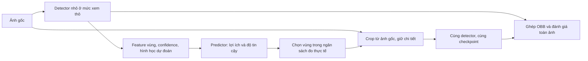

# T07 — Nghiên cứu lại từ đầu: lựa chọn hướng dưới ràng buộc 4 tuần / 60 USD

**Ngày chốt bằng chứng: 13/10/2026.** Định hướng gốc: *Multi-scale Aerial Object Detection and Segmentation* (#7). Người dùng cho phép thay phương pháp và dữ liệu; thời gian 4 tuần, Kaggle hoặc khoảng 60 USD trên Modal.

## 1. Kết luận để ra quyết định

**Nên dành bốn tuần cho một nghiên cứu hẹp về hiệu quả và độ tin cậy của việc cấp thêm độ phân giải cho phát hiện OBB, với một detector nhỏ giữ cố định.** Đây là hướng ưu tiên để kiểm tra, chưa phải kiến trúc mới đã được chứng minh. Không có bằng chứng hiện tại để gọi bất kỳ phương án nào dưới đây là “đủ Q1” hoặc “kiến trúc tốt nhất”.

Điểm quan trọng nhất từ rà soát: nhiều hướng nghe mới đã có tiền lệ rất sát. Học chọn vùng, dự đoán lợi ích khi zoom, Gaussian head, angle distribution, LoRA + multi-scale SAM đều đã có. Đóng góp phải vượt qua các đối chứng này bằng một phát hiện hoặc cơ chế cụ thể. Đặt mục tiêu “ghép kiến trúc mạnh nhất từ 50 bài” trước khi có chẩn đoán rất dễ tạo một hệ thống nhiều thành phần nhưng không biết vì sao tốt hơn.

**Đầu ra thực tế của 28 ngày nên là:** baseline đã tái lập, một giả thuyết đã bị kiểm tra nghiêm túc, kết quả đối chứng và độ biến thiên, code/config có thể chạy lại, bản thảo hoặc quyết định dừng có căn cứ. Nộp ứng viên Q2 chỉ hợp lý nếu kết quả qua các cổng bên dưới; Q1/hội nghị đầu ngành cần bằng chứng mạnh hơn, không mặc định nằm trong bốn tuần.

## 2. Đã khảo sát gì, chưa làm gì

[Corpus 50](CORPUS-50.md) gồm **32 bài trực tiếp, 8 bài chuyển giao cơ chế, 6 công trình dữ liệu và 4 baseline**. Có 55 ứng viên được định danh trong quá trình tuyển; 5 bài nền được thay bằng prior sát hơn. Đây là một khảo sát có chủ đích và citation chaining, **không phải SLR vét cạn hoặc thứ hạng “50 bài liên quan nhất” đã được chứng minh**.

Mức đọc hiện tại: **39 bài abstract/metadata; 10 bài đọc chọn lọc phương pháp hoặc thí nghiệm từ full text; 1 bài qua trích đoạn publisher**. Không gọi đây là 50 bài đã đọc toàn văn. Crossref khớp title cho 32 bài; 33 hồ sơ có DOI khớp hoặc được nguồn sơ cấp dẫn. Các DOI không khớp bị loại, không điền bằng kết quả tìm kiếm gần đúng. Bản arXiv, accepted và bản xuất bản được phân biệt trong CSV/JSON.

Ba lượt đọc song song bị dừng bởi giới hạn dịch vụ trước khi tạo distillate hoàn chỉnh. Điều phối viên tiếp quản việc xác minh corpus và đọc các đoạn trọng điểm. Vì vậy báo cáo ghi rõ mức đọc thực tế; chưa có full-method audit cho tất cả đối thủ gần. Không có detector nào đã được train hoặc tái lập trong lượt nghiên cứu tài liệu này.

File có thể dùng tiếp: [CSV](corpus-50.csv), [JSON](corpus-50.json), [protocol tìm tài liệu](PROTOCOL.md), [kế hoạch thí nghiệm và ngân sách](EXPERIMENT-PLAN.md), [audit](AUDIT.md). Các tài liệu mới lưu local; chưa push lên GitHub.

## 3. “Tiêu chuẩn Q2 và Q1” cần được hiểu đúng

Q1/Q2 mô tả vị trí **tạp chí** theo hệ chỉ số, năm và category; không phải điểm chất lượng của một bài hoặc số module cần có. JCR còn có thể gán quartile khác nhau cho cùng tạp chí ở các category khác nhau. Cần ghi đúng bộ: *tên tạp chí — hệ xếp hạng — năm dữ liệu — category — quartile*. [Clarivate: định nghĩa và xếp hạng](https://clarivate.libguides.com/jcr/basics), [quartile theo từng category](https://clarivate.com/academia-government/blog/a-primer-on-ties-in-the-jcr/).

**Sửa cách dùng rubric cũ:** quy tắc nội bộ “T1 chỉ Q4, T2 tương đương Q2, T3 mới Q1” không phải tiêu chuẩn ban biên tập. Đổi kiến trúc không phải điều kiện cần/phải đủ cho Q1. Có thể dùng T1/T2/T3 để mô tả loại can thiệp, nhưng không suy quartile từ nhãn đó. Các claim lịch sử C-11/C-12 không được tái sử dụng như định luật cho nghiên cứu mới.

CVPR yêu cầu công trình đúng kỹ thuật và có đóng góp; hướng dẫn còn nói không vượt SOTA hoặc chưa thử nhiều dataset không tự nó là lý do bác bài. Novelty phải được đối chiếu với nguồn cụ thể. [CVPR reviewer guidelines 2026, mục “Be Mindful/Be Specific”](https://cvpr.thecvf.com/Conferences/2026/ReviewerGuidelines). Đây là chuẩn tham chiếu về tư duy phản biện, không phải cam kết nhận bài hay thay thế quy định mùa 2027.

### Rubric thực hành cho dự án này — [design], không phải quy định chính thức

| Trục | Cổng cân nhắc gửi một tạp chí Q2 phù hợp | Cổng nâng mục tiêu Q1 / hội nghị đầu ngành |
|---|---|---|
| Câu hỏi | Một vấn đề có ích, phạm vi rõ, đo được | Vấn đề/insight có ý nghĩa vượt cấu hình và dataset cục bộ |
| Mới so với prior | Nêu được khác biệt thực chất với 3–5 prior gần nhất | Khác biệt thay đổi hiểu biết hoặc cách giải bài toán; không chỉ tổ hợp module |
| Bằng chứng cơ chế | Có đối chứng đơn giản, cùng tài nguyên, chứng minh phần nào tạo lợi ích | Phép thử có thể bác giả thuyết, failure cases, giải thích khi nào cơ chế thất bại |
| Tổng quát | Phạm vi claim khớp dữ liệu và miền đã thử | Kiểm chứng độc lập đủ để bảo vệ tính tổng quát; cần mở rộng nếu bài claim rộng |
| Đánh giá | Split sạch; metric đúng; so checkpoint/config tương đương; báo độ biến thiên | Thêm độ bền với domain/scale shift, frontier chất lượng–chi phí và đối thủ gần mạnh |
| Tái lập | Công khai config, seed, preprocessing, evaluator, ngân sách | Người khác có thể kiểm tra các kết luận trung tâm và các trade-off |
| Giá trị so với chi phí | Cải thiện hữu ích sau khi tính latency/VRAM và overhead | Cải thiện hoặc insight đủ đáng kể để thay đổi thực hành/nghiên cứu tiếp theo |

Không đặt một ngưỡng mAP chung cho Q2/Q1. Cũng không coi “hai dataset và ba seed” là vé vào Q1. Các số run trong kế hoạch là cách tiêu tiền của nhóm, không phải luật của venue.

### Venue đáng đối chiếu

- **Remote Sensing Letters:** phù hợp một kết quả phương pháp/ứng dụng gọn và rõ. Trang publisher hiện hiển thị *Q2 CiteScore Best Quartile*. Chưa xác minh được đầy đủ năm/category hoặc JCR/SJR tương ứng trong lượt này, nên **chưa chốt đây là Q2 theo chuẩn của trường**. [Publisher](https://www.tandfonline.com/journals/trsl20/about-this-journal).
- **IEEE TGRS:** scope nhấn mạnh tiến bộ phương pháp và nghiên cứu có ý nghĩa trong remote sensing. GRSS công bố Q1, category Remote Sensing trong thông báo JCR 2025; đây không phải xác nhận quartile mọi năm sau đó. [Scope chính thức](https://www.grss-ieee.org/publications/transactions-on-geoscience-remote-sensing/), [thông báo GRSS](https://www.linkedin.com/posts/ieee-grss_tgrs-ieeegrss-journalmetrics-activity-7382747311015256065-UwJw).
- **ISPRS Journal of Photogrammetry and Remote Sensing:** phù hợp nghiên cứu phương pháp hoặc ứng dụng có giá trị cho remote sensing/computer vision. Đây là venue tham chiếu cao để đọc NWD-RKA/FAIR1M, chưa gắn một quartile hiện hành chưa được nguồn sơ cấp xác minh. [Scope từ ISPRS](https://www.isprs.org/isprsjournal/).
- **CVPR/ICCV/ECCV:** xem như tuyến hội nghị riêng, không gọi là “Q1 conference”. Chỉ nên chọn tuyến này khi đóng góp có sức thuyết phục cho cộng đồng CV rộng hơn.

CVPR 2027 đang ghi hạn đăng ký **10/11/2026 AoE**, nộp bài **16/11/2026 AoE**. Kế hoạch bốn tuần kết thúc 09/11, sát hạn đăng ký; **không lấy việc kịp deadline làm lý do bỏ kiểm chứng**. [Lịch chính thức](https://cvpr.thecvf.com/Conferences/2027/Dates). Báo cáo không đăng ký hay nộp bài.

## 4. Những hướng đã bị prior art chiếm chỗ

| Ý tưởng ban đầu dễ chọn | Nguồn phải vượt qua | Hệ quả cho nhóm |
|---|---|---|
| Tìm vùng nhiều vật thể rồi zoom | R01 ClusDet, R10 AdaZoom, R11 YOLC | Không mới chỉ vì chuyển sang YOLO/OBB |
| Dự đoán vùng nào zoom sẽ tăng accuracy | R13 Dynamic Zoom-in, CVPR 2018 | Đây đã là cơ chế của R-net/Q-net |
| Phân chia tính toán theo latency budget | R14 Remix, F04 DenseScout | Phải nêu phần khác ngoài top-K/crop budget |
| Học crop theo detection loss | F05 AFWD-Net; F06 Visual Accommodation ở mức scale toàn ảnh | Không được nói selector chưa từng học từ task |
| Sparse high-resolution features | R02 QueryDet, R03 CEASC, R09 ESOD | Cần so với sparse baseline, không chỉ detector dense mặc định |
| Gaussian/angle-free OBB head | G04–G06, G10 GauCho | Covariance biểu diễn hình học không tự là uncertainty đã hiệu chuẩn |
| Dynamic số candidate/angle distribution | G11 GSDet, G12 O2-family, F01 RiO-DETR | “Dynamic queries” và “angle uncertainty” quá rộng để làm novelty |
| SAM + LoRA + đa tỷ lệ | S05 RS-SAM, S06 ROS-SAM | Đã có; thêm FPN vào SAM không đủ positioning |

Nguồn đặc biệt quyết định: [Dynamic Zoom-in](https://openaccess.thecvf.com/content_cvpr_2018/html/Gao_Dynamic_Zoom-In_Network_CVPR_2018_paper.html), [DenseScout](https://arxiv.org/abs/2604.25300), [GauCho](https://arxiv.org/abs/2502.01565), [AFWD-Net](https://www.mdpi.com/1424-8220/26/19/6157).

### Claim conflicts — những điều không được hòa chung

1. **“Độ phân giải cao giúp phát hiện” ≠ “phóng to mọi vùng là tối ưu”.** SAHI, QueryDet và ESOD minh họa lợi ích của xử lý chi tiết hơn trong setup riêng; AutoFocus/Remix/DenseScout đặt vấn đề phân bổ chi phí. Thí nghiệm phải giữ cả chất lượng lẫn tài nguyên trong so sánh. [R02, R04, R05, R09, R14, F04]
2. **Recall của selector ≠ AP của detector sau ghép.** DenseScout đã có closure benchmark với backend YOLOv8n cố định, nên không được gán cho nó lỗi “chỉ đo coverage”. Phải tách coverage, recall cuối và AP OBB. [F04, full text §3.1 và supplement §2.7]
3. **Gaussian shape ≠ phân bố sai số dự đoán.** GauCho mã hóa shape bằng Cholesky; muốn gọi đầu ra là bất định phải kiểm tra calibration riêng. [G10 §3.2–3.3; suy luận về thiết kế đánh giá]
4. **Semantic/interactive segmentation ≠ automatic instance detection.** Dice/IoU trong RS-SAM/ROS-SAM không thể đặt chung bảng với detection AP để xếp kiến trúc. [S05–S06]
5. **DOTA và iSAID không phải hai miền độc lập.** iSAID dùng cùng ảnh DOTA-v1.0; đây là lợi thế khi nghiên cứu box–mask nhưng phải khóa cùng scene split. [Dataset chính thức](https://captain-whu.github.io/iSAID/dataset.html).
6. **“First real-time oriented DETR” là claim có cạnh tranh.** F01 RiO-DETR và G12 O2-family đều dùng lời khẳng định tương tự trong abstract. Ghi nhận thời điểm/phiên bản, không chọn một lời “first” làm sự thật tuyệt đối.

## 5. Năm hướng cạnh tranh

Mức ưu tiên là **phán đoán theo 4 tuần / 60 USD**, không phải xác suất được nhận bài.

| Hướng | Phần cần kiểm chứng | Prior gần / rủi ro novelty | Pilot loại bỏ | Ưu tiên |
|---|---|---|---|---|
| H1: cấp độ phân giải theo độ tin cậy của lợi ích định vị OBB | Dự đoán lợi ích có calibration, xử lý cả vùng không có lợi hoặc gây hại dưới shift | R13, R14, F04–F06; gain routing chung đã cũ | Nếu uncertainty không thêm thông tin ngoài gain/density, bỏ phần mới | 1, chỉ để thử |
| H2: dự đoán chất lượng hình học thay vì chỉ confidence lớp | Chất lượng OBB theo scale/shape có cải thiện quyết định chọn–ghép ở budget cố định? | G05–G12; localization-aware score/uncertainty đã có | Nếu hiệu chỉnh score đơn giản đạt ngang, dừng đổi head | 2, dự phòng |
| H3: ổn định dự đoán tại biên crop | Tách truncation/context/merge rồi sửa một cơ chế cụ thể | R04, R05, F02; crop merging đã có nhiều biến thể | Nếu tăng overlap/crop ownership rẻ đã giải quyết, bỏ module | 3, rủi ro nghiên cứu thấp hơn nhưng novelty hẹp |
| H4: nhất quán box–mask cho vật thể nhỏ | Mask supervision có giúp hình học hơn cùng lượng nhãn và compute? | S01–S06, D04; multi-task đã phổ biến | Nếu thêm nhãn/teacher giải thích hết lợi ích, không claim kiến trúc | 4, tốn công dữ liệu |
| H5: scale-aware transfer từ mô hình pretrained | Feature adapter có bền hơn khi đổi resolution/native GSD? | S07–S11; domain/pretraining leakage | Nếu augmentation/multi-scale baseline đạt ngang, bỏ adapter | 5, chỉ transfer checkpoint |

**Cả năm đều chưa chạy được end-to-end như mô tả:** chưa đo throughput, chưa xác minh đủ checkpoint/config, chưa có internal baseline. H1 được chọn vì có thể thử phần lớn bằng inference và một predictor nhỏ, không vì đã xác nhận novelty.

### Quét bổ sung ngoài corpus cố định

Tìm kiếm theo uncertainty/OBB còn phát hiện [UGS, ICCV 2025](https://openaccess.thecvf.com/content/ICCV2025/papers/Sun_Uncertainty-Aware_Gradient_Stabilization_for_Small_Object_Detection_ICCV_2025_paper.pdf), [calibration cho oriented detection ảnh nhiệt](https://www.mdpi.com/1996-1073/18/12/3191), và [Partial Weakly-Supervised OOD, CVPR 2026](https://openaccess.thecvf.com/content/CVPR2026/html/Liu_Partial_Weakly-Supervised_Oriented_Object_Detection_CVPR_2026_paper.html). Các bài này mới ở mức phát hiện/abstract, **chưa dùng để kết luận một gap tồn tại**. Đây là danh sách phải đọc tiếp trước khi tuyên bố H1/H2 khác prior; không ép mọi bài mới vào con số 50.

## 6. Kiến trúc nên thử đầu tiên — [design, cần thực nghiệm]

Tên làm việc: **bộ chọn độ phân giải cho OBB có kiểm tra độ tin cậy**. Không đặt tên thương hiệu hay viết “novel network” ở giai đoạn này.

Detector, OBB representation và merge ban đầu đều giữ cố định. Không đồng thời thêm wavelet, super-resolution, Gaussian head và mask teacher. Predictor chỉ là bộ phận cần thử; một MLP nhỏ hoặc mô hình cây trên feature cache cũng phải được so trước khi thêm attention.

**Câu hỏi trung tâm:** khi đổi scale/độ nét/mật độ, một selector có thể biết việc xử lý chi tiết hơn sẽ giúp định vị đến mức nào, và biết khi nào dự đoán lợi ích của nó không đáng tin? Đây là câu hỏi nghiên cứu, chưa phải gap đã được xác nhận. Việc dự đoán gain đã có ở R13; phần có thể khác phải nằm ở định nghĩa rủi ro OBB, calibration dưới shift, hoặc quy tắc quyết định có bằng chứng tốt hơn — không nằm ở từ “adaptive”.

Có thể huấn luyện predictor bằng kết quả xem thô/xem chi tiết trên **split dành cho học selector**, giữ detector cố định. Nhãn mục tiêu nên đo thay đổi TP/FP hoặc localization utility dưới matching cố định; không gọi một đại lượng cộng theo patch là “delta AP” nếu nó không bằng AP toàn tập. Không được lấy GT validation/test làm input chọn crop khi báo kết quả chính.

Nếu reliability-aware policy không tốt hơn gain-only/heatmap ở cùng chi phí, bỏ nhánh uncertainty. Nếu gain-only cũng không hơn baseline đơn giản, kết quả trung thực là hướng này chưa đáng phát triển thành phương pháp mới.

## 7. Chọn dữ liệu từ bài toán, không giữ mặc định proposal cũ

- **DOTA-v1.0:** ứng viên pilot OBB vì task khớp và baseline phong phú. Không tự gán cho nó thuộc tính “toàn tiny”.
- **DOTA-v2.0:** giữ làm mục tiêu mở rộng của #7 nếu thời gian tải/chạy đủ; dùng đúng annotation v2.0, không trộn nhãn phiên bản. [DOTA official](https://captain-whu.github.io/DOTA/dataset.html).
- **AI-TOD-R:** chỉ chọn lại nếu tiny-OBB thật sự là câu hỏi chính và kiểm tra dữ liệu/split đạt. Việc xuất hiện trong proposal cũ không phải lý do tuyển.
- **VisDrone:** kiểm tra cơ chế budget/scale ở HBB hoặc làm nhánh thay thế nếu OBB tooling chặn tiến độ. Không dùng nó làm bằng chứng trực tiếp cho angle accuracy.
- **iSAID:** dùng khi chọn H4; chia theo ảnh gốc đồng bộ với DOTA. DOTA+iSAID không đủ để claim cross-domain.
- **FAIR1M/DIOR-R:** ứng viên validation độc lập cho OBB, nhưng phải xác minh access, nguồn ảnh trùng và đúng nhãn. DIOR gốc trong D03 không đồng nhất với DIOR-R.

Open Images có bbox/mask tổng quát nhưng trang chính thức không cung cấp một protocol tiny aerial OBB tương ứng. Vì vậy **[design] không ưu tiên làm benchmark chính**, chỉ cân nhắc nguồn pretraining có kiểm soát. [Open Images V7](https://storage.googleapis.com/openimages/web/index.html).

## 8. Kế hoạch bốn tuần và giới hạn quyết định

Chi tiết run và ngân sách nằm ở [EXPERIMENT-PLAN.md](EXPERIMENT-PLAN.md).

| Tuần | Ngày | Kết quả phải có | Dừng/chuyển khi |
|---|---|---|---|
| 1 | 13–19/10 | Chốt task; đọc full-method prior gần; kiểm tra data/checkpoint; baseline + profiling; đồ thị resolution response | Không tái lập được baseline hoặc không có hiện tượng đáng nghiên cứu |
| 2 | 20–26/10 | So fixed tiling, density/heatmap, gain-only và risk-aware trên cùng backend; chỉ chọn một can thiệp | Baseline đơn giản giải thích hết lợi ích; chi phí vượt dự toán |
| 3 | 27/10–02/11 | Xác nhận paired runs, held-out scenes/shift, failure cases; thử miền độc lập nếu đã sẵn | Hiệu quả chỉ có trên subset chọn sau hoặc biến mất khi khớp compute |
| 4 | 03–09/11 | Khóa cấu hình; validation cuối; code/config, bảng kết quả, bản thảo và quyết định venue | Thiếu bằng chứng cơ chế => báo cáo pilot, không đổi nhãn thành Q1 |

Không dùng AI để hợp thức hóa số run chưa thực hiện, tự sinh citation, hoặc điều chỉnh hypothesis sau khi xem test mà vẫn gọi là đăng ký trước.

### Venue Claim Card — C-13, nghiên cứu mới

- **Proposal:** năm ứng viên ở §5; H1 là hướng thử ưu tiên, không thay proposal v2.1 bằng một claim đã xác nhận.
- **Novelty tier:** chưa xác nhận. H1/H3 có thể chỉ là T1 nếu ghép policy/hậu xử lý đã có; H2/H4/H5 có thể có thay đổi module nhưng điều đó không quyết định quartile.
- **Venue band:** hiện chưa có đủ kết quả để gán band có thể bảo vệ. Cân nhắc venue Q2 phù hợp sau các cổng validity/novelty/utility; chỉ nâng mục tiêu Q1/top conference khi insight và kiểm chứng đủ rộng cho claim.
- **Downgrade triggers:** prior đã chứa cơ chế chính; không hơn đối chứng khớp tài nguyên; thất bại trên scene giữ lại; không tái lập; phát hiện leakage.
- **Confidence:** trung bình về bản đồ prior; thấp về novelty còn lại và hiệu quả của các đề xuất.
- **Feasibility:** chưa xác minh end-to-end; 60 USD là trần chi, không là bằng chứng đủ train.
- **Ledger:** C-13 trong ledger dự án; theo dõi ứng viên chi tiết tại [DECISIONS.md](DECISIONS.md).

## 9. Prompt nghiên cứu thay cho “tìm 50 bài rồi ghép kiến trúc”

> Với bài toán multi-scale aerial detection/segmentation, hãy xác định các failure mechanisms có thể đo và bác bỏ. Tuyển tài liệu theo vai trò giải thích hoặc phản biện từng cơ chế; phân biệt trực tiếp/chuyển giao/dữ liệu/baseline, ghi nguồn sơ cấp và mức đã đọc. Với mỗi hướng, tìm đối thủ gần nhất kể cả bài cũ và bài 2026, nêu chính xác phần đã có, phần chưa xác minh và phép thử rẻ nhất làm ý tưởng thất bại. Không tối ưu số module hoặc nhãn Q1. Chọn một thiết kế có thể kiểm chứng trong 28 ngày với Kaggle và 60 USD Modal; lập protocol khớp tài nguyên, split theo cảnh, metric toàn ảnh và chi phí end-to-end. Chỉ nâng mục tiêu venue sau khi bằng chứng thực nghiệm và novelty scan cho phép. Nếu không tìm được gap đủ mạnh, trả về kết luận đó cùng phương án nghiên cứu tiếp, không đặt tên mới cho một tổ hợp cũ.
