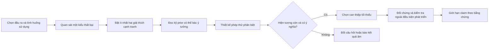

# T07 — Những mục tiêu cải tiến đáng nghiên cứu, trước khi chọn kiến trúc

**Ngày chốt khảo sát: 13/10/2026.** Định hướng: *Multi-scale Aerial Object Detection and Segmentation*. Phạm vi lần này là mở rộng câu hỏi khoa học, **không lọc hướng theo tiền train**. Đây là bản đồ để chọn vấn đề; chưa có thí nghiệm chứng minh phương án nào vượt trội.

## 1. Điều thay đổi so với kết luận trước

Lượt trước ưu tiên H1 — chọn vùng tăng độ phân giải có xét reliability — vì phù hợp bốn tuần/60 USD [C-13, báo cáo trước]. Ưu tiên thực dụng đó **không chứng minh H1 là hướng nghiên cứu mạnh nhất**. Theo yêu cầu mới, H1 trở về một câu hỏi trong nhiều nhánh, ngang hàng với hình học, segmentation, thời gian, tracking và khả năng chuyển miền. Lịch bốn tuần của triển khai chưa được sửa trong lượt khám phá này.

Mục tiêu tốt nên mô tả **khả năng muốn cải thiện và tình huống thất bại**, ví dụ “không mất dấu một xe nhỏ khi drone quay”, thay vì khởi đầu bằng “thêm Transformer/SAM/zoom”. Kiến trúc là câu trả lời cần kiểm nghiệm sau đó.

“Vượt trội” có ít nhất ba cách hiểu khác nhau: chất lượng cao hơn với cùng thông tin/nhãn được phép; chất lượng trạng thái hiện tại tốt hơn khi phải trả kết quả đúng hạn; hoặc ít suy giảm hơn ở miền chưa thấy. Chúng cần các đối chứng riêng, không gộp thành một thứ hạng duy nhất.

**Cách đọc bằng chứng:** cột “đã làm được” chỉ nói về điều paper mô tả/thử trong setup của nó. Mọi câu hỏi và đề xuất thí nghiệm dưới đây là **[design]**. “Cần khảo sát” không có nghĩa “chưa ai làm”. Corpus nền có 50 hồ sơ nhưng chỉ 10 bài được đọc các đoạn phương pháp/thí nghiệm chọn lọc; mức đọc từng nguồn bổ sung được ghi riêng.

Nguồn: [corpus nền](../t07-fresh-research/CORPUS-50.md), [nguồn bổ sung N-series](EVIDENCE-UPDATE.md), [nguồn X-series](ROOT-SOURCES.md), [phản biện độc lập](CRITIQUE.md), [ngân hàng câu hỏi](QUESTION-BANK.md).

## 2. Tách đúng bài toán trước khi hỏi

| Bài toán | Cần trả lời điều gì? | Đầu vào/nhãn cần thiết | Không được dùng kết quả để suy ra |
|---|---|---|---|
| Detection ảnh tĩnh | Có vật thể nào, ở đâu? | Ảnh, lớp, HBB/OBB/polygon theo protocol | Khả năng giữ ID qua video |
| Instance segmentation | Pixel nào thuộc từng vật thể riêng? | Instance masks; nêu rõ automatic hay được prompt | Semantic IoU cao là tách đúng từng xe/tàu |
| Semantic segmentation | Mỗi pixel thuộc loại bề mặt/lớp nào? | Semantic labels | Có thể đếm hoặc theo dõi từng instance |
| Video detection | Các frame trước có giúp phát hiện ở frame hiện tại? | Video, boxes từng frame; khóa causal/offline | Tracking tốt nếu chưa đánh giá ID |
| Multi-object tracking — MOT | Đối tượng nào vẫn là chính nó qua thời gian? | Video, detection labels và track IDs, births/deaths | AP tăng đồng nghĩa association tăng |
| Single-object tracking — SOT | Giữ một mục tiêu đã được chỉ định ở đâu? | Target khởi tạo theo protocol | Phát hiện mọi mục tiêu mới trong cảnh |
| Streaming perception | Đầu ra có đúng với thế giới lúc kết quả đến nơi? | Timestamp, pipeline latency, nhãn trạng thái/ID | FPS cao đồng nghĩa thông tin còn mới |
| Active perception | Nên quan sát đâu/bằng hành động nào tiếp theo? | Hành động camera/sensor và quan sát tương ứng | Crop từ ảnh đã lưu tương đương điều khiển camera thật |

Đây là bản phân loại tác vụ [design], đối chiếu D01/D04/D05, N01–N07 và X03–X04. Các nhánh video/active perception là mở rộng hợp lý của định hướng trên không; chúng cần đặc tả mới thay vì dùng nguyên evaluator ảnh tĩnh. Không gộp “phát hiện drone từ camera mặt đất” vào “drone chụp vật thể phía dưới”.

### Riêng “zoom” phải tách thành bốn việc

1. **Crop từ ảnh gốc còn nhiều pixel:** giữ chi tiết vốn có nhưng bị mất khi resize cả ảnh. SAHI/ClusDet/AutoFocus là prior trực tiếp [R01/R04/R05].
2. **Nội suy ảnh nhỏ:** tăng số pixel biểu diễn, không thu thêm phép đo. Có thể giúp mạng khớp scale huấn luyện; cần kiểm tra thay vì gọi là phục hồi thông tin thật.
3. **Super-resolution:** dùng mô hình/prior để suy ra chi tiết. Phải đo detection/hình học và false positives, không chỉ ảnh đẹp hoặc PSNR. SuperYOLO còn dùng SR như nhánh hỗ trợ huấn luyện rồi bỏ ở inference [N16]; không nên mô tả mọi SR là “phóng to ảnh trước detector”.
4. **Zoom quang học/đổi điểm quan sát:** thu quan sát mới và đổi vùng nhìn. Đây là nhánh mở rộng cần dữ liệu hành động; các bài crop trong corpus không đủ chứng minh hiệu quả vòng điều khiển này.

Phân biệt 2–4 là lập luận về nguồn thông tin; chưa có thí nghiệm so sánh bốn chế độ trong dự án.

## 3. Mười ba mục tiêu cải tiến

Các mục tiêu M01–M13 là **trục chẩn đoán**, không phải mười ba đề tài phải làm đồng thời. Chọn một hiện tượng trung tâm rồi lấy những trục cần thiết.

| Mục tiêu | Nghiên cứu đã tiến tới đâu? | Câu hỏi đáng kiểm tra tiếp [design] | Thế nào là cải thiện có ý nghĩa? [design] |
|---|---|---|---|
| **M01. Nhìn thấy vật thể đang quá nhỏ/mờ** | Tiling, xử lý feature phân giải cao và SR-assisted learning đã có [R02/R04/R09, N16/N17]. | Bỏ sót đến từ thiếu pixel, scale lệch với huấn luyện, hay tín hiệu đã mất vì blur? Khi nào SR cải thiện định vị và khi nào tạo chi tiết gây nhận nhầm? | Recall vật thể tiny, AP theo kích thước/blur và false positives cùng thay đổi theo dự đoán; có đối chứng ảnh native chất lượng cao. |
| **M02. Quan sát đúng vùng và đúng mức zoom** | ClusDet/AdaZoom/YOLC chọn vùng; Dynamic Zoom-in dự đoán gain; DenseScout có đánh giá detector cuối [R01/R10/R11/R13/F04]. | Đang zoom nơi đông nhất, nơi dễ nhất hay nơi còn khả năng cứu lỗi? Policy có bỏ rơi vật thể cô lập hoặc mới xuất hiện? | Tăng số lỗi thực sự được cứu, giảm vùng zoom vô ích/gây hại; nếu claim online thì phải giữ deadline. Không chỉ tăng coverage của selector. |
| **M03. Giữ đồng thời chi tiết nhỏ và ngữ cảnh lớn** | FPN, context trong sparse detection và scale-aware pretraining đã có [B01/R03/S07]. | Mạng dùng context để nhận biết hay học shortcut nền? Scale theo pixel và scale theo mét có cần biểu diễn khác nhau? | Lợi ích giữ được khi đổi crop/context/geography; tiny tốt hơn mà vật thể lớn không bị đánh đổi âm ngoài ngưỡng đã khai báo. |
| **M04. Định vị và hướng quay đúng mức thông tin ảnh** | Rotated RoI, Gaussian losses/heads, phase encoding và equivariance có nhiều prior [G01–G10, N15]; UGS xử lý một phần bất ổn localization [X01]. | Sai góc do tối ưu, quy ước nhãn hay thực sự không quan sát được? Với vật thể gần vuông, angle error có còn ý nghĩa? | Rotated AP/overlap và sai số hình học cải thiện theo size/aspect/blur; kiểm tra box tương đương và nhãn. Không chỉ làm góc “mượt hơn”. |
| **M05. Tách các vật thể sát nhau, tránh gộp và đếm trùng** | Matching/query/assignment và box–mask methods đã có [G08/G09/R06–R08/S01/S02]. | Giới hạn đến từ feature hòa lẫn, thiếu positive samples, số queries, NMS hay chính nhãn? Có phân biệt được “hai vật thể” với “một vật thể lớn” không? | Recall theo mật độ/khoảng cách, lỗi gộp–tách và đếm trùng; AP toàn ảnh sau ghép. Cap và hậu xử lý phải được kiểm tra. |
| **M06. Phân đoạn đúng từng vật thể nhỏ, biên không dính nhau** | iSAID có instance masks; SAM và các biến thể RS có cơ chế prompt/multiscale; SOPSeg đánh giá given-box→mask [D04/S01–S06, N18]. | Box và mask bổ trợ thật ở điều kiện nào? Prompt chất lượng thấp gây lỗi gì? Boundary supervision có hữu ích khi vật thể chỉ vài pixel? | Với box có sẵn: IoU/biên có điều kiện trên prompt. Với pipeline tự động: mask AP, split/merge errors. Tách predicted-prompt và GT-prompt; cùng quyền truy cập nhãn. |
| **M07. Dùng thời gian để cứu vật thể mất ở từng frame** | Benchmark UAV video và các hướng aerial streaming/memory đã có [D05/N01/N05]. PointSR gom pseudo-box qua epoch/iteration huấn luyện, không phải video fusion [N09]. | Frame trước mang thêm bằng chứng hay chỉ làm trơn? Camera motion có làm fusion kéo nhầm nền lên vật thể? Lịch sử có che mất vật thể vừa xuất hiện? | Video AP/recall theo blur/occlusion; thời gian tới lần phát hiện đầu tiên; chỉ dùng frame đã có nếu claim online. |
| **M08. Giữ đúng danh tính qua quay camera, che khuất và đổi scale** | Có benchmark riêng UAV MOT, SOT và multispectral SOT [N01/N02/N03/N06]. | Mất ID vì detector bỏ sót hay association sai? Appearance của tiny objects có đủ phân biệt không? Motion compensation có còn đúng khi parallax mạnh? | HOTA và các thành phần detection/association, ID switches, thời gian tái bắt; phân nhóm camera motion/occlusion. SOT dùng metric/protocol riêng. |
| **M09. Trả thông tin đúng lúc, đúng vị trí hiện tại** | Streaming perception đã xét scheduling/forecasting từ 2020; HARD 2026 thêm đánh giá MOT có latency [X04/N04]. | Zoom nhiều làm detection tốt hơn nhưng kết quả có bị cũ? Nên nhận biết lại, dự báo hay cập nhật track nào trước khi deadline đến? | Chất lượng trạng thái tại thời điểm đầu ra, sAP/s-HOTA phù hợp protocol, p95 latency và deadline misses. Đo cả capture/transfer/crop/infer/merge/track khi có quyền đo. |
| **M10. Chịu được đổi địa lý, sensor, thời tiết và độ cao** | RWDS đánh giá shift; N06–N08 nghiên cứu các setup đa cảm biến. N11 là domain-incremental detection tuần tự có replay, không phải zero-shot domain generalization [F03/N06–N08/N11]. | Shift nào thực sự gây lỗi? Sensor bổ sung có giúp khi lệch đăng ký hoặc thiếu modality? Scale metadata có hữu ích ngoài scene identity? | Quality theo miền/điều kiện, worst-group và mức suy giảm so với miền gốc; giữ ontology/annotation protocol tương thích. |
| **M11. Tìm lớp mới và mục tiêu được mô tả bằng ngôn ngữ** | RemoteCLIP/SegEarth-OV và OpenRSD cung cấp các prior vision-language/open-prompt; DroneEyes mở nhánh referring video segmentation [S10/S11/N10/N05]. | Lớp chưa thấy có được nhận ra ở độ phân giải tiny? Prompt mơ hồ và distractors giống nhau xử lý thế nào? Open-vocabulary có bị lẫn với khả năng từ chối unknown không? | AP lớp novel với split công khai; sai do prompt/distractor; khả năng từ chối unknown đánh giá riêng. Không dùng điểm semantic segmentation làm bằng chứng OBB. |
| **M12. Học tốt hơn khi nhãn thiếu, sai hoặc không xác định duy nhất** | AI-TOD-v2 sửa nhãn; PointSR/Point2RBox-v2 học từ điểm; có sparse annotation và prompt/mask generation [R07/N09/X02/N12/N18]. | Chất lượng dữ liệu hay kiến trúc đang là nút thắt? Nhãn góc/mask tiny có mức bất đồng nào? Chọn sửa nhãn nào để giảm lỗi có hệ thống? | So tại cùng loại/quyền truy cập supervision; audit nhãn độc lập, sensitivity với thiếu/sai nhãn; cải thiện trên tập kiểm tra được rà soát. |
| **M13. Biết khi nào dự đoán không đáng tin và dùng được thông tin đó** | Geometry distributions và uncertainty-guided training đã có [G04/G10/G12/X01]. | Confidence của lớp, chất lượng box, ambiguity quan sát và uncertainty của gain có phải cùng đại lượng? Calibration có thay đổi quyết định hữu ích hay chỉ đổi score? | Risk ở coverage cố định, ranking lỗi, calibration theo scale/shift và utility của quyết định; so post-hoc calibration, mean-only và shuffled-uncertainty. |

**Hai điểm cần giữ:** một mô hình xử lý toàn bộ chi tiết với cấu hình mạnh là đối chứng quan trọng khi đã bỏ lọc chi phí. Ngược lại, nếu bài toán tự nó yêu cầu deadline online, latency vẫn là thuộc tính khoa học phải đo; bỏ ngân sách tiền không làm vật thể ngừng chuyển động.

**Giới hạn nguồn segmentation:** ReSOS trong N18 dùng masks do teacher sinh từ SODA-A OBB rồi lọc thủ công; không phải mọi mask do người vẽ độc lập. Kết quả SOPSeg với bounding box được cung cấp không chứng minh khả năng tự phát hiện và phân đoạn mọi vật thể. Nếu dùng ReSOS để xác nhận, cần audit bias của teacher hoặc một tập nhãn độc lập.

## 4. Gom thành năm chương trình nghiên cứu có câu hỏi trung tâm

Đây là các phương án để chọn, **không đề xuất train cả năm hoặc ghép chúng vào một network**. Mỗi phương án hiện ở trạng thái câu hỏi/thiết kế; tính mới và khả năng chạy end-to-end chưa xác nhận.

**Quy ước bác bỏ [design]:** trước lượt xác nhận phải khóa endpoint, nhóm điều kiện và một biên hiệu quả nhỏ nhất có ý nghĩa cho task. Chưa có số biên này trong dự án. “Không khác biệt có ý nghĩa thống kê” không đủ để kết luận tương đương; cần khoảng tin cậy đủ hẹp so với biên đã khóa. Các thẻ dưới đây là thiết kế ban đầu, chưa là preregistration hoàn chỉnh.

### P1 — Thiếu thông tin hay mạng sử dụng thông tin kém? (M01–M03)

**Câu hỏi trung tâm:** khi tiny object bị bỏ sót, mức cải thiện đến từ thông tin chi tiết thực, sự khớp scale với huấn luyện, hay thêm context?

**Giả thuyết có thể bác [design]:** đáp ứng với tăng chi tiết phụ thuộc vào chất lượng quan sát và scale mismatch, nên một luật zoom theo diện tích/độ đông sẽ không giải thích hết lỗi. Trước tiên cần đo hiện tượng; chưa mặc định cần predictor mới.

**Phép thử phân biệt:** tách ảnh native→downsample→upsample khỏi crop native, SR và train-scale-matched detector; giữ vùng nhìn/context được kiểm soát, đo theo blur/size. So full-detail reference, tiling, gain routing đã có và SR-assisted baseline. Blur và downsample mô phỏng không được thay thế toàn bộ dữ liệu sensor thật.

**Điều gì bác giả thuyết trung tâm?** Sau khi cân bằng/kiểm soát context, size và nhãn, tương tác giữa chất lượng quan sát với lợi ích thêm chi tiết không vượt biên thực dụng đã khóa, và size/density-only dự đoán đáp ứng tốt tương đương trên cảnh giữ lại. Phải tách kiểm định hiện tượng này khỏi việc một selector mới có thắng hay không.

**Bác hướng phát triển module** nếu resizing/scale augmentation hoặc xử lý toàn ảnh chi tiết đã giải thích toàn bộ lợi ích. Kết quả âm vẫn cho biết nhóm nên sửa dữ liệu/recipe, không thêm kiến trúc. Prior: R04/R13/F04/N16/N17.

### P2 — Hình học và segmentation phù hợp với bằng chứng quan sát (M04–M06)

**Câu hỏi trung tâm:** khi nào ảnh thực sự hỗ trợ một OBB/góc hoặc mask cụ thể, và khi nào hệ thống đang bị ép học sự tùy ý của nhãn?

**Giả thuyết có thể bác [design]:** một phần bất ổn ở tiny/near-square/blur phản ánh ambiguity của đầu ra và annotation, không chỉ thiếu rotation-aware architecture.

**Phép thử phân biệt:** audit nhãn/polygon và box tương đương; đo bất đồng của người gán nhãn độc lập; đổi size/aspect/blur; đối chiếu Gaussian/phase/equivariance controls và cùng supervision cho box–mask. Không dùng raw angle error cho hình đối xứng như một endpoint duy nhất. Mục tiêu segmentation phải được đo bằng instance masks, không chỉ box.

**Điều gì bác giả thuyết trung tâm?** Trong đầu ra đã chọn (OBB hoặc mask), sau chuẩn hóa nhãn vẫn có đồng thuận cao giữa các annotator; các thay đổi ambiguity được kiểm soát không dự báo phần lỗi còn lại ngoài noise margin, còn thay đổi optimization/representation giải thích ổn định hiện tượng trên tập giữ lại. Kết quả này làm yếu giả thuyết ambiguity là nguyên nhân đáng kể trong phạm vi đó; không chứng minh toàn bộ ảnh tiny đều xác định được.

**Bác cơ chế được đề xuất** nếu chuẩn hóa nhãn, mạnh hóa baseline hoặc thêm cùng lượng supervision đã xóa khác biệt. Insight chẩn đoán vẫn có thể tồn tại nhưng không đủ để gọi một head mới là cần thiết. Prior: G04–G10/N15/X01/D04/S01–S06.

### P3 — Thấy liên tục và trả kết quả còn mới (M07–M09)

**Câu hỏi trung tâm:** có nên chọn quan sát theo khả năng cứu một track/đối tượng mới trước deadline, thay vì chỉ tối đa detection ở từng ảnh?

**Giả thuyết có thể bác [design]:** ưu tiên thu thêm bằng chứng tại các điểm dễ mất ID/khởi tạo track có thể cải thiện trạng thái hiện tại, so với chính sách ưu tiên AP ảnh tĩnh. Đây chưa phải claim mới; latency-aware scheduling/forecasting và aerial streaming đã có prior trực tiếp/chuyển giao.

**Phép thử phân biệt:** cùng bộ frame, detector và tracker; tách detector recall khỏi association; so fixed schedule, motion-only policy, gain-only policy, full-frame detector mạnh và policy theo track. Dùng causal frames; kiểm tra new births, reappearance, camera rotation, parallax. Đo timestamp đầu vào/đầu ra, queue, dropped frames và các thành phần HOTA.

**Bác giả thuyết cải thiện quyết định** nếu endpoint trạng thái hiện tại/association dưới cùng deadline không tốt hơn policy theo detection trong biên đã khóa, hoặc giảm chất lượng phát hiện mục tiêu mới quá ngưỡng đã khai báo. **Bác hướng module** nếu association/motion compensation tiêu chuẩn hoặc detector tốt hơn giải thích toàn bộ gain.

**Giới hạn bằng chứng hiện có:** HARD là preprint; thí nghiệm MOT streaming chính trên lớp **Car**, khoảng cách frame **2 giây**, mặc định nhân bản workers để **không có queue**. Không chuyển số s-HOTA đó thành runtime của một GPU onboard hoặc video tốc độ cao. DroneEyes/SkyAnchor cũng là preprint; phương pháp dùng causal stream nhưng các MLLM baselines ở Table II dùng chế độ offline, và tác giả nêu hạn chế với high-speed closed-loop/native capture rate. Vì vậy hai nguồn gợi mở câu hỏi, chưa chứng minh một giải pháp giải được bài toán online tốc độ cao. Prior: N01/N03/N04/N05/X03/X04.

### P4 — Nhận biết đúng và đáng tin ở điều kiện chưa thấy (M10–M11, M13)

**Câu hỏi trung tâm:** phần nào của hệ thống thực sự chuyển được sang sensor/địa lý hoặc lớp mới, và khi nào nó cần báo rằng bằng chứng không đủ?

Để tránh scope quá rộng, chọn **một** nhánh xác nhận: (a) closed-set cross-domain detection, hoặc (b) open-vocabulary detection/segmentation. Không trộn unknown-class và domain shift thành một phép thử duy nhất.

**Giả thuyết có thể bác [design]:** tách nguồn bất định/điều kiện quan sát sẽ giúp quyết định chấp nhận hoặc yêu cầu quan sát lại bền hơn score lớp đơn lẻ.

**Phép thử phân biệt:** khóa ontology, nhãn và split theo địa lý/sequence; đối chứng augmentation, post-hoc calibration và backbone/pretraining mạnh. Nếu dùng RGB–IR, thử lệch đăng ký/mất modality; nếu dùng text, giữ prompt protocol và novel-class split. Báo risk ở cùng coverage và kết quả theo miền, không chỉ ECE trung bình.

Phải khai báo hệ thống có được thích nghi trên dữ liệu miền đích không. N11 học tuần tự qua miền và có replay; không dùng kết quả đó như bằng chứng khái quát zero-shot sang miền chưa thấy, hay mặc định source-free/unlabeled adaptation.

**Bác giả thuyết trung tâm** nếu risk trên các miền giữ lại ở cùng coverage không giảm tới biên thực dụng đã khóa so với score-only/post-hoc calibration, hoặc giảm risk chỉ do từ chối thêm các trường hợp khó mà không giữ coverage. **Bác phương pháp** nếu cơ chế cần biết test labels trước. Prior: F03/S07/S10/S11/N06/N08/N10/N11. N07 hữu ích để mở nhánh sensor nhưng semantic labels không tự đủ cho tiny OBB/MOT.

### P5 — Giám sát nào tạo ra tiến bộ thật? (M12, nối M04–M06)

**Câu hỏi trung tâm:** ở vùng dense/tiny, thêm/sửa loại nhãn nào giảm lỗi nhận biết thực sự, và mô hình nào tận dụng được tín hiệu đó mà không học theo pseudo-label sai?

**Giả thuyết có thể bác [design]:** chất lượng/ambiguity của annotation giải thích một phần đáng kể khác biệt đang bị gán cho kiến trúc.

**Phép thử phân biệt:** một tập gốc chia cùng scene, có nhãn audit độc lập; tạo các mức point/box/mask và controlled missing/noisy annotations; đối chiếu point-supervised prior, supervised baseline và cùng teacher. Tách label efficiency khỏi tiền train — giá trị ở đây là hiểu lượng/thể loại giám sát cần để học.

**Điều gì bác giả thuyết trung tâm?** Factorial kiến trúc × mức nhãn sạch/nhiễu cho thấy khác biệt kiến trúc vẫn ổn định trên tập audit, và các can thiệp nhãn đã định nghĩa không giải thích được mức thay đổi vượt biên đã khóa. Đây là bác vai trò nhãn trong hiện tượng cụ thể, không phải bác giá trị nhãn tốt nói chung.

**Bác việc đổi kiến trúc** nếu sửa nhãn đơn giản làm lợi ích biến mất hoặc kết quả chỉ tốt hơn dưới một evaluator nhiễu. Prior: R07/N09/X02/N12/N18. Mask do mô hình sinh không được coi là ground truth độc lập nếu chưa audit.

## 5. Mười hai câu hỏi nên tranh luận trước

Đây là tuyển chọn của điều phối viên theo sức phân biệt giữa các giải thích, chưa xếp hạng theo mức tăng điểm dự kiến. Ngân hàng câu hỏi đầy đủ nằm ở [QUESTION-BANK.md](QUESTION-BANK.md).

1. **Nếu cấp lại pixel native mà vẫn bỏ sót, giả thuyết “thiếu độ phân giải” còn đứng được không?** So scale-matched training và label audit trước thay kiến trúc. [M01/P1]
2. **Ảnh SR giúp phát hiện vật thể thật hay làm detector tự tin hơn vào chi tiết do prior sinh ra?** Cần ảnh native tham chiếu, false-positive audit và kiểm tra sensor shift. [M01/P1]
3. **Nếu không phải tiết kiệm tiền, vì sao vẫn cần chọn vùng zoom thay vì xử lý toàn bộ ảnh?** Câu trả lời phải là giới hạn deadline/quan sát hoặc một cơ chế chất lượng có bằng chứng. [M02/P1/P3]
4. **Context giúp hiểu vật thể hay làm mạng đoán lớp từ nền?** Giữ foreground, can thiệp context có kiểm soát và kiểm tra ảnh thật ngoài miền. [M03/P1]
5. **Hai người có nhất trí về góc/biên của vật thể vài pixel không?** Nếu không, chuẩn thành công có đang đòi một đáp án duy nhất không được dữ liệu hỗ trợ? [M04/P2/P5]
6. **Cảnh đông đang thất bại trước hay sau NMS/merge?** Muốn sửa feature, trước hết phải loại khả năng cap/query/merge đang xóa detection đúng. [M05/P2]
7. **Mask giúp vì có ràng buộc hình học tốt hơn hay đơn giản vì được thêm nhãn?** So cùng supervision, cùng teacher và cùng thông tin lúc inference. [M06/P2]
8. **Frame trước cứu bỏ sót hay duy trì một sai lầm qua nhiều frame?** Xem cả vật thể vừa xuất hiện và biến mất; thêm đối chứng duplicate/shuffled frames. [M07/P3]
9. **Khi camera quay, tracker nhầm đối tượng vì không thấy rõ hay vì mô hình chuyển động sai?** Tách detector oracle, association controls và camera-motion compensation. [M08/P3]
10. **Một detection chính xác nhưng đến muộn có giá trị thấp hơn một ước lượng ít chính xác nhưng còn mới không?** Khóa deadline và metric trạng thái hiện tại trước chọn kiến trúc. [M09/P3]
11. **Đổi địa lý mà giữ phân bố size tương đương thì mô hình còn suy giảm không?** Nếu còn, bài toán không chỉ là multi-scale. [M10/P4]
12. **Khi đã dự đoán đúng lợi ích trung bình, uncertainty còn thay đổi quyết định nào?** Nếu không có tail-risk, lỗi bất đối xứng hoặc tương tác, đừng thêm uncertainty chỉ vì tên nghe hiện đại. [M13/P4; phản biện bên dưới]

## 6. Những sửa đổi sau phản biện Astra

### Không giữ H1 ở ngôi đầu

Lựa chọn trước dựa trên khả năng thực thi rẻ. Corpus cũng nghiêng về resolution/geometry. Bản này trả segmentation/video/shift về cùng tầng lựa chọn, thêm nguồn đối nghịch và không đặt tên kiến trúc trước khi xác nhận hiện tượng.

### Reliability phải gắn với một quyết định xác định

**Lập luận có điều kiện [suy luận]:** nếu utility cộng độc lập, quyết định risk-neutral, và đã biết đúng conditional mean của utility với toàn bộ thông tin được phép, tối đa kỳ vọng không tự cần thêm variance. AP thực tế không cộng độc lập theo patch, nên điều này là phép kiểm tra logic của mục tiêu, không phải định lý rằng uncertainty luôn vô dụng cho detector. Nguồn lập luận: [CRITIQUE.md, điểm 9–10](CRITIQUE.md).

Vì vậy, nếu nghiên cứu reliability phải nêu rõ nó nhằm giảm tail-risk, chọn quantile, tránh lỗi có tác hại lớn, hoặc mô hình hóa tương tác giữa các vùng. Hiệu chuẩn tốt hơn mà policy không đổi chưa chứng minh cải thiện nhiệm vụ.

### Ba loại đối chứng có vai trò khác nhau

| Đối chứng | Trả lời câu hỏi nào? |
|---|---|
| **Cô lập cơ chế**: giữ detector/nhãn/đầu vào thích hợp | Thành phần đề xuất có gây ra thay đổi đã đo không? |
| **Chất lượng mạnh nhất hợp lý**: detector lớn hơn, full-detail, recipe mạnh | Hướng này còn giá trị nếu dùng phương án mạnh đơn giản hơn không? |
| **Theo deadline triển khai**: cả pipeline trên protocol đã khóa | Kết quả có còn tốt khi hệ thống phải trả lời kịp thời không? |

Không ép mọi claim phải cùng compute sau khi người dùng bỏ chi phí; nhưng phải công khai thông tin, supervision, training/pretraining và runtime để người đọc hiểu nguồn lợi ích.

### Các cặp kết quả không được hòa làm một

- **Ảnh đẹp hơn ↔ detection/hình học tốt hơn:** hai endpoint; cần kiểm chứng quan hệ [N16/N17].
- **AP frame cao ↔ giữ ID tốt:** detection và association khác nhau [N01/N03/X03].
- **Offline tốt ↔ online tốt:** latency/scheduling có thể đổi kết luận [N04/X04].
- **Mask tốt với GT prompt ↔ tự động tìm đúng vật thể:** đầu vào khác nhau [S03/S06/N18].
- **Covariance hình học ↔ calibrated uncertainty:** không đồng nhất [G10/X01].
- **Điểm cao hơn trên DOTA và iSAID ↔ hai miền độc lập:** iSAID dùng ảnh DOTA-v1.0 [D04].

Các dòng này là khác biệt về task/điều kiện, không phải cáo buộc các paper mâu thuẫn trực tiếp. Không cộng điểm hoặc lấy trung bình giữa chúng.

## 7. Quy trình từ câu hỏi đến đề tài

Một **question card** đủ tốt phải ghi: task và ai dùng đầu ra; input/supervision được phép; hiện tượng lỗi; bằng chứng rằng lỗi tồn tại; ít nhất hai giải thích; prior gần nhất; câu hỏi khác prior ở điều kiện nào; can thiệp; metric chính; đối chứng; kết quả nào bác giả thuyết; giá trị nếu kết quả âm.

Chọn câu hỏi bằng **ý nghĩa của lỗi, khả năng phân biệt nguyên nhân, khoảng cách với prior đã đọc, mức phù hợp của dữ liệu và giá trị khái quát**. Không cho điểm “novelty 9/10” khi mới đọc abstract. Bước tiếp theo hợp lý là chọn 2–3 question cards đối nghịch để đọc method/supplement và đo hiện tượng; chưa có cơ sở chọn “kiến trúc tốt nhất”.

## 8. Dữ liệu phù hợp với từng lời khẳng định

| Nhánh | Điểm vào dữ liệu | Điều phải xác minh trước thực nghiệm |
|---|---|---|
| Tiny/OBB ảnh tĩnh | DOTA, AI-TOD-R, FAIR1M [D01/D02/R08/D06] | Nhãn, license/download, split theo ảnh gốc, lineage giữa bộ, convention evaluator. |
| Instance masks | iSAID [D04]; nguồn prompt segmentation [N18] | Automatic hay prompted; mask thật hay sinh; DOTA overlap; chất lượng biên tiny. |
| Video detection/MOT | VisDrone, UAVDT, DynUAV, HARD [D05/N01/N03/N04] | Video và track-ID labels, protocol online, camera motion, availability của split; không mặc định có OBB/masks. |
| SOT | UAV123/UAV20L, MUST [N02/N06] | Cách target được khởi tạo, modality và metric; không đánh giá new-object discovery bằng SOT. |
| Aerial referring video segmentation | DroneEyes [N05] | Prompt, causal window, masks và episode protocol; đây là task mở rộng. |
| Sensor/domain shift | RWDS, ATR-UMOD, UAVScenes [F03/N08/N07] | Tương thích ontology; HBB/OBB/semantic/instance; calibration sensor và registration. |

Đây là **các nguồn ứng viên**, không phải xác nhận dữ liệu/checkpoint đã tải và pipeline đã chạy. Ảnh sát nhau hoặc crop cùng scene không là mẫu độc lập. Với video, train/test phải tách sequence/scene phù hợp; CI cần resample đúng đơn vị và tính lại metric. Một phép thử xoay/blur tổng hợp không tự thay thế chứng cứ ngoài miền thật.

## 9. Kết luận hiện tại và việc còn chưa biết

Ba cuộc tranh luận có ích nhất để bắt đầu là **P1 — thông tin hay scale mismatch**, **P2 — hình học/nhãn có xác định được không**, và **P3 — liên tục, giữ ID và độ mới của kết quả**. Đây là ưu tiên phân tích của điều phối viên vì mỗi hướng có giả thuyết cạnh tranh rõ; không phải dự báo hướng nào tăng điểm nhiều nhất. P4/P5 vẫn là phương án chính đáng, không bị loại vì chi phí.

Chưa biết mức lỗi thực tế ở mỗi nhánh, prior gần nhất đã bao phủ câu hỏi đến đâu, hoặc phương pháp nào thắng. Nhiều nguồn bổ sung mới ở abstract/selected sections. Chưa có train, benchmark hoặc claim đủ điều kiện một venue. Nguồn mới và danh sách câu hỏi giúp **đặt đúng phép thử**, chưa thay thế phép thử.

Để theo dõi các quyết định: [SESSION.md](SESSION.md). Để xem giới hạn và giả thuyết cạnh tranh: [CRITIQUE.md](CRITIQUE.md). Để chọn câu hỏi cụ thể: [QUESTION-BANK.md](QUESTION-BANK.md).
